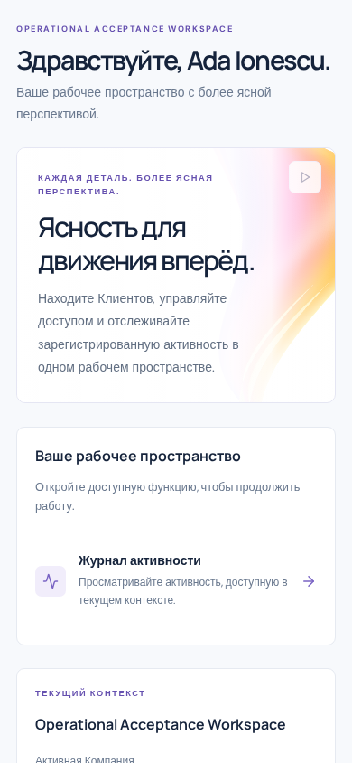
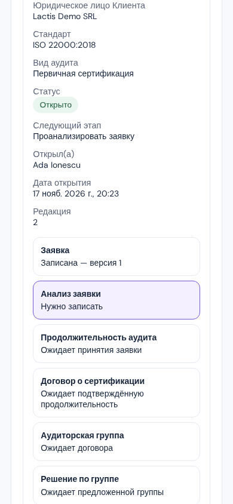

# context-narrow

Selected original browser screenshots. Fictional data only. Complete business commands were entered through the interface; fixture setup used public APIs.

## 07-manager-company-switch-retires-pending-case-read

Actor: manager; interface: ru; viewport: 390 px. [Accessible snapshot](07-manager-company-switch-retires-pending-case-read.aria.yml)

## 08-manager-late-old-company-result-does-not-return

Actor: manager; interface: ru; viewport: 390 px. [Accessible snapshot](08-manager-late-old-company-result-does-not-return.aria.yml)

## 09-manager-original-company-case-reloads-unchanged

Actor: manager; interface: ru; viewport: 390 px. [Accessible snapshot](09-manager-original-company-case-reloads-unchanged.aria.yml)

