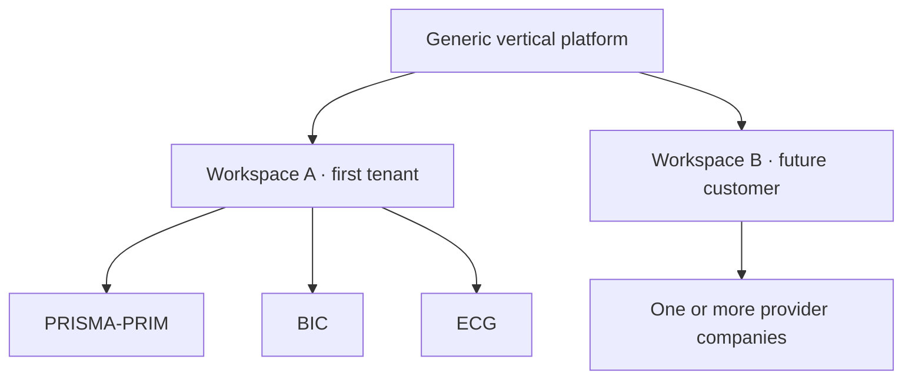
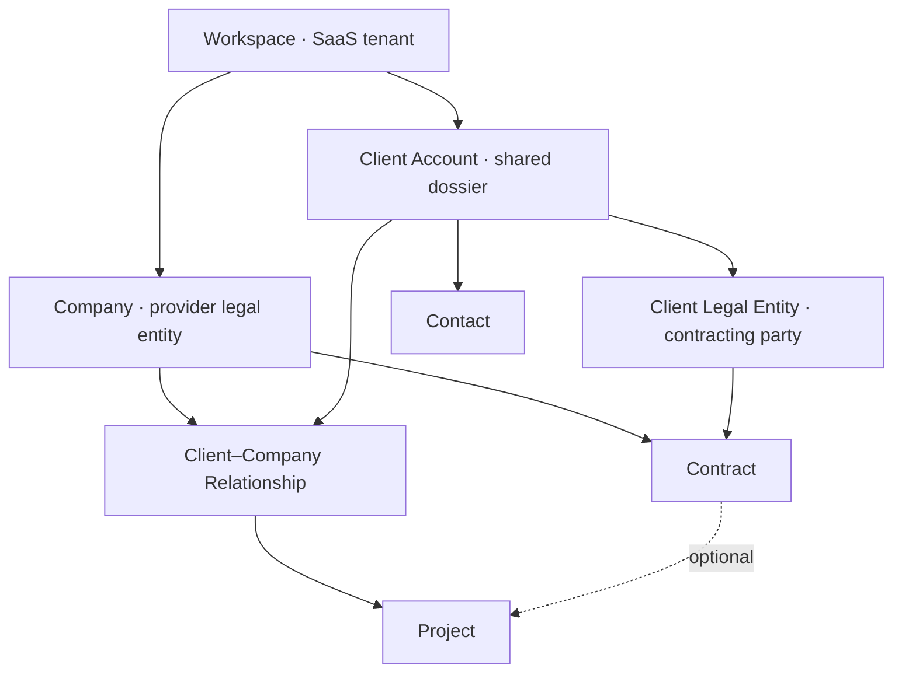
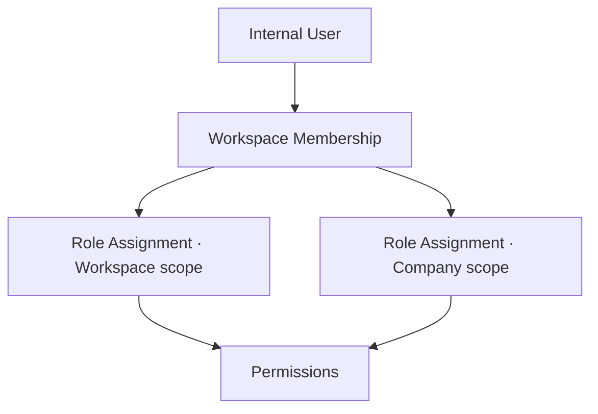
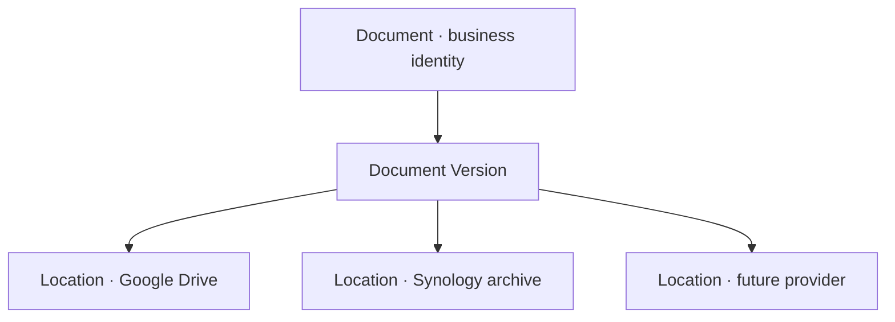

# Consolidated Product Reconciliation and Decision Record

**Product:** PRISMA-PRIM Suite  
**Status:** Active working record — decisions `DEC-001` through `DEC-045` approved  
**Record version:** 0.1  
**Last updated:** 2026-08-14  
**Source discussion language:** French  
**Repository language:** English

## 1. Purpose and authority

This document preserves the reasoning behind the ongoing reconciliation between:

- the repository and product specifications that existed on 2026-08-14;
- the requirements document received from Iurie on 2026-08-14, whose original title was `AUTOMATIZAREA TOTALĂ FIRMA — Sarcina Tehnică MASTER v1.1`;
- the product decisions approved during the reconciliation discussion.

The word `MASTER` is retained only when identifying the source document. It is not the product name, an academic classification, or a statement that this product is Dan's ESGI annual project.

This is a **living decision and rationale record**, not an implementation ticket and not a substitute for approved product specifications. It exists so that future agents can understand why the product direction changed and do not accidentally restore rejected assumptions.

### 1.1 Sources of authority

| Information | Authoritative location |
| --- | --- |
| Canonical domain vocabulary | `CONTEXT.md` |
| Durable, costly-to-reverse architecture | `docs/adr/` |
| Approved observable product behaviour | Product PRDs and GitHub specification issues |
| Work to execute, acceptance criteria, blockers and progress | GitHub Issues |
| Engineering and delivery rules | `AGENTS.md` and `docs/agents/` |
| Reconciliation reasoning and approved direction before normalization | This record |
| Original DOCX and the final report for Iurie | Outside the repository |

When reconciliation is complete, approved normative statements must be incorporated into their owning PRD, ADR, `CONTEXT.md`, or issue. This record should link to those authorities and preserve the reasoning, rather than silently becoming a second contradictory specification.

### 1.2 Update protocol

For every further material product decision:

1. Discuss the problem, alternatives, trade-offs and consequences.
2. Add a numbered `DEC-...` entry only after explicit approval.
3. Record unresolved questions separately; do not disguise them as decisions.
4. Update affected diagrams, release boundaries and reconciliation sections.
5. Later normalize the approved result into the correct PRD, ADR, glossary or GitHub issue.
6. Never create a new meeting-notes file for the same reconciliation unless this document becomes technically unmanageable.

## 2. Executive outcome

The new requirements do **not** justify restarting the repository or replacing the technical stack. They change the product boundary and delivery order.

The original MVP described a focused assisted commercial workflow:

> Client Request → AI-assisted Analysis → deterministic Pricing → Offer → Contract → cited knowledge search

The consolidated product direction is a broader operational platform:

> tenant and company foundation → shared Client → Projects → Tasks → Documents → Google integrations → Audit/Training/Certification → Finance → historical search → AI/RAG

The original commercial and AI-assisted workflow remains valuable, but becomes one later capability of the operational platform instead of the definition of the whole product.

The platform is designed as a sellable multi-tenant vertical SaaS for organizations similar to PRISMA-PRIM: audit, certification, ISO consulting and training firms. PRISMA-PRIM, BIC and ECG form the first real tenant and design-partner case. They must not be hard-coded as the product architecture.

## 3. Source requirements and business priority

Iurie's accompanying message established this priority:

1. application core and database;
2. multi-company architecture for PRISMA-PRIM, BIC and ECG;
3. one shared Client, Projects, Tasks and Documents;
4. Google Drive, Calendar and Gmail integrations;
5. Audit, Finance and Certificates;
6. AI/RAG and agents only after the structured operational foundation.

It also asked for a practical comparison using:

> `PĂSTRĂM / MODIFICĂM / ELIMINĂM / LIPSEȘTE`

and explicitly requested preservation of useful existing work.

The source proposed a Synology NAS as part of the eventual infrastructure because an 8 TB device already exists in Moldova. Operational ownership is weak: Iurie does not manage it easily, Dan has not used Synology and would operate the application remotely from France. That constraint materially changes its recommended role.

## 4. Repository baseline observed on 2026-08-14

The repository foundation is reusable:

- pnpm monorepo;
- React, Vite and TypeScript web application;
- NestJS and TypeScript business API;
- PostgreSQL with Drizzle ORM and reviewed migrations;
- Clerk authentication behind a provider-neutral identity boundary;
- local `Workspace` and `InternalUser` records;
- initial Access and Accountability boundaries;
- preserved Atlas Blue mockup in `/ui-baseline`;
- agent workflow, diagnostics, tests and repository governance.

PR #42 was squash-merged into `main` as `10909f8`. Manual invitation, sign-in, sign-out, reconnection and administrative session-revocation smoke tests passed. Issue #22 remains the next compatible implementation slice for the first real append-only Activity Log behaviour.

The repository still contains very little of the new operational business domain. That is expected at this stage and does not make the foundation throwaway work.

## 5. Reconciliation: PĂSTRĂM / MODIFICĂM / ELIMINĂM / LIPSEȘTE

### 5.1 PĂSTRĂM — preserve

- React + Vite + TypeScript.
- NestJS as owner of business rules, authorization, workflows and final decisions.
- PostgreSQL + Drizzle.
- The pnpm monorepo.
- Clerk behind the neutral external-principal boundary.
- `InternalUser` and the existing `Workspace` concept.
- The Atlas Blue baseline as a recoverable UI and interaction reference.
- Human-in-the-loop governance.
- Deterministic pricing and quality checks.
- Append-only business Activity Log principles.
- RAG restricted to approved sources with visible citations.
- Existing tests and repository delivery rules.

### 5.2 MODIFICĂM — change or extend

- `Workspace` changes from a singleton pilot container into the SaaS tenant boundary.
- Add `Company` below Workspace for the tenant's provider legal entities.
- Replace equal permissions for every user with permission-based RBAC scoped to Workspace or Company.
- Replace a company-owned Client with one tenant-level shared Client Account plus Company relationships.
- Distinguish the shared commercial dossier from the Client Legal Entity that contracts, receives invoices or is certified.
- Reposition the original MVP PRD as a later commercial and AI-assisted capability.
- Make Projects operational records that may exist before a signed Contract.
- Introduce configurable project templates and stages without building a universal BPM engine.
- Make Documents provider-independent and separate their business identity from physical locations.
- Move AI/RAG after the operational core and structured data.
- Update Atlas Blue navigation around tenant/company context and the shared Client dossier.
- Extend Activity Log coverage to critical actions in every future module.

### 5.3 ELIMINĂM — remove obsolete assumptions, not useful code

No important production code is currently designated for deletion. Remove or supersede these assumptions from future authorities:

- every invited user has the same permissions;
- roles, multiple Workspaces and multi-company operation are permanently out of scope;
- the next large business module must be AI Analysis;
- the original MVP PRD defines the complete product;
- Project can only be created from an accepted Offer and linked Contract;
- Synology is a required runtime dependency or production database host;
- PRISMA-PRIM/BIC-specific names or processes may be hard-coded;
- the product is already selected as an academic Master's project.

### 5.4 LIPSEȘTE — missing capabilities

- commercial multi-tenant isolation;
- Company model and persistent company selector;
- Workspace/Company RBAC;
- shared Client Account and Client Legal Entity;
- Client–Company Relationship;
- Project, Project Template, Project Stage and Standard editions;
- Task management;
- minimal provider-independent Document registry;
- Google Drive, Calendar and Gmail integrations;
- document templates and generation;
- ISO Audit and Finding management;
- corrective actions;
- Training and Certificate management;
- Finance and payment tracking;
- global and historical search;
- optional Synology archival adapter;
- approved Knowledge Base, RAG and later copilots.

## 6. Product positioning

### 6.1 Chosen position

The product is a **vertical operational SaaS for audit, certification, ISO consulting and training organizations**.

It is not:

- a bespoke application whose architecture is PRISMA-PRIM itself;
- an ERP intended for every type of business;
- a public self-service SaaS in the first releases;
- an academic project unless a separate future decision establishes an academic scope.

### 6.2 First tenant versus future tenants



PRISMA-PRIM, BIC and ECG are initial configuration data. Code must use generic concepts such as `Workspace`, `Company`, `ClientAccount`, `Project` and feature/capability settings.

Do not write business behaviour such as:

```ts
if (company.name === 'BIC') {
  // special behaviour
}
```

Prefer an explicit capability or configuration:

```ts
if (company.features.certificateIssuance) {
  // behaviour enabled for this company
}
```

### 6.3 Productization now versus later

Design now for the costly-to-change boundaries:

- tenant ownership on all business data;
- database-enforced and application-enforced tenant isolation;
- company scopes and legal ownership;
- provider-independent integrations;
- configurable names, roles, templates, numbering and commercial settings;
- localization-ready user-facing text;
- no hard-coded first-tenant names or country assumptions.

Defer until real demand exists:

- public tenant registration;
- subscription billing and Stripe;
- plan entitlements;
- automated provisioning;
- complete white-labeling;
- marketplace or plugin platform;
- universal workflow builder;
- support for unrelated industries;
- advanced SaaS support impersonation.

## 7. Target domain boundaries



### 7.1 Workspace

Keep the existing technical name `Workspace`. It becomes the tenant boundary rather than introducing a redundant `Tenant` entity and migration.

Every business record must be owned by exactly one Workspace. Cross-Workspace references are invalid even when two tenants happen to serve the same real-world organization.

### 7.2 Company

A Company is a provider legal or operational entity inside the Workspace. It owns its legal identity, branding, numbering, tax/default currency settings, integrations, templates and user scopes.

### 7.3 Client Account

The Client Account is the tenant-level shared commercial and operational dossier. In the UI it may simply be labelled `Client`.

If SICOM works with PRISMA-PRIM and BIC, one SICOM dossier is related to both Companies. It is not duplicated per provider Company.

### 7.4 Client Legal Entity

The contracting, invoiced or certified legal organization is distinct from the shared commercial dossier. One Client Account may eventually contain a parent organization, subsidiaries, legal identifiers and sites.

For a simple client, the application creates one primary Client Legal Entity and keeps the initial user experience simple.

### 7.5 Client–Company Relationship

This entity contains Company-specific commercial context such as account owner, local client code, relationship status, start date, normal payment terms, tags and external identifiers.

One active relationship exists per Client Account and Company pair.

### 7.6 Contract

In the initial model, a Contract has exactly one issuing provider Company and one contracting Client Legal Entity. PRISMA-PRIM and BIC normally create separate contracts even when serving the same shared Client Account.

Multi-party contracts are deferred until a concrete case justifies the additional model.

### 7.7 Project

A Project belongs to exactly one provider Company and one Client Account. It may identify the relevant Client Legal Entity when known.

A Project may exist before a Contract for migration, preparation, free/internal work or delayed paperwork. Pre-contract or active-without-contract conditions remain visible and auditable. They are not silently forbidden by the database.

If two provider Companies participate, use separate Projects under the same Client Account. A future `Engagement` grouping may be introduced only after a real cross-company case proves its value.

### 7.8 Core data invariants

1. Related records always belong to the same Workspace.
2. Business operations never run without an established Workspace context.
3. A Project has one owning Company.
4. A Contract has one issuing Company in the initial model.
5. A Project linked to a Contract must use the same provider Company.
6. A Client Account never crosses Workspace boundaries.
7. Critical changes create canonical Activity Log events.
8. Clients with operational history are archived, not hard-deleted.
9. Tax/legal identifiers help detect duplicates, but matching names never cause automatic merge.

## 8. Authorization model

Clerk authenticates an external identity. The application database and NestJS authorize business actions.



### 8.1 Initial role templates

| Role template | Scope | Main purpose |
| --- | --- | --- |
| Workspace Owner | Workspace | Functional ownership and full administration |
| Workspace Admin | Workspace | Members, Companies, settings and integrations |
| Workspace Manager | Workspace | Consolidated operational management |
| Company Manager | Company | Clients, Projects and team activity for one Company |
| Project Professional | Company | Authorized Project, Task and Document work |
| Finance | Workspace or Company | Contract, schedule, payment and finance visibility |
| Read-only | Workspace or Company | Consultation without mutation |

Roles are named permission bundles, not authorization conditions. Initial permissions include capabilities such as:

```text
company.read
company.manage
member.invite
member.assign_role
client.read
client.create
client.update_shared
client.update_relationship
client.archive
client.merge
project.read
project.create
project.update
project.close
task.read
task.manage
document.read
document.manage
contract.read
contract.manage
finance.read
finance.manage
activity_log.read
integration.manage
workspace.settings.manage
```

Authorization uses default deny and the union of granted permissions. Explicit deny rules are deferred because they make access harder to explain and test.

### 8.2 Shared Client visibility

A BIC-scoped user may see the shared identity of a Client related to BIC and all authorized BIC information. That does not reveal PRISMA-PRIM Contracts, Projects, finance, notes or other restricted activity.

Store information at the narrowest correct boundary:

| Information | Owner |
| --- | --- |
| Official name, tax identifier, primary address | Shared Client / Client Legal Entity |
| BIC account manager | BIC Client–Company Relationship |
| PRISMA-PRIM confidential note | PRISMA-PRIM relationship or Project |
| ECG Contract | ECG + Client Legal Entity |
| General Contact | Client Account |
| Mission-specific Contact | Project or relevant relationship |

Workspace managers and authorized Company managers may update shared identity fields. Such mutations are logged. Merge and archive require elevated permissions.

### 8.3 Internal, external and platform actors

- `InternalUser`: a tenant collaborator.
- Future external/client users: a separate category with a narrower model; not part of Release 1.
- `PlatformOperator`: a SaaS operator outside tenant membership.

Platform operators receive no implicit access to customer business data. A future support-access mechanism must be explicit, time-limited, revocable and fully logged.

Project-specific membership may later support external auditors or temporary consultants. Release 1 primarily uses Workspace and Company scopes.

## 9. Project, workflow, standards and tasks

### 9.1 Lifecycle status versus workflow stage

Project lifecycle statuses are stable platform invariants:

```text
DRAFT
ACTIVE
ON_HOLD
COMPLETED
CANCELLED
ARCHIVED
```

Workflow stages depend on a Project Template. Example:

```text
Preparation
Document review
Audit Stage 1
Audit Stage 2
Decision
Certificate issuance
Surveillance
```

`Stage 1`, `Stage 2`, `S1` and `S2` are not global technical concepts until their exact business meanings are clarified.

### 9.2 Project categories and templates

Initial configurable categories may include certification, audit, consulting, training and other.

A Project Template may define:

- category;
- initial ordered stages;
- recommended Tasks or checklists;
- expected Document types;
- indicative timing;
- compatible Standards.

Template data is copied into a new Project. Later template edits do not mutate existing Projects retroactively.

This is deliberately smaller than a universal workflow engine.

### 9.3 Standards and editions

Distinguish the framework from its edition:

```text
Standard: ISO 9001
Edition: ISO 9001:2015
```

A Project may use multiple Standard Editions through an explicit relationship. Universal identifiers can be platform-supported while each Workspace controls activation and internal frameworks. Do not copy protected standard contents into the database without lawful authority.

### 9.4 Tasks

Every Task belongs to a Workspace and Company. A Task may be linked to a Project, Project Stage or Client, or be an internal Company Task.

Initial statuses:

```text
TODO
IN_PROGRESS
BLOCKED
DONE
CANCELLED
```

Essential fields include title, description, priority, assignee, due date, creator, completion date, scope and optional blockage information.

Subtask trees, complex dependencies, Gantt planning and advanced automation are deferred.

## 10. Document and storage architecture

A Document is a governed business artifact. A physical copy or external path is a Document Location.



The minimal Document registry enters Release 1 with metadata, type, status, confidentiality, business links and an external URL/reference. Provider integration is not required for the core runtime.

`DocumentLocation` should eventually record provider, external identifier, path when needed, status, checksum, synchronization status and last verification time.

### 10.1 Synology decision

Synology must not initially host:

- the production PostgreSQL database;
- the primary API or web runtime;
- storage required for daily application availability;
- publicly exposed SMB shares.

The application runs independently in infrastructure Dan can operate remotely. Google Drive may support current operational documents. Synology is an optional later archive or backup destination behind an adapter and persistent retryable jobs.

If the NAS is offline, the core application continues working. Archive work remains pending and resumes later.

Before any integration, obtain the device model and configuration, assess connectivity and security, identify on-site operational ownership, and validate snapshots, independent off-site backup and restore tests. RAID or snapshots alone are not treated as a complete backup strategy.

## 11. Release roadmap

### Release 0 — Technical foundation

Existing or nearly complete:

- monorepo and database foundation;
- React/NestJS boundaries;
- production shell and Atlas Blue baseline;
- Clerk authentication;
- Workspace and Internal User;
- provider-neutral identity;
- initial tests and delivery governance;
- first Activity Log slice through issue #22.

### Release 1 — Operational multi-tenant core

- **R1A:** multi-tenant Workspace boundary, Company and RBAC;
- **R1B:** shared Client, Contacts, Client Legal Entity and Company relationships;
- **R1C:** Projects, Standards, stages, templates and Tasks;
- **R1D:** minimal provider-independent Document registry;
- **R1E:** operational dashboard and complete acceptance journey.

Acceptance journey:

> sign in → choose authorized Company → create one Client → relate it to two Companies → create separate Projects and Tasks → reference Documents → update shared identity → verify scoped visibility and Activity Log events

### Release 2 — Google and document integrations

- Google Drive;
- controlled folder creation and synchronization;
- Calendar;
- Gmail reading and draft generation;
- retryable asynchronous work;
- Document versions;
- DOCX/XLSX/PDF templates and generation.

### Release 3 — Commercial workflow

- Opportunity or Client Request;
- missing and contradictory information;
- Service catalog;
- deterministic Tariffs and Pricing Rules;
- Offers and immutable versions;
- Quality Checks and human Approval;
- Contracts and versions;
- Project creation/linking after signature.

The workflow must function with structured human input even when AI Analysis is disabled.

### Release 4 — Audit, training and certification

- Audit planning;
- checklists;
- Findings and non-conformities;
- corrective actions;
- reports;
- Training;
- Certificates, expiration, revocation and QR verification.

### Release 5 — Financial tracking

- contract value, tax, currency;
- schedules and instalments;
- recorded invoices;
- payments and balance;
- overdue state and reminders.

Whether the platform merely tracks invoices or legally generates accounting documents remains open.

### Release 6 — History and global search

- consolidated metadata search;
- import of approximately 300 historical Clients;
- optional Synology adapter;
- prototype on ten Clients;
- completeness test such as “everything held for SICOM”;
- gradual extension after validation.

### Release 7 — AI/RAG and copilots

- approved Knowledge Base;
- source-cited RAG;
- obsolete-version exclusion;
- dossier analysis;
- missing-document and contradiction detection;
- recommendations and drafts;
- ISO Project Copilot;
- advanced agents only after measurable evaluation.

## 12. Approved decision register

### Product scope, preservation and documentation

#### DEC-001 — Consolidated vision, not one sprint

The received requirements describe the global target product. They are not one implementation issue, one sprint or one monolithic MVP. The target must be divided into deliverable releases and capability PRDs.

#### DEC-002 — Reposition the original MVP

The original AI-assisted commercial pilot remains useful but becomes a narrower later capability. Its requirements must be redistributed without losing traceability rather than treated as the whole product.

#### DEC-003 — Preserve the technical foundation

Reuse the current monorepo, frontend, backend, PostgreSQL/Drizzle, Clerk boundary, Workspace, Internal User, Atlas Blue baseline and quality infrastructure unless concrete repository evidence proves a specific part unsuitable.

#### DEC-004 — Structured operations before AI

Build the operational data model and deterministic workflows before RAG or advanced agents. AI should consume governed operational data, not compensate for its absence.

#### DEC-005 — Synology is optional infrastructure

Synology is a possible archival or backup adapter. It does not host the primary production runtime or PostgreSQL before a technical and operational audit validates that option.

#### DEC-006 — Runtime independence from Synology

The application must remain usable and deployable when the NAS is absent, offline or replaced. Archive synchronization is asynchronous and retryable.

#### DEC-007 — Original and external report stay outside the repository

The original DOCX and final Romanian report for Iurie remain outside the repository. The source may be identified by title, date and hash without committing confidential source material.

#### DEC-008 — One normative owner per fact

Product behaviour belongs in PRDs, language in `CONTEXT.md`, durable architecture in ADRs and execution in GitHub Issues. This record preserves reconciliation rationale and must point to normalized authorities after they exist.

#### DEC-009 — One intentional living record

Intermediate analysis does not automatically become permanent documentation. This single record is an approved exception created to prevent context loss during reconciliation. Do not fragment it into many chronological notes.

### Business versus academic identity

#### DEC-010 — Business product identity

PRISMA-PRIM Suite is currently a business product for PRISMA-PRIM, BIC and ECG and possible future customers.

#### DEC-011 — No academic claim in product authorities

No PRD, ADR or issue should call it a Master's product, annual project or approved academic subject.

#### DEC-012 — Academic possibility remains separate

Possible future use for an ESGI annual project is unconfirmed and outside the current roadmap.

#### DEC-013 — Separate academic scope if later approved

If an academic supervisor approves it later, create separate AI research questions, experiments, metrics and academic deliverables without distorting the business roadmap.

### Productization and tenancy

#### DEC-014 — Sellable multi-tenant vertical platform

Design the platform for multiple customer organizations from the beginning, focused on audit, certification, ISO consulting and training firms.

#### DEC-015 — First tenant, not hard-coded product

PRISMA-PRIM/BIC/ECG are the first tenant and design partner. Their names and current organization are initial data, not application branches or global constants.

#### DEC-016 — First-tenant utility before SaaS commerce

Prioritize operational utility for the first tenant. Public registration, billing, plan management and advanced white-labeling are deferred.

#### DEC-017 — Vertical SaaS, not universal ERP

Support comparable domain organizations. Do not generalize for arbitrary sectors without validated demand.

#### DEC-018 — Tenant isolation is foundational

Every business record belongs to a Workspace and tenant isolation must be enforced and tested from the first operational release.

#### DEC-019 — Configuration over tenant-name conditions

Predictable tenant differences use settings, templates, roles and capabilities. Do not build a universal extension engine or hard-code first-tenant names.

### Core domain model

#### DEC-020 — Workspace is the tenant boundary

Keep the existing `Workspace` technical concept and redefine it as one SaaS customer organization. Avoid a redundant rename to `Tenant`.

#### DEC-021 — Company is a provider entity

`Company` represents a provider legal or operational entity inside a Workspace, including PRISMA-PRIM, BIC and ECG for the first tenant.

#### DEC-022 — One shared Client per Workspace

A Client Account is shared at Workspace level and related to every provider Company that serves it. Do not duplicate the core dossier per Company.

#### DEC-023 — Dossier and legal entity are distinct

Distinguish `ClientAccount` from `ClientLegalEntity`. Keep the simple-client UI streamlined by creating one primary legal entity automatically.

#### DEC-024 — One issuing Company per Contract initially

A Contract has one provider Company and one Client Legal Entity in the initial model. Multi-party contracts are deferred.

#### DEC-025 — One responsible Company per Project

A Project has exactly one owning provider Company. Cross-company work uses related Projects under the shared Client until a concrete need justifies an Engagement grouping.

#### DEC-026 — Projects may precede Contracts

Permit Projects before Contract signature for preparation, migration, free/internal work and delayed paperwork. Make the condition visible through status, warnings and traceability.

#### DEC-027 — Shared identity does not imply shared activity access

Access to a shared Client identity does not reveal Projects, Contracts, finance or confidential notes belonging to unauthorized Companies.

#### DEC-028 — Archive and trace critical records

Operational records with history are archived rather than physically deleted. Merge and archive are elevated, logged actions.

### Authorization

#### DEC-029 — Clerk authenticates; the application authorizes

Clerk verifies identity and sessions. NestJS and the application database own business authorization through provider-neutral actor context.

#### DEC-030 — Permission bundles with Workspace or Company scope

Roles are named permission bundles. Assignments apply to the whole Workspace or one Company.

#### DEC-031 — Default deny and additive grants

No permission means refusal. Granted permissions combine by union. Explicit deny rules are deferred.

#### DEC-032 — Shared and Company-specific Client data are separate

Store common identity on the shared Client/Legal Entity and Company-confidential data on the relationship, Project, Contract or other scoped resource.

#### DEC-033 — Company scope protects activity

Finding a shared Client through an authorized Company does not reveal the existence or contents of unauthorized Company activity.

#### DEC-034 — Separate internal and external users

Internal tenant collaborators and future client/external users use distinct authorization categories. Do not overload `InternalUser` for an extranet.

#### DEC-035 — No implicit operator access

SaaS platform operators do not automatically become tenant members or gain routine access to tenant business data.

#### DEC-036 — Prepare, but defer advanced customization

Keep the model extensible for custom roles and Project-specific membership, but do not implement advanced role design or external Project access without a real requirement.

### Projects, tasks and documents

#### DEC-037 — Lifecycle status and workflow stage differ

Use stable Project lifecycle states and separately configurable operational stages.

#### DEC-038 — Templates without a universal BPM engine

Project Templates define initial stages, suggested Tasks, expected Documents and timing. Do not build a general-purpose workflow language.

#### DEC-039 — Do not globalize ambiguous stage names

`Stage 1`, `Stage 2`, `S1` and `S2` remain configurable labels until their exact business meanings and distinctions are confirmed.

#### DEC-040 — Projects support multiple Standard Editions

Model a Standard separately from its edition and allow Projects to reference multiple editions or frameworks.

#### DEC-041 — Tasks always have Company scope

Every Task belongs to a Workspace and Company and may be linked to a Project, Project Stage, Client or internal Company activity.

#### DEC-042 — Instantiate templates by copy

Copy the relevant template configuration into a new Project. Editing a template later must not silently rewrite active or historical Projects.

#### DEC-043 — Minimal Document registry in Release 1

Because Documents are part of the urgent operational core, Release 1 includes provider-independent metadata and external references even before full storage integration.

#### DEC-044 — Google automation in Release 2

Drive, Gmail, Calendar, version synchronization and document generation follow the core Client/Project/Task/Document model.

#### DEC-045 — Document identity differs from physical locations

A governed Document and Document Version are business records; Google Drive, Synology or future copies are replaceable Document Locations.

## 13. Known effects on existing authorities

These changes are intentionally not applied by this record alone:

- `docs/product/mvp-prd.md` must be marked as an original/superseded pilot specification and its valid requirements redistributed.
- `docs/product/access-and-accountability-prd.md` delivered the initial identity foundation, but its singleton/equal-permission assumptions must not govern the new operational core.
- `CONTEXT.md` must later add Workspace-as-tenant, Company, Client Account, Client Legal Entity, Client–Company Relationship, Project Template, Project Stage and Task terminology.
- A durable ADR should capture Workspace tenancy, Company hierarchy and isolation strategy after schema-level implications are verified.
- Product vision and capability PRDs must be created before implementation issues for the new modules.
- Existing Access work should be extended rather than rewritten.

## 14. Open product questions

These are not implementation-ready decisions:

1. What exact meanings distinguish `Stage 1`, `Stage 2`, `S1` and `S2` in Iurie's terminology?
2. What exact permission matrix should the first tenant assign to named real users?
3. Which Google identity model will be used: individual accounts, shared accounts or Google Workspace?
4. Which data fields require stronger separation between PRISMA-PRIM, BIC and ECG beyond the general Company-scope rule?
5. Does Finance only track externally produced invoices, or must it legally generate accounting invoices?
6. Which Company legally issues each type of Certificate?
7. Which Certificate types, numbering rules, QR verification rules and revocation rules are authoritative?
8. What Synology model, DSM version, network path, backup configuration and on-site support are actually available?
9. Which current real Projects and Clients should become acceptance examples for the operational core?
10. Which project categories and workflow templates are genuinely needed for the first release?
11. What data-retention and deletion obligations apply in Moldova and future target markets?
12. When, if ever, should an external Client portal enter the roadmap?

## 15. Immediate next work after this checkpoint

1. Continue product reconciliation and append approved decisions to this record.
2. Complete issue #22 because its Activity Log foundation remains compatible with the new direction.
3. Define the complete product/PRD/epic/issue hierarchy before creating many implementation tickets.
4. Normalize approved product language and architecture into `CONTEXT.md`, PRDs and ADRs.
5. Mark obsolete assumptions explicitly rather than deleting historical specifications.
6. Create Release 1 issues as narrow vertical slices only after their decisions and dependencies are testable.
7. Prepare a separate Romanian report and email for Iurie after GitHub specifications and issues match the final reconciliation.

