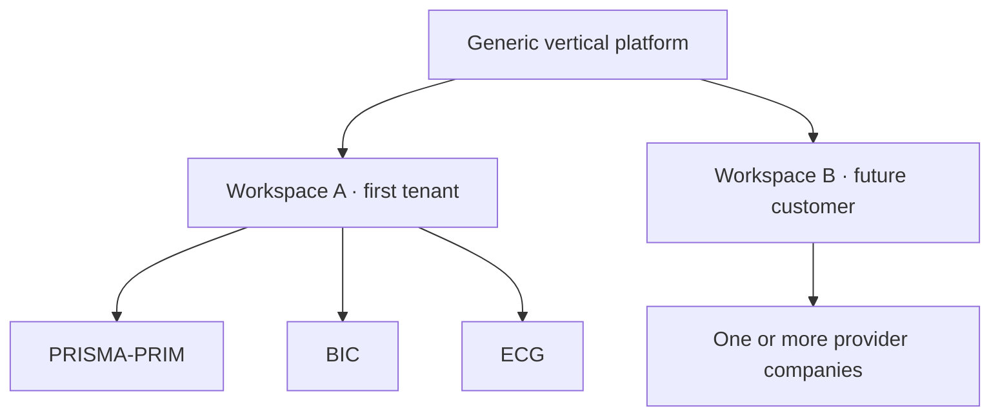
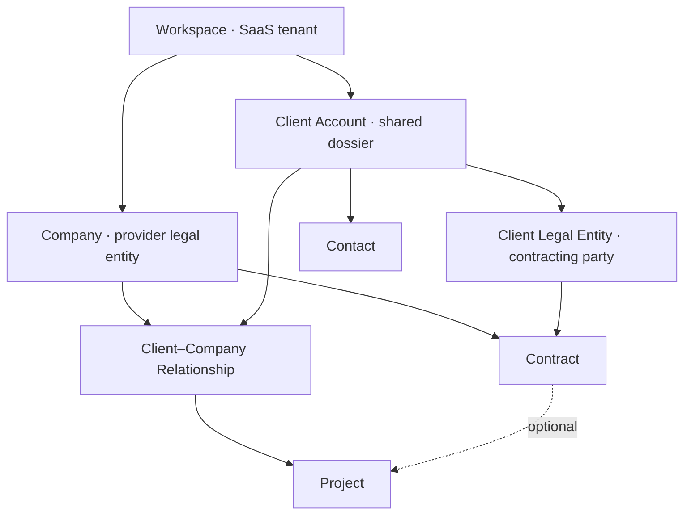
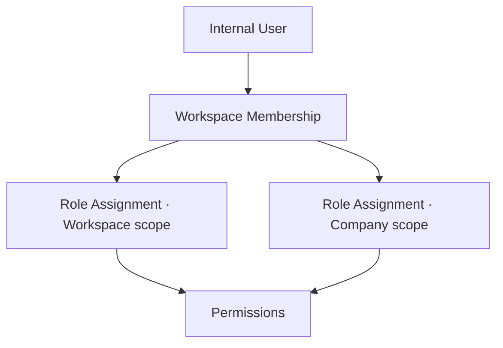
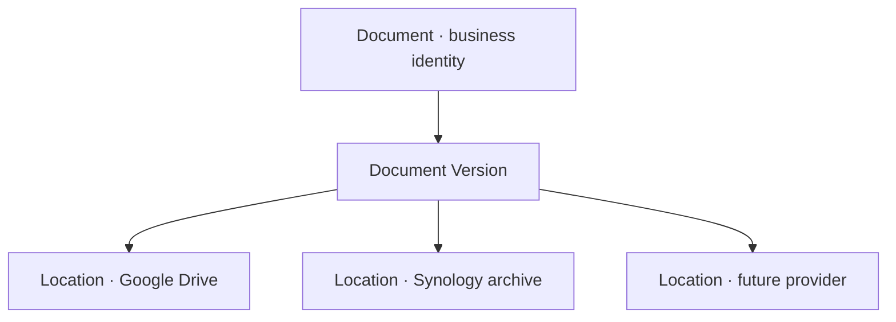
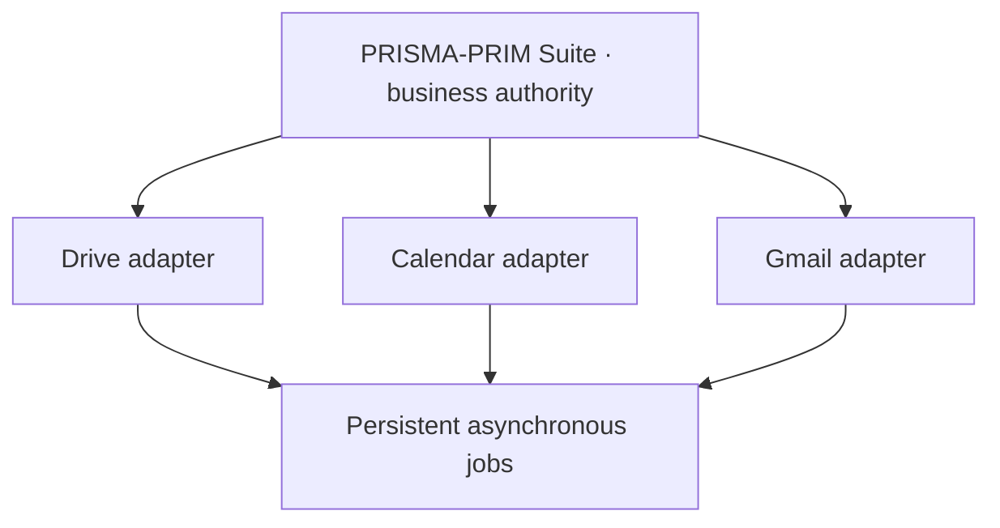
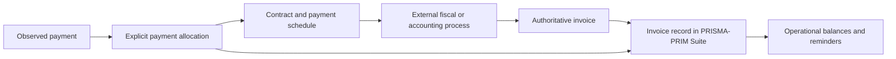
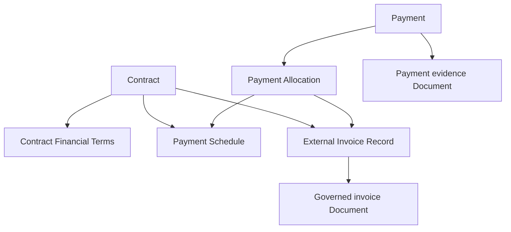
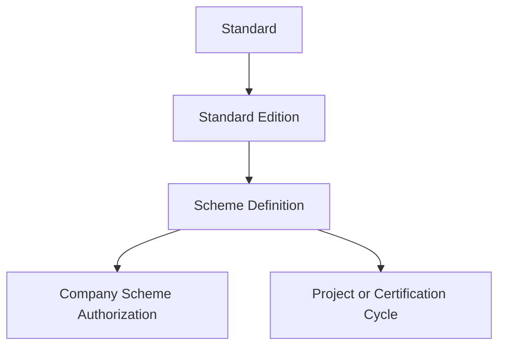
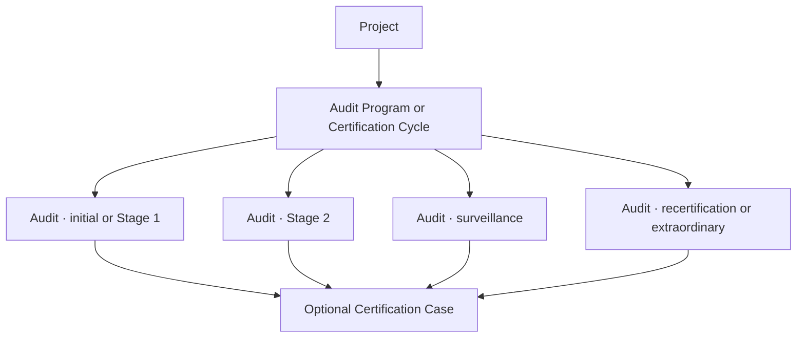
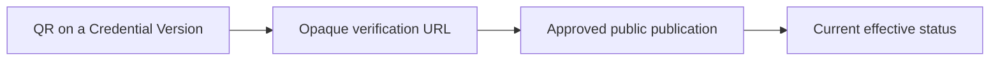

# Consolidated Product Reconciliation and Decision Record

**Product:** PRISMA-PRIM Suite  
**Status:** Active working record — decisions `DEC-001` through `DEC-099` approved  
**Record version:** 0.4  
**Last updated:** 2026-08-15  
**Source discussion language:** French  
**Repository language:** English

## 1. Purpose and authority

This document preserves the reasoning behind the ongoing reconciliation between:

- the repository and product specifications that existed on 2026-08-14;
- the requirements document received from Iurie on 2026-08-14, whose original title was `AUTOMATIZAREA TOTALĂ FIRMA — Sarcina Tehnică MASTER v1.1`;
- the product decisions approved during the reconciliation discussion.

The word `MASTER` is retained only when identifying the source document. It is not the product name, an academic classification, or a statement that this product is Dan's ESGI annual project.

This is a **living decision and rationale record**, not an implementation ticket and not a substitute for approved product specifications. It exists so that future agents can understand why the product direction changed and do not accidentally restore rejected assumptions.

### 1.1 Sources of authority

| Information                                                          | Authoritative location                       |
| -------------------------------------------------------------------- | -------------------------------------------- |
| Canonical domain vocabulary                                          | `CONTEXT.md`                                 |
| Durable, costly-to-reverse architecture                              | `docs/adr/`                                  |
| Approved observable product behaviour                                | Product PRDs and GitHub specification issues |
| Work to execute, acceptance criteria, blockers and progress          | GitHub Issues                                |
| Engineering and delivery rules                                       | `AGENTS.md` and `docs/agents/`               |
| Reconciliation reasoning and approved direction before normalization | This record                                  |
| Original DOCX and the final report for Iurie                         | Outside the repository                       |

When reconciliation is complete, approved normative statements must be incorporated into their owning PRD, ADR, `CONTEXT.md`, or issue. This record should link to those authorities and preserve the reasoning, rather than silently becoming a second contradictory specification.

### 1.2 Update protocol

For every further material product decision:

1. Discuss the problem, alternatives, trade-offs and consequences.
2. Add a numbered `DEC-...` entry only after explicit approval.
3. Record unresolved questions separately; do not disguise them as decisions.
4. Update affected diagrams, release boundaries and reconciliation sections.
5. Later normalize the approved result into the correct PRD, ADR, glossary or GitHub issue.
6. Never create a new meeting-notes file for the same reconciliation unless this document becomes technically unmanageable.

## 2. Executive outcome

The new requirements do **not** justify restarting the repository or replacing the technical stack. They change the product boundary and delivery order.

The original MVP described a focused assisted commercial workflow:

> Client Request → AI-assisted Analysis → deterministic Pricing → Offer → Contract → cited knowledge search

The consolidated product direction is a broader operational platform:

> tenant and company foundation → shared Client → Projects → Tasks → Documents → Google integrations → Audit/Training/Certification → Finance → historical search → AI/RAG

The original commercial and AI-assisted workflow remains valuable, but becomes one later capability of the operational platform instead of the definition of the whole product.

The platform is designed as a sellable multi-tenant vertical SaaS for organizations similar to PRISMA-PRIM: audit, certification, ISO consulting and training firms. PRISMA-PRIM, BIC and ECG form the first real tenant and design-partner case. They must not be hard-coded as the product architecture.

## 3. Source requirements and business priority

Iurie's accompanying message established this priority:

1. application core and database;
2. multi-company architecture for PRISMA-PRIM, BIC and ECG;
3. one shared Client, Projects, Tasks and Documents;
4. Google Drive, Calendar and Gmail integrations;
5. Audit, Finance and Certificates;
6. AI/RAG and agents only after the structured operational foundation.

It also asked for a practical comparison using:

> `PĂSTRĂM / MODIFICĂM / ELIMINĂM / LIPSEȘTE`

and explicitly requested preservation of useful existing work.

The source proposed a Synology NAS as part of the eventual infrastructure because an 8 TB device already exists in Moldova. Operational ownership is weak: Iurie does not manage it easily, Dan has not used Synology and would operate the application remotely from France. That constraint materially changes its recommended role.

## 4. Repository baseline observed on 2026-08-14

The repository foundation is reusable:

- pnpm monorepo;
- React, Vite and TypeScript web application;
- NestJS and TypeScript business API;
- PostgreSQL with Drizzle ORM and reviewed migrations;
- Clerk authentication behind a provider-neutral identity boundary;
- local `Workspace` and `InternalUser` records;
- initial Access and Accountability boundaries;
- preserved Atlas Blue mockup in `/ui-baseline`;
- agent workflow, diagnostics, tests and repository governance.

PR #42 was squash-merged into `main` as `10909f8`. Manual invitation, sign-in, sign-out, reconnection and administrative session-revocation smoke tests passed. Issue #22 remains the next compatible implementation slice for the first real append-only Activity Log behaviour.

The repository still contains very little of the new operational business domain. That is expected at this stage and does not make the foundation throwaway work.

## 5. Reconciliation: PĂSTRĂM / MODIFICĂM / ELIMINĂM / LIPSEȘTE

### 5.1 PĂSTRĂM — preserve

- React + Vite + TypeScript.
- NestJS as owner of business rules, authorization, workflows and final decisions.
- PostgreSQL + Drizzle.
- The pnpm monorepo.
- Clerk behind the neutral external-principal boundary.
- `InternalUser` and the existing `Workspace` concept.
- The Atlas Blue baseline as a recoverable UI and interaction reference.
- Human-in-the-loop governance.
- Deterministic pricing and quality checks.
- Append-only business Activity Log principles.
- RAG restricted to approved sources with visible citations.
- Existing tests and repository delivery rules.

### 5.2 MODIFICĂM — change or extend

- `Workspace` changes from a singleton pilot container into the SaaS tenant boundary.
- Add `Company` below Workspace for the tenant's provider legal entities.
- Replace equal permissions for every user with permission-based RBAC scoped to Workspace or Company.
- Replace a company-owned Client with one tenant-level shared Client Account plus Company relationships.
- Distinguish the shared commercial dossier from the Client Legal Entity that contracts, receives invoices or is certified.
- Reposition the original MVP PRD as a later commercial and AI-assisted capability.
- Make Projects operational records that may exist before a signed Contract.
- Introduce configurable project templates and stages without building a universal BPM engine.
- Make Documents provider-independent and separate their business identity from physical locations.
- Move AI/RAG after the operational core and structured data.
- Update Atlas Blue navigation around tenant/company context and the shared Client dossier.
- Extend Activity Log coverage to critical actions in every future module.

### 5.3 ELIMINĂM — remove obsolete assumptions, not useful code

No important production code is currently designated for deletion. Remove or supersede these assumptions from future authorities:

- every invited user has the same permissions;
- roles, multiple Workspaces and multi-company operation are permanently out of scope;
- the next large business module must be AI Analysis;
- the original MVP PRD defines the complete product;
- Project can only be created from an accepted Offer and linked Contract;
- Synology is a required runtime dependency or production database host;
- PRISMA-PRIM/BIC-specific names or processes may be hard-coded;
- the product is already selected as an academic Master's project.

### 5.4 LIPSEȘTE — missing capabilities

- commercial multi-tenant isolation;
- Company model and persistent company selector;
- Workspace/Company RBAC;
- shared Client Account and Client Legal Entity;
- Client–Company Relationship;
- Project, Project Template, Project Stage and Standard editions;
- Task management;
- minimal provider-independent Document registry;
- Google Drive, Calendar and Gmail integrations;
- document templates and generation;
- ISO Audit and Finding management;
- corrective actions;
- Training and Certificate management;
- Finance and payment tracking;
- global and historical search;
- optional Synology archival adapter;
- approved Knowledge Base, RAG and later copilots.

## 6. Product positioning

### 6.1 Chosen position

The product is a **vertical operational SaaS for audit, certification, ISO consulting and training organizations**.

It is not:

- a bespoke application whose architecture is PRISMA-PRIM itself;
- an ERP intended for every type of business;
- a public self-service SaaS in the first releases;
- an academic project unless a separate future decision establishes an academic scope.

### 6.2 First tenant versus future tenants



PRISMA-PRIM, BIC and ECG are initial configuration data. Code must use generic concepts such as `Workspace`, `Company`, `ClientAccount`, `Project` and feature/capability settings.

Do not write business behaviour such as:

```ts
if (company.name === 'BIC') {
  // special behaviour
}
```

Prefer an explicit capability or configuration:

```ts
if (company.features.certificateIssuance) {
  // behaviour enabled for this company
}
```

### 6.3 Productization now versus later

Design now for the costly-to-change boundaries:

- tenant ownership on all business data;
- database-enforced and application-enforced tenant isolation;
- company scopes and legal ownership;
- provider-independent integrations;
- configurable names, roles, templates, numbering and commercial settings;
- localization-ready user-facing text;
- no hard-coded first-tenant names or country assumptions.

Defer until real demand exists:

- public tenant registration;
- subscription billing and Stripe;
- plan entitlements;
- automated provisioning;
- complete white-labeling;
- marketplace or plugin platform;
- universal workflow builder;
- support for unrelated industries;
- advanced SaaS support impersonation.

## 7. Target domain boundaries



### 7.1 Workspace

Keep the existing technical name `Workspace`. It becomes the tenant boundary rather than introducing a redundant `Tenant` entity and migration.

Every business record must be owned by exactly one Workspace. Cross-Workspace references are invalid even when two tenants happen to serve the same real-world organization.

### 7.2 Company

A Company is a provider legal or operational entity inside the Workspace. It owns its legal identity, branding, numbering, tax/default currency settings, integrations, templates and user scopes.

### 7.3 Client Account

The Client Account is the tenant-level shared commercial and operational dossier. In the UI it may simply be labelled `Client`.

If SICOM works with PRISMA-PRIM and BIC, one SICOM dossier is related to both Companies. It is not duplicated per provider Company.

### 7.4 Client Legal Entity

The contracting, invoiced or certified legal organization is distinct from the shared commercial dossier. One Client Account may eventually contain a parent organization, subsidiaries, legal identifiers and sites.

For a simple client, the application creates one primary Client Legal Entity and keeps the initial user experience simple.

### 7.5 Client–Company Relationship

This entity contains Company-specific commercial context such as account owner, local client code, relationship status, start date, normal payment terms, tags and external identifiers.

One active relationship exists per Client Account and Company pair.

### 7.6 Contract

In the initial model, a Contract has exactly one issuing provider Company and one contracting Client Legal Entity. PRISMA-PRIM and BIC normally create separate contracts even when serving the same shared Client Account.

Multi-party contracts are deferred until a concrete case justifies the additional model.

### 7.7 Project

A Project belongs to exactly one provider Company and one Client Account. It may identify the relevant Client Legal Entity when known.

A Project may exist before a Contract for migration, preparation, free/internal work or delayed paperwork. Pre-contract or active-without-contract conditions remain visible and auditable. They are not silently forbidden by the database.

If two provider Companies participate, use separate Projects under the same Client Account. A future `Engagement` grouping may be introduced only after a real cross-company case proves its value.

### 7.8 Core data invariants

1. Related records always belong to the same Workspace.
2. Business operations never run without an established Workspace context.
3. A Project has one owning Company.
4. A Contract has one issuing Company in the initial model.
5. A Project linked to a Contract must use the same provider Company.
6. A Client Account never crosses Workspace boundaries.
7. Critical changes create canonical Activity Log events.
8. Clients with operational history are archived, not hard-deleted.
9. Tax/legal identifiers help detect duplicates, but matching names never cause automatic merge.

## 8. Authorization model

Clerk authenticates an external identity. The application database and NestJS authorize business actions.



### 8.1 Initial role templates

| Role template        | Scope                | Main purpose                                        |
| -------------------- | -------------------- | --------------------------------------------------- |
| Workspace Owner      | Workspace            | Functional ownership and full administration        |
| Workspace Admin      | Workspace            | Members, Companies, settings and integrations       |
| Workspace Manager    | Workspace            | Consolidated operational management                 |
| Company Manager      | Company              | Clients, Projects and team activity for one Company |
| Project Professional | Company              | Authorized Project, Task and Document work          |
| Finance              | Workspace or Company | Contract, schedule, payment and finance visibility  |
| Read-only            | Workspace or Company | Consultation without mutation                       |

Roles are named permission bundles, not authorization conditions. Initial permissions include capabilities such as:

```text
company.read
company.manage
member.invite
member.assign_role
client.read
client.create
client.update_shared
client.update_relationship
client.archive
client.merge
project.read
project.create
project.update
project.close
task.read
task.manage
document.read
document.manage
contract.read
contract.manage
finance.read
finance.manage
activity_log.read
integration.manage
workspace.settings.manage
```

Authorization uses default deny and the union of granted permissions. Explicit deny rules are deferred because they make access harder to explain and test.

### 8.2 Shared Client visibility

A BIC-scoped user may see the shared identity of a Client related to BIC and all authorized BIC information. That does not reveal PRISMA-PRIM Contracts, Projects, finance, notes or other restricted activity.

Store information at the narrowest correct boundary:

| Information                                    | Owner                               |
| ---------------------------------------------- | ----------------------------------- |
| Official name, tax identifier, primary address | Shared Client / Client Legal Entity |
| BIC account manager                            | BIC Client–Company Relationship     |
| PRISMA-PRIM confidential note                  | PRISMA-PRIM relationship or Project |
| ECG Contract                                   | ECG + Client Legal Entity           |
| General Contact                                | Client Account                      |
| Mission-specific Contact                       | Project or relevant relationship    |

Workspace managers and authorized Company managers may update shared identity fields. Such mutations are logged. Merge and archive require elevated permissions.

### 8.3 Internal, external and platform actors

- `InternalUser`: a tenant collaborator.
- Future external/client users: a separate category with a narrower model; not part of Release 1.
- `PlatformOperator`: a SaaS operator outside tenant membership.

Platform operators receive no implicit access to customer business data. A future support-access mechanism must be explicit, time-limited, revocable and fully logged.

Project-specific membership may later support external auditors or temporary consultants. Release 1 primarily uses Workspace and Company scopes.

## 9. Project, workflow, standards and tasks

### 9.1 Lifecycle status versus workflow stage

Project lifecycle statuses are stable platform invariants:

```text
DRAFT
ACTIVE
ON_HOLD
COMPLETED
CANCELLED
ARCHIVED
```

Workflow stages depend on a Project Template. Example:

```text
Preparation
Document review
Audit Stage 1
Audit Stage 2
Decision
Certificate issuance
Surveillance
```

`Stage 1`, `Stage 2`, `S1` and `S2` are not global technical concepts until their exact business meanings are clarified.

### 9.2 Project categories and templates

Initial configurable categories may include certification, audit, consulting, training and other.

A Project Template may define:

- category;
- initial ordered stages;
- recommended Tasks or checklists;
- expected Document types;
- indicative timing;
- compatible Standards.

Template data is copied into a new Project. Later template edits do not mutate existing Projects retroactively.

This is deliberately smaller than a universal workflow engine.

### 9.3 Standards and editions

Distinguish the framework from its edition:

```text
Standard: ISO 9001
Edition: ISO 9001:2015
```

A Project may use multiple Standard Editions through an explicit relationship. Universal identifiers can be platform-supported while each Workspace controls activation and internal frameworks. Do not copy protected standard contents into the database without lawful authority.

### 9.4 Tasks

Every Task belongs to a Workspace and Company. A Task may be linked to a Project, Project Stage or Client, or be an internal Company Task.

Initial statuses:

```text
TODO
IN_PROGRESS
BLOCKED
DONE
CANCELLED
```

Essential fields include title, description, priority, assignee, due date, creator, completion date, scope and optional blockage information.

Subtask trees, complex dependencies, Gantt planning and advanced automation are deferred.

## 10. Document and storage architecture

A Document is a governed business artifact. A physical copy or external path is a Document Location.



The minimal Document registry enters Release 1 with metadata, type, status, confidentiality, business links and an external URL/reference. Provider integration is not required for the core runtime.

`DocumentLocation` should eventually record provider, external identifier, path when needed, status, checksum, synchronization status and last verification time.

### 10.1 Synology decision

Synology must not initially host:

- the production PostgreSQL database;
- the primary API or web runtime;
- storage required for daily application availability;
- publicly exposed SMB shares.

The application runs independently in infrastructure Dan can operate remotely. Google Drive may support current operational documents. Synology is an optional later archive or backup destination behind an adapter and persistent retryable jobs.

If the NAS is offline, the core application continues working. Archive work remains pending and resumes later.

Before any integration, obtain the device model and configuration, assess connectivity and security, identify on-site operational ownership, and validate snapshots, independent off-site backup and restore tests. RAID or snapshots alone are not treated as a complete backup strategy.

## 11. Google integration architecture

Google Drive, Calendar and Gmail are three separate integrations with different authorization, security and productization costs. They must not be treated as one generic “Google integration” ticket.

PostgreSQL remains the system of record for Clients, Projects, Tasks, Documents, permissions, deadlines, statuses and business history. Google services expose replaceable external capabilities:

- Drive stores or exposes file bytes;
- Calendar mirrors selected operational events;
- Gmail may later expose selected messages and user-approved drafts.



An external outage never rolls back an already committed business operation. The application records pending or failed synchronization visibly and retries it according to policy.

### 11.1 Connection ownership

Use three explicit levels rather than one shared token:

#### Workspace Integration Connection

An administrative provider connection owned by one tenant. It records provider, authentication mode, status, granted scopes, configuring actor, health, revocation state and a secure credential reference.

#### Company Integration Configuration

Configuration that maps one Company to its Shared Drive, root folder, shared calendar, permitted sender identity, folder conventions and enabled integration capabilities.

#### User Integration Connection

A user's explicit OAuth grant for capabilities that act on that user's mailbox or calendars. It records the Google account, scopes, status, revocation state and last synchronization without exposing token material.

This division prevents a token intended for one user or Company from becoming an implicit tenant-wide credential.

### 11.2 Drive topology

The preferred first-tenant topology is:

```text
Workspace: first tenant
├── Shared Drive PRISMA-PRIM
├── Shared Drive BIC
├── Shared Drive ECG
└── Shared Drive Group — optional and restricted to genuinely shared material
```

Separate Shared Drives provide a clear permission and operational boundary. The shared Client dossier remains primarily a PostgreSQL concept. A Document may have Company-scoped locations or an explicitly Workspace-shared location according to its confidentiality classification.

Google documents that service accounts do not have Drive storage quota and cannot own normal files. They should upload into Shared Drives or act through delegated OAuth. The initial design therefore uses a service identity only as an explicitly authorized member of configured Shared Drives. It does not receive domain-wide impersonation authority.

For user-selected files, prefer the narrow `drive.file` scope and a picker or explicit sharing flow. Broad Drive scopes are restricted scopes and require stronger verification. Application code stores Drive and file identifiers, not a display path as the durable identity.

```text
DocumentLocation
├── provider = GOOGLE_DRIVE
├── externalDriveId
├── externalFileId
├── parentFolderId
├── checksum
├── syncStatus
└── lastVerifiedAt
```

### 11.3 Calendar model

Calendar reflects business scheduling but never owns it. The preferred model is one secondary shared calendar per Company or operational team, for example:

```text
PRISMA-PRIM — Audits
BIC — Projects
ECG — Training
```

After a Project milestone, Audit, appointment or scheduled Task is committed:

1. the business transaction completes in PostgreSQL;
2. an idempotent synchronization job is persisted;
3. Calendar is called asynchronously;
4. the external event identifier and synchronization version are stored;
5. a failure becomes visible and retryable without deleting the business record.

Use the narrowest suitable scope. Google provides scopes for event-only access and for secondary calendars created by the application, including `calendar.app.created`. The exact scope follows the final user journey rather than being selected pre-emptively.

### 11.4 Gmail risk boundary

Gmail is materially more expensive to productize than Drive or Calendar. In a normal web application, scopes that read messages or manage drafts, including `gmail.readonly`, `gmail.compose`, `gmail.modify` and `gmail.metadata`, are restricted scopes. An external application that stores or transmits restricted-scope data can require Google's restricted-scope verification and a recurring security assessment.

The first email capability therefore remains provider-neutral and does not require mailbox access:

- prepare recipient, subject, body and intended attachments inside the application;
- show source data and the responsible actor;
- require human review;
- allow copy/open-in-client behaviour;
- do not send automatically;
- do not read or synchronize an entire mailbox.

A later Gmail OAuth capability may add:

- an individual user connection;
- explicit import of a selected message or thread;
- optional monitoring of a dedicated label;
- creation of a draft in that user's mailbox;
- human-triggered sending;
- revocation and deletion controls.

Do not use a shared password, silently read every mailbox, delete mail, train a model on Google user data, or transmit mailbox data to an AI provider without an explicitly approved user-facing purpose and compliant data handling.

Gmail push notifications require Cloud Pub/Sub, subscription handling and periodic watch renewal. They can be delayed or dropped, so a future synchronization design must retain recovery through history-based or periodic reconciliation.

### 11.5 No shared human credentials

Do not implement a common password or human account reused by several collaborators. A common address such as `office@...` should be a real managed Workspace mailbox or another officially supported shared-address pattern. Human users retain individual accounts and accountability.

Gmail delegation can support collaborators in the same Google Workspace organization. Programmatically administering delegation requires domain-wide authority and is not an initial application responsibility.

### 11.6 No initial Domain-Wide Delegation

Google Workspace Domain-Wide Delegation allows a service account to impersonate domain users. This is powerful and creates a large blast radius. Initial integrations instead use:

- explicit Shared Drive membership for the service identity;
- explicit per-user OAuth where a user capability is necessary;
- minimum scopes;
- no automatic access to every mailbox, Drive or calendar in the domain.

Domain-Wide Delegation requires a future, explicit security decision supported by a concrete administrative use case that cannot be met safely through narrower authorization.

### 11.7 Credential protection

Google access and refresh tokens:

- are never committed;
- are never stored in Clerk;
- are never written to Activity Log or application logs;
- are encrypted at rest;
- are isolated by Workspace and user or service identity;
- can be revoked;
- expose connection health without exposing secret material.

Refresh tokens may be stored as application-encrypted database values, with the encryption key held outside the database in the deployment secret manager. The integration boundary must permit a stronger secret-storage strategy later.

### 11.8 Asynchronous synchronization contract

Provider operations use persistent jobs with states such as:

```text
PENDING
RUNNING
SUCCEEDED
RETRYABLE_FAILURE
PERMANENT_FAILURE
CANCELLED
```

Every operation records an idempotency key, attempt count, next attempt, sanitized error, affected business resource, integration connection and external result identifier. Critical administrative or user-visible transitions also produce canonical Activity Log events.

Google API calls do not occur inside a PostgreSQL transaction that remains open while waiting for an external network response.

### 11.9 Official constraints used for this decision

- [Google Drive Shared Drives overview](https://developers.google.com/workspace/drive/api/guides/about-shareddrives)
- [Google Drive OAuth scopes](https://developers.google.com/workspace/drive/api/guides/api-specific-auth)
- [Google Calendar OAuth scopes](https://developers.google.com/workspace/calendar/api/auth)
- [Gmail OAuth scope classifications](https://developers.google.com/workspace/gmail/api/auth/scopes)
- [Gmail push notifications](https://developers.google.com/workspace/gmail/api/guides/push)
- [Gmail delegation](https://developers.google.com/workspace/gmail/api/guides/delegate_settings)
- [Google service accounts and Domain-Wide Delegation](https://developers.google.com/identity/protocols/oauth2/service-account)
- [Google OAuth verification FAQ](https://support.google.com/cloud/answer/13463817)

## 12. Financial architecture

### 12.1 Chosen boundary

PRISMA-PRIM Suite provides **operational financial control**, not general-ledger accounting or authoritative fiscal-document issuance in its initial financial release.

The platform records the commercial and operational reality needed by PRISMA-PRIM, BIC, ECG and comparable future tenants:

- Contract financial terms;
- expected payment schedules and instalments;
- references to invoices issued through an external authoritative process;
- received, refunded or reversed payments;
- explicit allocation of payments to invoices or expected instalments;
- remaining, overdue and unallocated balances;
- reminders, evidence and financial Activity Log events;
- Company-, Client-, Contract- and currency-scoped indicators.

It does not initially:

- maintain a general ledger;
- generate debit and credit journal entries;
- calculate or submit official tax declarations;
- provide payroll;
- perform complete accounting bank reconciliation;
- replace the tenant's accountant;
- become the legal source of fiscal invoices;
- assign authoritative fiscal numbering;
- submit fiscal invoices automatically to a tax administration.

These are initial product boundaries rather than permanent prohibitions. Any future accounting or fiscal capability requires an independently approved scope, evidence of business value and jurisdiction-specific validation.

### 12.2 Why tracking and fiscal issuance are separated

Moldova has the governmental `SIA e-Factura` service for creating, circulating and validating fiscal invoices. Its use is governed by tax rules and is mandatory for some transactions and taxpayer categories. The workflow involves legal identities, tax status, authorized access, fiscal numbering, corrections, cancellations, signatures or delegation, preservation and evolving portal or API behaviour.

Turning PRISMA-PRIM Suite into the legal issuer before the first tenant's real process is audited would combine three distinct responsibilities too early:

1. operational follow-up for Projects and Contracts;
2. accounting records and reconciliation;
3. legally authoritative fiscal-document issuance.

The initial integration boundary is therefore:



The platform stores the external number, source system, dates, monetary snapshots, status known to the business and governed Document reference. It does not silently claim that its internal operational state is the legal state held by the external fiscal authority.

Official sources used to establish this boundary:

- [Moldovan State Tax Service — e-Factura applicability and regulation](https://sfs.md/ro/intrebare-baza-de-date-generalizare/20);
- [Moldovan State Tax Service — official e-Factura usage guide](https://sfs.md/ro/document/ghid-de-utlizare-a-serviciului-e-factura);
- [Ministry of Finance — standardized primary document form order](https://mf.gov.md/ro/content/ordin-cu-privire-la-aprobarea-formularului-tipizat-de-document-primar-cu-regim-special-).

This record is a product and architecture decision, not tax advice. Before fiscal issuance or official tax calculation is implemented, the current requirements must be confirmed with Iurie, the responsible accountant and, where necessary, a Moldovan tax specialist.

### 12.3 Financial domain model



#### Contract Financial Terms

`ContractFinancialTerms` preserves the agreed commercial values for a specific Contract version:

- issuing provider Company;
- contracting Client Legal Entity;
- Contract version;
- original currency;
- net, tax and gross amount snapshots when known;
- payment terms;
- agreed instalment or milestone rules;
- penalties or exceptional terms when relevant.

The terms are versioned or snapshotted. A later Contract amendment, Company default change or tax-configuration change must not rewrite the financial meaning of an earlier signed version.

#### Payment Schedule

`PaymentSchedule` represents what is expected to be paid, independently from both the invoice eventually issued and the payment eventually observed. It supports advances, instalments, milestone payments, final balances and renewals.

Initial operational states are:

```text
PLANNED
DUE
PARTIALLY_PAID
PAID
OVERDUE
CANCELLED
```

#### External Invoice Record

`InvoiceRecord` references an invoice produced by e-Factura, accounting software or another approved external process. It includes:

- Workspace and issuing Company;
- receiving Client Legal Entity;
- related Contract;
- optional Project reference or references where the Company invariant remains valid;
- external number and source system;
- issue and due dates;
- original currency;
- net, tax and gross snapshots;
- governed Document reference;
- operational state known to the platform.

Initial operational states are:

```text
EXPECTED
ISSUED
PARTIALLY_PAID
PAID
OVERDUE
CANCELLED
CREDITED
```

These are application workflow states. They must not be presented as authoritative e-Factura states unless a verified synchronization contract is implemented later.

#### Payment

`Payment` represents money observed as received, refunded or reversed. It includes:

- Workspace and receiving Company;
- Client or payer context;
- amount and currency;
- effective date;
- payment method;
- bank or external reference when available;
- evidence Document;
- actor who recorded it;
- actor and time of confirmation.

Initial states are:

```text
DRAFT
CONFIRMED
REVERSED
```

Confirmation is a distinct permissioned action. A confirmed Payment is not silently overwritten. Errors use reversal or a traceable adjustment linked to the original record.

#### Payment Allocation

`PaymentAllocation` explicitly connects Payments to Invoice Records or Payment Schedules. The relation is many-to-many because real payment behaviour includes:

- one partial payment against one invoice;
- several payments against one invoice;
- one bank payment covering several invoices;
- advance payments before invoice issuance;
- overpayment or credit not yet allocated;
- later reallocation with an audit trail.

An invoice therefore never receives a simplistic mutable `paid = true` flag. Its paid amount and balance are derived from confirmed allocations.

### 12.4 Monetary precision and currencies

Money never uses binary floating-point values. Store monetary amounts using fixed-precision decimals or validated minor units together with an ISO 4217 currency code such as `MDL`, `EUR`, `RON` or `USD`.

Do not silently add unlike currencies. A dashboard may show:

```text
Outstanding: 120,000 MDL
Outstanding: 4,500 EUR
```

It must not show an unexplained combined value of `124,500`.

If consolidated reporting becomes necessary, every conversion preserves:

- original amount and currency;
- exchange rate;
- rate source;
- rate date;
- recorded or imported rate version;
- converted amount and reporting currency.

Conversion never replaces the original amount. A later rate change does not mutate a historical conversion used in an approved report.

### 12.5 Tax snapshots and effective configuration

Company configuration may eventually describe jurisdiction, tax registration, normal rates, exemptions and effective dates. The initial financial release primarily records the values present on the externally authoritative invoice as historical snapshots.

A later change to a tax rate or Company tax status must not recalculate an old Invoice Record. The platform may assist a human with calculations in a separately approved capability, but it does not initially claim that those calculations are legally authoritative.

No tax rate, VAT status, numbering rule or country-specific fiscal branch is hard-coded into the generic core.

### 12.6 Derived state and invariants

The API derives paid, partially paid and overdue state from confirmed allocations, amounts and due dates. Users cannot arbitrarily mark an invoice or schedule as paid without corresponding evidence in the financial model.

Core invariants include:

1. every financial record belongs to exactly one Workspace;
2. every Contract Financial Term, Schedule, Invoice Record and Payment has one responsible Company;
3. Invoice Record, Contract and Project links cannot cross Workspace or Company boundaries;
4. allocations cannot exceed the allocatable confirmed Payment amount unless an explicit approved adjustment model permits it;
5. amounts used in one allocation use compatible currencies or an explicit conversion record;
6. confirmed records are corrected through reversals or adjustments, not destructive edits;
7. historical monetary and tax snapshots are immutable;
8. financial records with history are archived or reversed, never hard-deleted;
9. external identifiers are not globally unique unless the external system guarantees that scope; uniqueness includes Company and source system where necessary.

### 12.7 Financial authorization and confidentiality

Financial permissions remain separate from general Project access and are scoped to Workspace or Company:

```text
finance.read
finance.manage
payment.record
payment.confirm
payment.reverse
finance.export
finance.configure
```

Membership in a Company does not automatically reveal all financial information. A Project Professional may receive only the minimum operational indicator needed for their work, such as whether a blocking payment condition is satisfied, without receiving all invoices, margins or Company-wide totals.

Workspace Owner and specifically authorized Finance roles may receive consolidated access. Platform operators receive no implicit financial access. Exports, confirmations, reversals and configuration changes are sensitive operations and must be logged.

### 12.8 Activity Log and correction model

Canonical Activity Log events cover at least:

- creation and versioning of Contract Financial Terms;
- Payment Schedule creation or cancellation;
- Invoice Record creation and external-reference change;
- Payment recording and confirmation;
- Payment allocation, deallocation or reallocation;
- reversal, refund, credit or adjustment;
- due-date changes;
- tax or currency configuration changes;
- financial export.

The log records the actor, Company scope, affected resource, time and safe change summary. It must not expose bank credentials or other secret material.

### 12.9 Initial reporting semantics

Initial indicators include:

- contracted amount;
- invoiced amount;
- collected amount;
- amount remaining to invoice;
- outstanding amount;
- overdue amount;
- next expected payments;
- unapplied payment or credit;
- breakdown by Company, Client, Contract, period and currency.

The product does not label an indicator as profit or profitability until reliable cost, expense, subcontractor and time data exists. Revenue, cash collected and profit are different measures and must not be conflated.

### 12.10 Integration sequence

Implement financial integrations only after real operational examples validate the model:

```text
controlled manual entry
    → reviewed CSV/XLSX import
    → accounting export
    → optional accounting-system adapter
    → optional bank-statement or payment-provider adapter
    → conditional e-Factura integration
```

Manual entry is not the final ambition. It is the lowest-risk way to discover numbering, currencies, instalments, partial payments, corrections and permission rules before automating an unknown process.

Any future e-Factura or accounting adapter must be provider-specific behind a stable financial integration boundary, asynchronous where external calls are involved, idempotent, observable and independently revocable.

## 13. Audit, certification and training architecture

### 13.1 Chosen separation of responsibilities

The platform uses a shared traceability foundation but keeps four business facts distinct:

```text
Audit
  = collection and evaluation of evidence

Certification Decision
  = formal decision based on authorized evidence and review

Certificate or Credential
  = governed assertion and document issued after an authorized decision

Training
  = learning session with participants, attendance and optional assessment
```

An Audit may exist without any certification decision, including an internal, supplier, diagnostic, readiness or extraordinary Audit. A Certification Decision may consider several Audits and other evidence. A Certificate may be corrected or reissued without rewriting the Audit. A Training Session may produce attendance or completion evidence without constituting certification of a person's competence.

This separation prevents the source requirement's convenient “Audit → Certificate” journey from becoming a database invariant that is false for internal audits, surveillance, denied decisions, training attendance and many other real cases.

### 13.2 Current normative context

The architecture is informed by current public normative context without attempting to reproduce or implement paid standards by assumption:

- [ISO 19011:2026](https://www.iso.org/standard/19011), published in May 2026, describes auditing principles, audit-program management, conducting management-system Audits and auditor competence. It does not itself provide certification.
- [ISO/IEC 17021-1:2015](https://www.iso.org/standard/61651.html) specifies principles and requirements concerning competence, consistency and impartiality for bodies auditing and certifying management systems. It remains published but is under review, so rules must be versioned rather than frozen in code.
- [ISO/IEC 17024:2026](https://www.iso.org/standard/17024), published in March 2026, concerns bodies operating certification of persons and schemes that assess defined competence. Ordinary course attendance must not be represented as this type of certification.
- [ISO's certification guidance](https://www.iso.org/certification.html) states that ISO does not certify organizations or issue certificates. External certification bodies perform that work, and ISO does not authorize use of its logo in connection with certification.
- [MOLDAC's accredited-body registers](https://acreditare.md/registre/) identify Moldovan conformity-assessment bodies and their annexes. [MOLDAC's general presentation](https://acreditare.md/despre-2/prezentarea-generala/) identifies ISO/IEC 17021-1 for management-system certification-body accreditation and emphasizes competence, impartiality, confidentiality and independent treatment of complaints and appeals.

These sources establish the need for adaptable schemes, traceable competence and impartiality controls, distinct human decisions and precise credential language. They do not establish which role or accreditation PRISMA-PRIM, BIC or ECG currently possesses; that remains a first-tenant evidence question.

### 13.3 Product capability differs from legal or accredited authority

Product configuration may activate capabilities such as:

```text
audit.delivery
system_certification.manage
system_certificate.issue
training.manage
person_certification.manage
public_verification.publish
```

A feature flag is not proof that a Company is legally, contractually or validly accredited to perform the corresponding activity.

`CompanySchemeAuthorization` or equivalent evidence records may later describe:

- accreditation or other authority type;
- issuing accreditation body;
- certificate number and governed evidence Documents;
- standards, schemes, sectors or codes covered;
- geographic scope;
- effective and expiry dates;
- suspension, restriction or withdrawal periods;
- authorized marks and public-register references.

The application may warn or block according to approved configuration, but it must not invent legal authority. PRISMA-PRIM, BIC and ECG capabilities are first-tenant configuration data and require documentary confirmation.

### 13.4 Scheme above Standard Edition

The existing `Standard` and `StandardEdition` model describes normative references. Add a configurable `SchemeDefinition` for the operational rules of an audit, certification or training service.



A Scheme may define:

- service and credential category;
- compatible Standards and Editions;
- allowed Audit types and required sequence;
- Finding taxonomy and severity labels;
- competence and role requirements;
- review and separation-of-duty rules;
- normal certification cycle and surveillance cadence;
- validity rules;
- numbering and reissue policy;
- report and Certificate templates;
- approved marks;
- publishable verification fields;
- reminders and human approval points.

This is a vertical product configuration model, not a universal compliance-programming language. Predictable choices use typed configuration; arbitrary user-authored code and unconstrained workflow logic remain out of scope.

### 13.5 Audit Program, Certification Cycle and individual Audit

An `AuditProgram` or `CertificationCycle` represents a coordinated series of activities. An `Audit` represents one planned and performed assessment.



The model supports internal, initial, Stage 1, Stage 2, surveillance, recertification, extraordinary, supplier or other configured Audit types without making all of them mandatory for every Scheme.

`Stage 1`, `Stage 2`, `S1` and `S2` remain configurable labels until Iurie defines their exact first-tenant meaning. The platform stores stable technical identifiers and localized display labels rather than deriving behaviour from the literal label.

### 13.6 Individual Audit record

An Audit includes at least:

- Workspace and performing Company;
- Project and Client Legal Entity;
- Scheme and Audit Type Definition;
- objectives, criteria and scope;
- Standard Editions;
- covered sites and processes;
- on-site, remote or hybrid mode;
- planned and actual dates;
- audit leader and team assignments;
- approved duration assessment;
- checklist instances and evidence references;
- Findings and Corrective Action Cases;
- governed Audit Report versions.

Initial lifecycle:

```text
DRAFT
PLANNED
CONFIRMED
IN_PROGRESS
REPORT_DRAFT
UNDER_REVIEW
COMPLETED
CANCELLED
```

Completion is a controlled transition. A completed Audit is not silently reopened or edited; material corrections create linked, auditable amendments or new Document versions.

### 13.7 Versioned Audit Plan and duration assessment

`AuditPlanVersion` preserves the objectives, criteria, scope, sites, schedule, processes, assigned professionals, responsibilities, language and meetings communicated for a specific version. Sending or approving a later plan does not remove the previous one.

Audit duration is not one global formula. The calculation may depend on Scheme, Audit type, Standard, effective personnel, sites, complexity, sector, risk, integrated systems, remote work, history and applicable accreditation documents.

`AuditDurationAssessment` preserves:

- input facts and their provenance;
- calculation method and version;
- proposed duration;
- manual adjustment;
- adjustment rationale;
- reviewer and approval;
- final planned duration.

The first release may record and validate a human calculation. It must not claim that an unverified formula determines a compliant Audit duration.

### 13.8 Team assignment, competence and impartiality

`AuditTeamAssignment` references an internal professional or controlled external professional and records:

- Audit role such as leader, auditor, technical expert or observer;
- assigned Standard, sector, process, site or time period;
- relevant competence or authorization evidence;
- conflict or impartiality declaration;
- reviewer and assignment approval.

The initial capability is not a complete human-resources system. It nevertheless avoids placing unstructured names in a report with no durable actor, role or competence justification.

The platform must support Scheme-specific separation rules. A restrictive default prevents one actor from completing incompatible sensitive actions merely because that actor has broad Company access. Overrides, where legitimately permitted, require explicit policy, rationale and Activity Log evidence.

### 13.9 Checklist instances and evidence

`AuditChecklistTemplate` belongs to a Company and Scheme. Instantiating it for an Audit copies the applicable structure and version so a later template edit cannot rewrite historical results.

An item may reference:

- Standard and Edition;
- clause identifier or other criterion reference;
- Company-authored question and audit guidance;
- expected evidence categories;
- applicability conditions.

Evidence uses governed Document references or structured notes with provenance. Removing a physical Document Location does not silently remove the Audit evidence identity.

### 13.10 Checklist outcomes differ from Findings

The source document groups conforming, nonconforming, observation, opportunity and `N/A` as Finding values. The consolidated model corrects this ambiguity.

An item response may have an evaluation outcome such as:

```text
NOT_REVIEWED
CONFORMING
NONCONFORMING
NOT_APPLICABLE
NOT_VERIFIED
```

`NOT_APPLICABLE` is an applicability or evaluation outcome, not a Finding.

A separate `Finding` captures an auditor's formal statement and may use configured semantic categories such as:

```text
NONCONFORMITY
OBSERVATION
OPPORTUNITY
POSITIVE_PRACTICE
OTHER
```

Scheme-specific labels and severity, including major/minor distinctions where applicable, remain configured and versioned. A Finding may reference multiple criteria, responses, sites, processes and evidence records.

### 13.11 Nonconformity and corrective-action lifecycle

A Finding that requires corrective handling may open a distinct `CorrectiveActionCase`:

```text
Finding
  → immediate correction
  → cause analysis
  → corrective-action proposal
  → due date
  → submitted evidence
  → verification
  → effectiveness evaluation
  → closure or rejection
```

Initial operational states are:

```text
OPEN
ACTION_REQUESTED
ACTION_PROPOSED
EVIDENCE_SUBMITTED
VERIFICATION_PENDING
CLOSED
CANCELLED
```

The system preserves actor, dates, rationale, evidence and every material transition. Closing a Corrective Action Case does not erase its Finding, previous rejected proposals or evidence history.

Until an external Client portal is separately approved, authorized internal users record Client submissions and preserve their source and receipt date.

### 13.12 Human judgment and governed Audit Report

The platform may prepare plans, instantiate checklists, identify missing evidence, calculate deadlines, draft report sections and remind responsible actors. It does not autonomously:

- issue the auditor's final conclusion;
- assign final nonconformity classification;
- approve the Audit Report;
- declare corrective action effective;
- make a Certification Decision;
- suspend or withdraw a Certificate.

An `AuditReport` is a governed Document with author, responsible auditor, template version, source-data snapshot, review, approval, transmission and replacement history.

Initial Document workflow may use:

```text
DRAFT
UNDER_REVIEW
APPROVED
TRANSMITTED
SUPERSEDED
ARCHIVED
```

An approved report is never regenerated in place from current mutable data. Any material correction creates a new version linked to the approved historical artifact.

### 13.13 Certification Case and immutable Decision

`CertificationCase` groups the evidence considered for a formal decision:

- Client Legal Entity and responsible certification Company;
- Scheme and requested certification scope;
- sites, Standards and Editions;
- relevant Audits and Reports;
- Findings and Corrective Action status;
- additional reviewed Documents;
- review personnel;
- decision personnel or committee.

`CertificationDecision` is a distinct immutable business act rather than a mutable field on Audit or Certificate. Initial configurable decision semantics may include:

```text
GRANTED
DENIED
DEFERRED
MAINTAINED
SUSPENDED
RESTORED
SCOPE_REDUCED
WITHDRAWN
```

The exact first-tenant vocabulary must be confirmed. The decision record preserves actor or committee, authority, reviewed evidence set, decision date, rationale, conditions and effective date.

The model can enforce that auditors do not take the corresponding decision when the applicable Scheme or accreditation rule requires separation. A Project manager assignment never implies decision authority.

### 13.14 Shared Credential identity with type-specific records

Use a shared `Credential` identity for numbering, versions, lifecycle, verification and issuing Company, with specialized domain records:

```text
Credential
├── Management System Certificate
├── Training Attendance Credential
├── Training Completion Credential
└── Person Certification Credential
```

The common identity may contain:

- Workspace and issuing Company;
- credential type;
- holder reference;
- series and number;
- opaque verification identifier;
- issue, effective and optional expiry dates;
- status and status reason;
- Scheme;
- governed Document versions;
- optional public-verification publication.

Type-specific fields do not accumulate in one nullable mega-table.

`ManagementSystemCertificate` additionally snapshots the Client Legal Entity, certification scope, covered sites, Standard Editions, issuing Decision, certification cycle, permitted marks and languages.

### 13.15 Training credentials differ from person certification

The platform distinguishes:

- attendance evidence, confirming presence;
- training completion or achievement, confirming satisfaction of course criteria;
- certification of a person, asserting competence under a defined certification Scheme.

Only the third category is represented as person certification. A course completion Certificate must never be described as ISO/IEC 17024 certification unless the real Scheme and authorized process support that claim.

### 13.16 Credential identifiers, versions and status

A credential identifier is never reused for another Credential. Uniqueness is evaluated in the correct Company, Scheme and series scope. Imported historical identifiers are preserved with source metadata.

A correction or reissue creates a new immutable `CredentialVersion`, preserving:

- previous Document;
- reason for reissue;
- actor and approval;
- effective time;
- relationship to the preceding version.

The effective status is derived from authorized Decisions, dates and lifecycle events rather than an arbitrary editable `valid` flag.

Base semantic statuses are:

```text
DRAFT
ACTIVE
SUSPENDED
EXPIRED
WITHDRAWN
SUPERSEDED
```

`REVOKED`, requested in the source, may be a Scheme-specific label, withdrawal reason or specialized credential state after Iurie explains its operational meaning. Expiry, suspension, withdrawal, scope reduction and supersession remain different facts.

### 13.17 QR and minimum public verification

A QR code is a locator, not the source of truth. It points to a controlled verification page through a non-enumerable opaque identifier:



Depending on the Scheme, the public page may expose issuing Company, credential number, authorized holder identity, Standard Edition, publishable scope, dates, status and last update.

It does not expose contacts, identity documents, Audit Reports, Findings, finance or confidential Documents. Publication concerning a natural person is more restrictive and requires an approved privacy basis and policy.

This narrowly scoped public verification route is not an external Client portal.

### 13.18 External accreditation and certificate registers

The product may later export to or synchronize with an accreditation or certificate register. Such a register is a provider-specific adapter with explicit source-of-truth, publication, retry, discrepancy and revocation rules.

Do not hard-code an `IAF` provider throughout the domain. [Global Accreditation Cooperation Incorporated](https://global-aci.org/en/home/) began full operations on 1 January 2026 and assumed the former roles of IAF and ILAC. The institutional and technical integration landscape may continue to change even when underlying business facts remain stable.

No external register integration is implementation-ready until Iurie's actual obligations, current accounts, supported interfaces and authority to publish are verified.

### 13.19 Training domain

`CourseDefinition` is versioned and describes Company, title, objectives, content, duration, language, prerequisites, assessment method, pass criteria and credential types it may produce.

`TrainingSession` represents one delivery occurrence and includes:

- Course Definition version;
- organizing Company;
- optional Client and Project;
- trainers;
- dates, location or remote mode;
- participants and registration source;
- attendance evidence;
- assessments and validated results;
- learning-material references;
- status.

Initial Training Session states:

```text
DRAFT
SCHEDULED
IN_PROGRESS
COMPLETED
CANCELLED
```

Participant or enrollment outcomes may include:

```text
REGISTERED
ATTENDED
ABSENT
PASSED
FAILED
WITHDRAWN
```

Attendance and results are independently validated. Credential generation follows required human validation and never treats registration as proof of attendance or competence.

### 13.20 Standards content, copyright and marks

Checklist and future Knowledge Base functionality must not assume a right to reproduce the complete text of ISO publications. Store Standard and clause references, Company-authored or licensed checklist content, provenance, rights and allowed uses.

[ISO's copyright statement](https://www.iso.org/copyright.html) states that ISO publications are copyright protected, reproduction requires authorization and ISO content is subject to explicit restrictions concerning machine-learning or AI use. No purchased or received Standard content is automatically available for external RAG or model prompting.

[ISO's name and logo guidance](https://www.iso.org/iso-name-and-logo.html) prohibits unauthorized use of the ISO logo and misleading certification claims. Certificate templates therefore use `ApprovedMarkAsset` records with owner, authorized Company and Scheme, usage conditions, effective dates, evidence and approved template context.

### 13.21 Permissions, Activity Log and automation boundary

Initial permissions include:

```text
audit.read
audit.plan
audit.perform
audit.finding.manage
audit.report.review
audit.report.approve
certification.case.read
certification.review
certification.decide
certificate.issue
certificate.suspend
certificate.withdraw
certificate.publish
training.read
training.manage
training.attendance.validate
training.result.validate
training.credential.issue
scheme.manage
professional.competence.manage
```

Permissions are Company-scoped and do not erase Scheme competence, assignment or separation-of-duty checks.

Canonical Activity Log events include material scope changes, team assignments, conflict declarations, final Finding classification, Corrective Action closure, Report approval, Certification Decision, Credential issue or reissue, suspension, withdrawal, public publication and Training result validation.

Automations may instantiate checklists, create preparation Tasks, prepare Calendar events, calculate reminders, identify missing inputs and draft Documents. They cannot make or approve the sensitive judgments listed in section 13.12.

## 14. Release roadmap

### Release 0 — Technical foundation

Existing or nearly complete:

- monorepo and database foundation;
- React/NestJS boundaries;
- production shell and Atlas Blue baseline;
- Clerk authentication;
- Workspace and Internal User;
- provider-neutral identity;
- initial tests and delivery governance;
- first Activity Log slice through issue #22.

### Release 1 — Operational multi-tenant core

- **R1A:** multi-tenant Workspace boundary, Company and RBAC;
- **R1B:** shared Client, Contacts, Client Legal Entity and Company relationships;
- **R1C:** Projects, Standards, stages, templates and Tasks;
- **R1D:** minimal provider-independent Document registry;
- **R1E:** operational dashboard and complete acceptance journey.

Acceptance journey:

> sign in → choose authorized Company → create one Client → relate it to two Companies → create separate Projects and Tasks → reference Documents → update shared identity → verify scoped visibility and Activity Log events

### Release 2 — Google and document integrations

- **R2A — Drive:** connection inventory, Shared Drives by Company, controlled folder creation, Document upload/linking, retryable synchronization and permission audit;
- **R2B — Calendar:** Company calendars, selected operational events, conflict visibility, retries and reminders;
- **R2C — provider-neutral assisted email:** templates, recipients, content, attachments, human review and copy/open-in-client behaviour without broad mailbox access;
- **R2D — Gmail OAuth, conditional:** selected message import, dedicated-label synchronization and mailbox drafts only after the scope, verification, security and ROI decision;
- Document versions;
- DOCX/XLSX/PDF templates and generation.

### Release 3 — Commercial workflow

- Opportunity or Client Request;
- missing and contradictory information;
- Service catalog;
- deterministic Tariffs and Pricing Rules;
- Offers and immutable versions;
- Quality Checks and human Approval;
- Contracts and versions;
- Project creation/linking after signature.

The workflow must function with structured human input even when AI Analysis is disabled.

### Release 4 — Audit, training and certification

- **R4A — Scheme and Audit foundation:** Scheme Definitions, Audit Programs or Certification Cycles, Audit Types, Plans, duration assessments, sites and team assignments;
- **R4B — Audit execution:** instantiated checklists, evidence, responses, Findings, Corrective Action Cases and governed Reports;
- **R4C — management-system certification:** Certification Cases, human review and Decisions, Certificate issuance, immutable versions, lifecycle and minimum public QR verification;
- **R4D — Training:** versioned courses, Training Sessions, participants, attendance, assessments and attendance/completion credentials;
- **R4E — conditional advanced capabilities:** person certification, external certificate registers, complaints and appeals, and deeper accreditation-rule automation after the real process is verified.

### Release 5 — Financial tracking

- versioned Contract Financial Terms;
- Payment Schedules and instalments separate from invoices;
- references and governed Documents for externally issued invoices;
- received Payments, confirmation and reversal;
- explicit allocations supporting partial, grouped and unapplied payments;
- balances, overdue state and reminders derived by the server;
- fixed-precision, multi-currency reporting without silent currency aggregation;
- Company-scoped finance permissions, exports and Activity Log events;
- controlled manual entry and reviewed import before accounting, banking or fiscal integrations.

Authoritative fiscal invoice generation, general-ledger accounting and e-Factura submission are outside the initial Release 5 boundary.

### Release 6 — History and global search

- consolidated metadata search;
- import of approximately 300 historical Clients;
- optional Synology adapter;
- prototype on ten Clients;
- completeness test such as “everything held for SICOM”;
- gradual extension after validation.

### Release 7 — AI/RAG and copilots

- approved Knowledge Base;
- source-cited RAG;
- obsolete-version exclusion;
- dossier analysis;
- missing-document and contradiction detection;
- recommendations and drafts;
- ISO Project Copilot;
- advanced agents only after measurable evaluation.

## 15. Approved decision register

### Product scope, preservation and documentation

#### DEC-001 — Consolidated vision, not one sprint

The received requirements describe the global target product. They are not one implementation issue, one sprint or one monolithic MVP. The target must be divided into deliverable releases and capability PRDs.

#### DEC-002 — Reposition the original MVP

The original AI-assisted commercial pilot remains useful but becomes a narrower later capability. Its requirements must be redistributed without losing traceability rather than treated as the whole product.

#### DEC-003 — Preserve the technical foundation

Reuse the current monorepo, frontend, backend, PostgreSQL/Drizzle, Clerk boundary, Workspace, Internal User, Atlas Blue baseline and quality infrastructure unless concrete repository evidence proves a specific part unsuitable.

#### DEC-004 — Structured operations before AI

Build the operational data model and deterministic workflows before RAG or advanced agents. AI should consume governed operational data, not compensate for its absence.

#### DEC-005 — Synology is optional infrastructure

Synology is a possible archival or backup adapter. It does not host the primary production runtime or PostgreSQL before a technical and operational audit validates that option.

#### DEC-006 — Runtime independence from Synology

The application must remain usable and deployable when the NAS is absent, offline or replaced. Archive synchronization is asynchronous and retryable.

#### DEC-007 — Original and external report stay outside the repository

The original DOCX and final Romanian report for Iurie remain outside the repository. The source may be identified by title, date and hash without committing confidential source material.

#### DEC-008 — One normative owner per fact

Product behaviour belongs in PRDs, language in `CONTEXT.md`, durable architecture in ADRs and execution in GitHub Issues. This record preserves reconciliation rationale and must point to normalized authorities after they exist.

#### DEC-009 — One intentional living record

Intermediate analysis does not automatically become permanent documentation. This single record is an approved exception created to prevent context loss during reconciliation. Do not fragment it into many chronological notes.

### Business versus academic identity

#### DEC-010 — Business product identity

PRISMA-PRIM Suite is currently a business product for PRISMA-PRIM, BIC and ECG and possible future customers.

#### DEC-011 — No academic claim in product authorities

No PRD, ADR or issue should call it a Master's product, annual project or approved academic subject.

#### DEC-012 — Academic possibility remains separate

Possible future use for an ESGI annual project is unconfirmed and outside the current roadmap.

#### DEC-013 — Separate academic scope if later approved

If an academic supervisor approves it later, create separate AI research questions, experiments, metrics and academic deliverables without distorting the business roadmap.

### Productization and tenancy

#### DEC-014 — Sellable multi-tenant vertical platform

Design the platform for multiple customer organizations from the beginning, focused on audit, certification, ISO consulting and training firms.

#### DEC-015 — First tenant, not hard-coded product

PRISMA-PRIM/BIC/ECG are the first tenant and design partner. Their names and current organization are initial data, not application branches or global constants.

#### DEC-016 — First-tenant utility before SaaS commerce

Prioritize operational utility for the first tenant. Public registration, billing, plan management and advanced white-labeling are deferred.

#### DEC-017 — Vertical SaaS, not universal ERP

Support comparable domain organizations. Do not generalize for arbitrary sectors without validated demand.

#### DEC-018 — Tenant isolation is foundational

Every business record belongs to a Workspace and tenant isolation must be enforced and tested from the first operational release.

#### DEC-019 — Configuration over tenant-name conditions

Predictable tenant differences use settings, templates, roles and capabilities. Do not build a universal extension engine or hard-code first-tenant names.

### Core domain model

#### DEC-020 — Workspace is the tenant boundary

Keep the existing `Workspace` technical concept and redefine it as one SaaS customer organization. Avoid a redundant rename to `Tenant`.

#### DEC-021 — Company is a provider entity

`Company` represents a provider legal or operational entity inside a Workspace, including PRISMA-PRIM, BIC and ECG for the first tenant.

#### DEC-022 — One shared Client per Workspace

A Client Account is shared at Workspace level and related to every provider Company that serves it. Do not duplicate the core dossier per Company.

#### DEC-023 — Dossier and legal entity are distinct

Distinguish `ClientAccount` from `ClientLegalEntity`. Keep the simple-client UI streamlined by creating one primary legal entity automatically.

#### DEC-024 — One issuing Company per Contract initially

A Contract has one provider Company and one Client Legal Entity in the initial model. Multi-party contracts are deferred.

#### DEC-025 — One responsible Company per Project

A Project has exactly one owning provider Company. Cross-company work uses related Projects under the shared Client until a concrete need justifies an Engagement grouping.

#### DEC-026 — Projects may precede Contracts

Permit Projects before Contract signature for preparation, migration, free/internal work and delayed paperwork. Make the condition visible through status, warnings and traceability.

#### DEC-027 — Shared identity does not imply shared activity access

Access to a shared Client identity does not reveal Projects, Contracts, finance or confidential notes belonging to unauthorized Companies.

#### DEC-028 — Archive and trace critical records

Operational records with history are archived rather than physically deleted. Merge and archive are elevated, logged actions.

### Authorization

#### DEC-029 — Clerk authenticates; the application authorizes

Clerk verifies identity and sessions. NestJS and the application database own business authorization through provider-neutral actor context.

#### DEC-030 — Permission bundles with Workspace or Company scope

Roles are named permission bundles. Assignments apply to the whole Workspace or one Company.

#### DEC-031 — Default deny and additive grants

No permission means refusal. Granted permissions combine by union. Explicit deny rules are deferred.

#### DEC-032 — Shared and Company-specific Client data are separate

Store common identity on the shared Client/Legal Entity and Company-confidential data on the relationship, Project, Contract or other scoped resource.

#### DEC-033 — Company scope protects activity

Finding a shared Client through an authorized Company does not reveal the existence or contents of unauthorized Company activity.

#### DEC-034 — Separate internal and external users

Internal tenant collaborators and future client/external users use distinct authorization categories. Do not overload `InternalUser` for an extranet.

#### DEC-035 — No implicit operator access

SaaS platform operators do not automatically become tenant members or gain routine access to tenant business data.

#### DEC-036 — Prepare, but defer advanced customization

Keep the model extensible for custom roles and Project-specific membership, but do not implement advanced role design or external Project access without a real requirement.

### Projects, tasks and documents

#### DEC-037 — Lifecycle status and workflow stage differ

Use stable Project lifecycle states and separately configurable operational stages.

#### DEC-038 — Templates without a universal BPM engine

Project Templates define initial stages, suggested Tasks, expected Documents and timing. Do not build a general-purpose workflow language.

#### DEC-039 — Do not globalize ambiguous stage names

`Stage 1`, `Stage 2`, `S1` and `S2` remain configurable labels until their exact business meanings and distinctions are confirmed.

#### DEC-040 — Projects support multiple Standard Editions

Model a Standard separately from its edition and allow Projects to reference multiple editions or frameworks.

#### DEC-041 — Tasks always have Company scope

Every Task belongs to a Workspace and Company and may be linked to a Project, Project Stage, Client or internal Company activity.

#### DEC-042 — Instantiate templates by copy

Copy the relevant template configuration into a new Project. Editing a template later must not silently rewrite active or historical Projects.

#### DEC-043 — Minimal Document registry in Release 1

Because Documents are part of the urgent operational core, Release 1 includes provider-independent metadata and external references even before full storage integration.

#### DEC-044 — Google automation in Release 2

Drive, Gmail, Calendar, version synchronization and document generation follow the core Client/Project/Task/Document model.

#### DEC-045 — Document identity differs from physical locations

A governed Document and Document Version are business records; Google Drive, Synology or future copies are replaceable Document Locations.

### Google integrations

#### DEC-046 — PostgreSQL remains the business authority

Google services are external adapters. Clients, Projects, Tasks, Documents, permissions, deadlines and lifecycle state remain authoritative in PostgreSQL.

#### DEC-047 — Connections have explicit ownership levels

Separate Workspace administrative connections, Company configurations and user OAuth connections. Do not reuse one undifferentiated token across scopes and Companies.

#### DEC-048 — No shared human Google credentials

Do not design around a common password or a human Google account reused by the team. Use individual accounts, managed shared addresses and official delegation patterns.

#### DEC-049 — Prefer Google Workspace without coupling the core

Google Workspace is the preferred operational environment for the first tenant because it supports managed identities, Shared Drives and administration. The application's core business model remains deployable without Google.

#### DEC-050 — One Shared Drive per Company by default

Use separate Shared Drives for PRISMA-PRIM, BIC and ECG. Add a group-wide Shared Drive only for information deliberately shared across Companies.

#### DEC-051 — Narrow service-account access and no initial domain impersonation

A service identity may access explicitly configured Shared Drives. It receives no initial Domain-Wide Delegation and cannot silently impersonate all users.

#### DEC-052 — Minimum OAuth scopes

Choose the narrowest scope that completes an approved journey. Prefer per-file Drive authorization and restricted operational scopes over entire-account access.

#### DEC-053 — Protect and revoke token material

Tokens are encrypted, revocable, isolated, absent from logs and Clerk, and referenced through the integration boundary rather than exposed to business modules.

#### DEC-054 — External synchronization is asynchronous and idempotent

Persist jobs, retries, failures and external identifiers. Never keep a business transaction open while waiting for a Google API response.

#### DEC-055 — Calendar mirrors, but does not own, business schedules

The database owns deadlines and events. Calendar receives synchronized representations whose failures remain visible and recoverable.

#### DEC-056 — No initial global mailbox ingestion

The first Gmail-related capability does not read or synchronize every user's mailbox. Broad mail access is neither an implicit requirement nor a shortcut for intake.

#### DEC-057 — Human-reviewed provider-neutral email first

Prepare email content and attachments in the application and require a human action before sending. Deliver useful assisted drafting before requesting restricted Gmail scopes.

#### DEC-058 — Full Gmail OAuth is conditional

Selected message import, label synchronization and mailbox draft creation require a separate decision on scopes, Google verification, security assessment, data handling and expected business value.

#### DEC-059 — Split Release 2 into four Google capabilities

Drive, Calendar, provider-neutral assisted email and conditional Gmail OAuth are separately scoped sub-capabilities with independent acceptance criteria and dependencies.

#### DEC-060 — Inventory before Google implementation tickets

No Google integration ticket becomes `ready-for-agent` until the first tenant's real accounts, domains, administrator, Shared Drives, folders, mailboxes, calendars and required actions have been inventoried.

### Finance

#### DEC-061 — Operational financial control, not general-ledger accounting

Release 5 tracks Contract values, expected instalments, external Invoice Records, Payments, allocations, balances and overdue state. It does not initially maintain a general ledger, payroll, tax declarations or complete accounting reconciliation.

#### DEC-062 — Reference externally authoritative invoices first

The initial platform records invoices issued through e-Factura, accounting software or another approved process and links their governed Documents. It does not initially become the legally authoritative fiscal-invoice issuer.

#### DEC-063 — Explicit Company and Client Legal Entity

Every Invoice Record and applicable financial commitment identifies exactly one issuing or responsible Company and the relevant Client Legal Entity. Financial ownership is never inferred from a display name or a user's current screen.

#### DEC-064 — Version and snapshot Contract Financial Terms

Preserve the monetary, currency, tax and payment terms associated with a specific Contract version. Later configuration or Contract amendments must not silently rewrite historical financial meaning.

#### DEC-065 — Separate schedules, invoices and payments

A Payment Schedule expresses what is expected, an Invoice Record expresses what was externally issued and a Payment expresses money observed. Do not collapse these different business facts into one status or table.

#### DEC-066 — Allocate Payments explicitly

Use explicit many-to-many Payment Allocations so partial payments, several payments per invoice, one payment across several invoices, advances and unapplied balances are supported without redesigning the core.

#### DEC-067 — Correct confirmed records through reversal or adjustment

Confirmed financial records are not silently overwritten or hard-deleted. Corrections reference the original through reversal, refund, credit or another traceable adjustment.

#### DEC-068 — Fixed-precision money and ISO currency

Never use binary floating point for monetary values. Every amount has validated fixed precision and an explicit ISO 4217 currency.

#### DEC-069 — No unexplained cross-currency totals

Report each currency separately unless an explicit, dated and sourced conversion is stored. Preserve both original and converted amounts and never replace the original value.

#### DEC-070 — Snapshot taxes without initial authoritative calculation

Record net, tax and gross values from the authoritative external document and preserve their historical snapshot. Do not hard-code rates or claim official tax calculation in the initial release.

#### DEC-071 — Derive financial state on the server

Paid, partially paid, outstanding and overdue states are derived from confirmed allocations, amounts and due dates. Users cannot set these states arbitrarily without corresponding financial evidence.

#### DEC-072 — Separate Company-scoped financial permissions

Finance access is not implied by ordinary Company or Project membership. Reading, managing, recording, confirming, reversing, exporting and configuring finance use explicit permissions at the narrowest correct scope.

#### DEC-073 — Audit critical finance actions and prevent hard deletion

Financial creation, confirmation, allocation, correction, due-date change, configuration and export actions create canonical Activity Log events. Historical finance records are archived, credited or reversed rather than physically deleted.

#### DEC-074 — Manual entry and reviewed import before external automation

Validate the financial model with controlled manual entry and real anonymized examples, then add reviewed import and export. Bank, payment-provider and accounting automation follow only after the process is understood.

#### DEC-075 — Fiscal and accounting integrations require a separate audit

Any e-Factura, accounting or authoritative tax capability is conditional on a current workflow, legal, security and API audit with Iurie and the responsible accountant. Do not create implementation-ready integration tickets from assumptions.

### Audit, certification and training

#### DEC-076 — Separate Audit, Decision, Credential and Training facts

Model Audit evidence, Certification Decision, issued Credential and Training delivery as distinct business facts. They may participate in one journey but do not imply one another.

#### DEC-077 — Product capability is not legal or accredited authority

Enabling a Company feature does not prove authorization or accreditation. Record verified Scheme scope, evidence, issuer, dates, restrictions and status separately before enforcing or claiming authority.

#### DEC-078 — Scheme complements Standard Edition

Use a configurable Scheme Definition for service sequence, roles, Findings, cycle, validity, templates, numbering, marks and approval rules. Do not place these changing operational rules directly on a Standard Edition.

#### DEC-079 — Keep ambiguous Audit types configurable

`Stage 1`, `Stage 2`, `S1` and `S2` are configured labels with stable technical identities until Iurie confirms their exact meanings and relationships.

#### DEC-080 — Separate Program or Cycle from individual Audit

An Audit Program or Certification Cycle coordinates multiple activities. Every performed Audit remains its own scoped, dated and auditable record.

#### DEC-081 — Version or snapshot Audit scope and planning

Preserve Audit Plan versions, criteria, Standard Editions, sites, duration inputs, approved adjustment and communicated schedule. Later configuration changes do not rewrite an historical Audit.

#### DEC-082 — Record team role, competence and conflicts

Audit Team Assignments use durable actors and roles with relevant competence or authorization evidence and explicit conflict or impartiality declarations. Do not rely on names embedded only in Documents.

#### DEC-083 — Instantiate checklist templates by copy

Copy the approved checklist template and version into an Audit. Later template edits must not rewrite answers, evidence or Findings from a performed Audit.

#### DEC-084 — Checklist outcome and Finding are distinct

`NOT_APPLICABLE` and other item outcomes describe evaluation. A Finding is a separate formal statement with configured category, criteria, evidence and classification history.

#### DEC-085 — Separate Finding, nonconformity and corrective action lifecycle

A Finding may open a Corrective Action Case with correction, cause analysis, action, evidence, verification, effectiveness and closure. Closing the action never deletes the Finding or prior history.

#### DEC-086 — Preserve human final judgment

The responsible authorized person retains final Audit conclusion, Finding classification, Report approval, corrective-action effectiveness and closure. AI and deterministic automation may assist but do not decide.

#### DEC-087 — Approved Audit Reports are governed immutable versions

An approved Audit Report is a governed Document built from a traceable snapshot. Material correction or regeneration creates a linked new version rather than overwriting the approved artifact.

#### DEC-088 — Certification Decision is separate and immutable

Certification review and Decision are distinct from the Audit and the issued Certificate. Preserve the reviewed evidence set, actor or committee, authority, rationale, conditions, date and effective time.

#### DEC-089 — Enforce configurable separation of duties with a restrictive default

Scheme rules may prevent one actor from auditing, reviewing, deciding and issuing in incompatible combinations. Broad Company permissions do not bypass these checks; justified exceptions remain explicit and logged.

#### DEC-090 — Shared Credential identity with specialized records

Share numbering, lifecycle, versions and verification through a Credential identity while keeping management-system, Training and person-certification fields in specialized domain records.

#### DEC-091 — Do not conflate system, Training and person credentials

Management-system Certificates, attendance evidence, course-completion credentials and certification of persons make different assertions. Never market ordinary Training completion as person certification.

#### DEC-092 — Never reuse Credential identity and preserve reissues

A series and number identify one Credential within their configured scope and are never reassigned to another holder. Corrections and reissues create immutable Credential Versions with reason and approval history.

#### DEC-093 — Derive effective Credential status

Effective status follows Decisions, dates, suspension, restoration, withdrawal, scope changes and supersession. Do not expose an arbitrary mutable `valid` flag as authoritative.

#### DEC-094 — QR resolves to minimum approved public data

A QR code points through an opaque identifier to an approved verification publication. It reveals only Scheme-authorized fields and never exposes Audit, Finding, finance, contact or confidential dossier data.

#### DEC-095 — Respect rights for Standards, content, marks and logos

Store provenance, license and allowed uses for checklist content, Standard excerpts, AI access and marks. Do not reproduce ISO publications or use ISO and accreditation logos by assumption.

#### DEC-096 — Use distinct Company-scoped permissions for sensitive assurance work

Audit planning and performance, Finding management, Report approval, certification review and Decision, Credential issue and lifecycle, Training result validation and Scheme administration require distinct permissions at the narrowest correct scope.

#### DEC-097 — Automation prepares and reminds, but does not decide

Automations may create Tasks, Calendar proposals, checklist instances, reminders, consistency warnings and draft Documents. They do not finalize Audit conclusions, nonconformity classification, Report approval, Certification Decisions or Credential lifecycle actions.

#### DEC-098 — External certificate and accreditation registers are conditional adapters

Do not couple the domain to MOLDAC, IAF, Global ACI or another registry name or API. Integrate a verified provider only after authority, supported interface, published fields, discrepancy policy and revocation behaviour are approved.

#### DEC-099 — Inventory real assurance workflows before implementation tickets

No detailed Audit, certification, Certificate or Training ticket becomes `ready-for-agent` until the first tenant's Companies, accreditations, Schemes, terminology, role separation, templates, numbering, cycles, Findings and representative cases have been inventoried.

## 16. Known effects on existing authorities

These changes are intentionally not applied by this record alone:

- `docs/product/mvp-prd.md` must be marked as an original/superseded pilot specification and its valid requirements redistributed.
- `docs/product/access-and-accountability-prd.md` delivered the initial identity foundation, but its singleton/equal-permission assumptions must not govern the new operational core.
- `CONTEXT.md` must later add Workspace-as-tenant, Company, Client Account, Client Legal Entity, Client–Company Relationship, Project Template, Project Stage and Task terminology.
- A durable ADR should capture Workspace tenancy, Company hierarchy and isolation strategy after schema-level implications are verified.
- Product vision and capability PRDs must be created before implementation issues for the new modules.
- Existing Access work should be extended rather than rewritten.

## 17. Open product questions

These are not implementation-ready decisions:

1. What exact meanings distinguish `Stage 1`, `Stage 2`, `S1` and `S2` in Iurie's terminology?
2. What exact permission matrix should the first tenant assign to named real users?
3. Which data fields require stronger separation between PRISMA-PRIM, BIC and ECG beyond the general Company-scope rule?
4. Which external accounting and fiscal systems must Release 5 reference, import from or export to after the real workflow audit?
5. Which Company legally issues each type of Certificate?
6. Which Certificate types, numbering rules, QR verification rules and revocation rules are authoritative?
7. What Synology model, DSM version, network path, backup configuration and on-site support are actually available?
8. Which current real Projects and Clients should become acceptance examples for the operational core?
9. Which project categories and workflow templates are genuinely needed for the first release?
10. What data-retention and deletion obligations apply in Moldova and future target markets?
11. When, if ever, should an external Client portal enter the roadmap?

## 18. Questions to ask Iurie about Google

These questions must be preserved for the first-tenant configuration audit. They are intentionally more concrete than the general open-question register so the answers can be converted into implementation prerequisites.

### 18.1 Accounts, domains and administration

1. **Which Google email addresses are currently used by every collaborator involved in PRISMA-PRIM, BIC and ECG?** Record the address, person, Company and whether it is an individual or shared identity.
2. **Does the group currently pay for Google Workspace?** If yes, identify the Workspace edition and the organization name visible in the Admin console.
3. **Which internet domains are attached to Google Workspace?** Identify the primary domain, aliases and which Company uses each domain.
4. **Who has the Google Workspace super-administrator role?** The integration cannot assume that Dan or Iurie can authorize domain-level settings.
5. **Are any accounts personal `@gmail.com` accounts?** Personal accounts change Shared Drive availability, internal OAuth configuration and administrative control.

Why these answers matter: they determine whether managed Shared Drives, internal-only OAuth, centralized administration and official delegation are available. They also identify the person who can approve integration changes.

### 18.2 Drive and document ownership

6. **Do Shared Drives already exist, or is all content stored in individual My Drives?** List every relevant Drive and its current owner.
7. **What is the current top-level folder structure for PRISMA-PRIM, BIC and ECG?** Do not reorganize it yet; capture it as evidence.
8. **Are Company documents already separated, or are they mixed in shared folders?** Identify deliberately shared folders and accidental mixtures.
9. **Who currently owns the approximately 300 historical Client folders and documents?** Note inaccessible, duplicated or orphaned material.
10. **Which files must remain editable directly in Google formats, and which may remain DOCX/XLSX/PDF?**
11. **Which documents are genuinely shared across the three Companies?** Distinguish group master data from Company-confidential Projects, Contracts, finance and certificates.
12. **What naming and numbering conventions are currently used for Client and Project folders?** Capture real examples, including exceptions.

Why these answers matter: they decide the Shared Drive topology, migration strategy, Document Location model, permission mapping and first pilot sample. They prevent the application from automating an unknown or already inconsistent folder structure.

### 18.3 Gmail and email workflow

13. **What does “Gmail integration” mean operationally to Iurie?** Ask him to rank these separately: attach selected email to a Client, import attachments, read a full thread, monitor a label, create a draft, send, detect replies, or search old email.
14. **Which mailboxes are individual and which addresses are used communally?** Record whether communal access uses a shared password, delegation, forwarding, Google Group or another mechanism.
15. **Must the application ever send automatically, or is human-reviewed draft creation sufficient?** Identify any legally or commercially sensitive email classes that always require manual approval.
16. **Should the application access every email or only messages explicitly selected or labelled by a user?** The recommended answer is explicit selection or a dedicated label.
17. **Which messages or attachments may be retained in the application, and for how long?** Clarify whether the authoritative copy remains in Gmail, Drive or the application.
18. **May email content be sent to an external AI provider for a user-requested analysis or draft?** This requires an explicit data-protection decision and must never imply model training.

Why these answers matter: Gmail read and compose scopes are restricted. The requested behaviour determines whether Google verification and an external security assessment become necessary. “Integrate Gmail” is not sufficiently precise for a ticket.

### 18.4 Calendar workflow

19. **Which calendars currently exist and who owns them?** Capture shared calendars, individual calendars and Company-specific calendars.
20. **Which business objects should create events?** Examples include Audits, Project stages, Training sessions, Contract deadlines, certificate expiry and Tasks.
21. **Should users be allowed to modify synchronized events directly in Google Calendar?** If yes, define whether Google changes update the business record, create a proposed change or are overwritten.
22. **Who should receive invitations, reminders and notifications?** Separate internal users, Client Contacts and external auditors.
23. **Are there confidentiality cases where an event title or Client name must not appear in a shared calendar?**

Why these answers matter: they determine scope, conflict policy, calendar topology, privacy of event content and whether synchronization is one-way or partially bidirectional.

### 18.5 Required evidence from Iurie

When practical, ask for screenshots or exports rather than relying only on memory:

- Google Admin organization and domains, without secrets;
- list of users and roles, with unnecessary personal data removed;
- Shared Drives and folder roots;
- example Client and Project folder trees;
- list of shared/individual mailboxes and current delegation pattern;
- list of calendars and sharing model.

Never request passwords, recovery codes, private keys, OAuth tokens or unrestricted document archives by email or chat.

## 19. Questions to ask Iurie and the responsible accountant about Finance

These questions must be answered before creating authoritative fiscal, accounting, bank or automated-payment integration tickets. Answers should distinguish PRISMA-PRIM, BIC and ECG rather than assuming that all three Companies use the same process.

### 19.1 Current systems and responsibility

1. **Which accounting software, spreadsheet or manual process does each Company use today?** Record the product, edition, hosting model and responsible person without collecting credentials.
2. **Who legally issues fiscal invoices for each Company?** Distinguish the person preparing data, the person authorized to issue or sign, and the accountant verifying it.
3. **Who records, verifies and confirms received Payments?** Identify whether the source is a bank statement, cash record, accountant notification or another process.
4. **Which Companies currently use e-Factura, and for which transaction categories?** Do not infer one Company's status from another's.
5. **Who has the relevant e-Factura access and signature or delegation authority?** Record roles and organizational ownership, never passwords, tokens or signing secrets.
6. **Which invoices, if any, are issued outside e-Factura?** Capture the reason, document type and authoritative system.
7. **Does Iurie expect tracking, assisted preparation, export, import or legally authoritative issuance from PRISMA-PRIM Suite?** Rank each capability separately instead of accepting the ambiguous phrase “finance integration.”

Why these answers matter: they establish where legal authority resides, which system remains the source of record and whether any future adapter is read-only, export-oriented or capable of submission.

### 19.2 Numbering, tax and legal context

8. **What numbering conventions are currently used per Company, document type and year?** Capture real anonymized examples, prefixes, sequences, resets and correction documents.
9. **What is the current VAT or other relevant tax status of each Company?** Confirm this with the responsible accountant.
10. **Which rates, exemptions, reverse-charge cases or foreign-client scenarios occur in practice?** Separate frequent cases from theoretical possibilities.
11. **Which legal identifiers and registered addresses must appear on financial documents?** Identify their authoritative source and who may change them.
12. **What retention, correction, cancellation and audit requirements does the accountant apply?** Record both formal obligations and the evidence normally requested during review.

Why these answers matter: numbering and tax assumptions are dangerous to hard-code, and historical documents must retain the context applicable at their issue date.

### 19.3 Currencies and payment terms

13. **Which currencies are actually used by each Company?** Confirm the frequency of MDL, EUR, RON, USD and any other currency.
14. **Which exchange-rate source and date convention does the accountant use?** Examples include invoice date, payment date, central-bank rate or an accounting-system rate.
15. **Which payment structures occur in real Contracts?** Capture advances, instalments, milestone payments, monthly payments, final balances, retention and late penalties.
16. **Can one invoice cover several Projects or Contracts?** Identify the common case and exceptions.
17. **Can one bank payment cover several invoices?** Confirm how the allocation is decided and documented.

Why these answers matter: they validate the Payment Schedule, multi-currency and many-to-many allocation model against real work rather than an idealized happy path.

### 19.4 Payment evidence and exceptions

18. **How are Payments received?** Distinguish bank transfer, cash, card, payment provider and any other method.
19. **How are bank statements or payment notifications obtained and reviewed?** Record available file formats and normal delay.
20. **How are partial payments, overpayments and unapplied amounts handled today?**
21. **How are refunds, credit notes, cancelled invoices and correction invoices represented?**
22. **What evidence must be retained for a Payment confirmation or reversal?**
23. **Who may correct an error, and is a second-person approval required for sensitive actions?**

Why these answers matter: exception handling determines whether the financial history remains auditable and whether confirmation requires separation of duties.

### 19.5 Access, reports and integrations

24. **Who may see Contract values, invoices, Payments, overdue balances and consolidated Company totals?** Define access for named real roles before assigning templates.
25. **Who may record, confirm, reverse, export or configure financial information?**
26. **Which reports are currently prepared, for whom and how often?** Request examples with sensitive data removed.
27. **Which reminders are useful, and who should receive them?** Separate internal reminders from Client communications.
28. **Which imports or exports would remove the most manual work?** Rank CSV/XLSX, accounting software, bank statements and e-Factura separately.
29. **Does the current accounting or fiscal system expose a documented API or supported import/export format?** Verify current official documentation before designing the adapter.

Why these answers matter: they determine the permission matrix, Release 5 acceptance criteria, first reports and the ROI order of later integrations.

### 19.6 Required anonymized examples

Ask for at least five representative examples with unnecessary personal and banking data removed:

1. one simple Contract paid in full;
2. one Contract paid in several instalments;
3. one overdue or partially paid invoice;
4. one foreign-currency transaction with the applied exchange-rate method;
5. one cancellation, refund, credit note or correction.

For each example, preserve the sequence of events, actors, dates, expected amounts, issued documents, observed Payments and corrections. Screenshots or exports are preferable to recollection when they can be shared safely.

Never request passwords, bank-login credentials, unrestricted bank statements, private signing keys, OAuth tokens or fiscal certificates through chat or email.

## 20. Questions to ask Iurie about Audit, certification and Training

These questions must distinguish PRISMA-PRIM, BIC and ECG. Do not infer legal roles, accreditation or impartiality arrangements from Company names or the source document's simplified end-to-end journey.

### 20.1 Company roles, authorization and accreditation

1. **Which Company provides consulting or implementation support?** List the actual service categories rather than using one general “ISO” label.
2. **Which Company performs internal, supplier, readiness or other non-certification Audits?**
3. **Which Company performs third-party certification Audits?**
4. **Which Company reviews evidence and makes Certification Decisions?**
5. **Which Company legally issues management-system Certificates?**
6. **Which Company organizes Training and issues attendance or completion credentials?**
7. **Does any Company operate a genuine person-certification Scheme?** Distinguish it from Training and course examinations.
8. **Which Companies are accredited or otherwise authorized, by whom and under which certificate number?**
9. **What annexes, Standards, sectors, codes, countries and sites are included in each scope?** Obtain the current evidence rather than an oral summary alone.
10. **Are any services non-accredited, suspended, restricted or subcontracted?** Identify how this must be represented to Clients.
11. **How is impartiality between consulting and certification protected today?** Identify legal separation, personnel separation, reviews, committees and documented controls.
12. **Which marks, accreditation logos or public claims may each Company use?** Preserve the supporting authorization and conditions.

Why these answers matter: product features and role permissions cannot establish accreditation. They determine Company capabilities, Scheme authorization, templates, marks, separation-of-duty rules and truthful public wording.

### 20.2 Audit terminology, cycle and scope

13. **What do `Stage 1`, `Stage 2`, `S1` and `S2` mean in Iurie's current terminology?** Provide real examples and their position in the cycle.
14. **Which Audit types are actually performed?** Include internal, initial, surveillance, recertification, extraordinary, transfer, supplier or readiness cases where applicable.
15. **What is the normal initial, surveillance and recertification sequence for each Scheme?**
16. **Can one Audit cover several Standards or an integrated management system?**
17. **Can one Audit cover several legal entities or sites?** Explain sampling, central function and temporary or virtual sites if they occur.
18. **Which Audits may be on-site, remote or hybrid?**
19. **Can an Audit exist without a Project or Contract in current operations?** Identify migration and exceptional cases.
20. **How are certification scope, exclusions, sites and Standard Editions worded and approved?**

Why these answers matter: they validate Audit Program, Certification Cycle, multi-site, integrated-Audit and scope snapshots without hard-coding one Scheme's sequence.

### 20.3 Duration, planning and team competence

21. **How is Audit duration currently calculated?** Request the spreadsheet, form, rules or external documents actually used.
22. **Which inputs and adjustment factors are retained?** Include personnel, complexity, sector, risk, sites, integration, remote work and history where relevant.
23. **Who proposes and who approves duration adjustments?**
24. **Which fields and approvals appear in the Audit Plan?**
25. **Which team roles exist?** Distinguish leader, auditor, technical expert, observer, translator and trainee where applicable.
26. **Are external or subcontracted professionals used?** How are identity, contract, confidentiality and authority recorded?
27. **How are competence and sector authorization evaluated and renewed?**
28. **How are conflicts of interest and impartiality declarations collected and reviewed?**
29. **May one person plan, perform, review, decide and issue?** Document every prohibited or conditionally allowed combination by Scheme.

Why these answers matter: they define Duration Assessment, professional profiles, team assignments and separation-of-duty enforcement. A generic `Auditor` role alone is insufficient.

### 20.4 Checklists, evidence and Findings

30. **Where do the current checklists come from and who owns their content?**
31. **Do they reproduce ISO or other copyrighted text, and under which license?**
32. **How are Standard Editions and clause references represented?**
33. **Which checklist response outcomes are used?** Distinguish applicability, conformity, missing evidence and inability to verify.
34. **Which formal Finding categories and severity levels are used per Scheme?**
35. **Do major/minor or equivalent classifications exist, and who may finalize them?**
36. **Can one Finding reference several clauses, processes, sites or pieces of evidence?**
37. **Which evidence types are retained and where are they stored?**
38. **What is communicated to the Client at the closing meeting and what may change afterward?**

Why these answers matter: they prevent `N/A` from becoming a Finding, preserve licensed content boundaries and establish the historical checklist and evidence model.

### 20.5 Corrective actions and Report approval

39. **Which Findings require correction, cause analysis and corrective action?**
40. **Which deadlines apply and who may extend them?**
41. **How does the Client submit plans and evidence today?**
42. **Who accepts or rejects the proposed action?**
43. **Who verifies implementation and who evaluates effectiveness?**
44. **When may a Finding or Corrective Action Case be closed?**
45. **Which open cases block Report approval, Certification Decision or Certificate maintenance?**
46. **Which Audit Report templates, languages, reviewers and signatories are used?**
47. **What happens when an approved or transmitted Report contains an error?**

Why these answers matter: they establish separate Finding, Corrective Action and Report lifecycles and prevent silent historical changes.

### 20.6 Certification review and Decision

48. **Who prepares the Decision dossier?**
49. **Who performs technical review and who takes the final Decision?**
50. **Is the Decision taken by one person or a committee?**
51. **What evidence must be complete before a case is ready for review?**
52. **Which Decisions occur in practice?** Confirm grant, deny, defer, maintain, suspend, restore, reduce scope and withdraw rather than assuming the proposed list.
53. **May a Decision contain conditions or a delayed effective date?**
54. **How are negative Decisions and reasons communicated?**
55. **How are appeals and complaints received, assigned, reviewed and resolved?**
56. **Which separation rules apply between auditor, reviewer, decision maker and Certificate operator?**

Why these answers matter: Certification Decision is a legally and operationally sensitive act that cannot remain a status field on an Audit.

### 20.7 Management-system Certificates and public verification

57. **Which exact fields appear on every Certificate type?**
58. **How are series and numbers assigned per Company, Scheme, year or language?**
59. **Which identifier must never change, and which Document fields may change on reissue?**
60. **Which languages and bilingual combinations are required?**
61. **Which certification, accreditation and Company marks appear, and under which rules?**
62. **What is the normal validity period and how is it related to the certification cycle?**
63. **How are expiry, suspension, restoration, scope reduction, withdrawal and replacement handled?**
64. **What does `REVOKED` mean in Iurie's current workflow?** Determine whether it is distinct from withdrawal.
65. **How is a Certificate corrected or reissued without losing the previous version?**
66. **Does a QR or public verification registry already exist?** Obtain examples and identify its authority.
67. **Which Certificate data must or may be public?** Separate legal-entity credentials from natural-person privacy.
68. **Must Certificates be sent to MOLDAC, Global ACI or another external registry?** Identify the current supported process and account owner.

Why these answers matter: they define immutable Credential identity, versions, effective state, QR privacy and any conditional external adapter.

### 20.8 Training and possible person certification

69. **What is the current course catalogue and which Company owns each course?**
70. **Who versions and approves course objectives, content and materials?**
71. **How are registrations, attendance and absences recorded?**
72. **Which courses include tests or examinations?**
73. **What pass thresholds, retakes, appeals and result validations apply?**
74. **Which output does each course produce: attendance, completion, achievement or another credential?**
75. **Which personal identifiers are required on the credential and in the private record?**
76. **Who may validate attendance, validate results and issue the credential?**
77. **Are external trainers used, and how is their competence approved?**
78. **How long must attendance, assessment and issued-Credential evidence be retained?**
79. **Is public verification of a natural person's credential required and legally permitted?**
80. **If person certification is claimed, what exact Scheme, assessment, Decision, surveillance and authorization distinguish it from Training?**

Why these answers matter: a Training Session, completion Certificate and certification of a person's competence require different assertions, evidence and privacy controls.

### 20.9 Required anonymized examples and evidence

Request representative material with unnecessary personal, confidential and licensed Standard text removed where appropriate:

- one internal Audit;
- one real Stage 1 and one Stage 2;
- one surveillance or recertification Audit;
- one multi-site or multi-Standard case if it exists;
- one duration calculation and approved adjustment;
- one Audit Plan and team-competence record;
- one checklist structure without unauthorized Standard reproduction;
- one nonconformity with correction, cause, action, evidence and closure;
- one approved Audit Report and one corrected version;
- one Certification Decision dossier;
- one active management-system Certificate;
- one suspended, withdrawn, scope-reduced or reissued Certificate;
- one Training attendance case and one assessed course result;
- current accreditation certificates and annexes;
- current Certificate templates, permitted marks, QR and public-register examples.

Never request private signing keys, passwords, unrestricted personnel files, complete licensed Standards, accreditation-portal credentials or bulk confidential Client archives through chat or email.

## 21. Immediate next work after this checkpoint

1. Continue product reconciliation and append approved decisions to this record.
2. Complete issue #22 because its Activity Log foundation remains compatible with the new direction.
3. Define the complete product/PRD/epic/issue hierarchy before creating many implementation tickets.
4. Normalize approved product language and architecture into `CONTEXT.md`, PRDs and ADRs.
5. Mark obsolete assumptions explicitly rather than deleting historical specifications.
6. Create Release 1 issues as narrow vertical slices only after their decisions and dependencies are testable.
7. Prepare a separate Romanian report and email for Iurie after GitHub specifications and issues match the final reconciliation.
