# Consolidated Product Reconciliation and Decision Record

**Product:** PRISMA-PRIM Suite  
**Status:** Reconciliation complete — decisions `DEC-001` through `DEC-213` approved  
**Record version:** 1.4  
**Last updated:** 2026-09-20  
**Source discussion language:** French  
**Repository language:** English

## 1. Purpose and authority

This document preserves the reasoning behind the ongoing reconciliation between:

- the repository and product specifications that existed on 2026-08-14;
- the requirements document received from Iurie on 2026-08-14, whose original title was `AUTOMATIZAREA TOTALĂ FIRMA — Sarcina Tehnică MASTER v1.1`;
- the product decisions approved during the reconciliation discussion.

The word `MASTER` is retained only when identifying the source document. It is not the product name, an academic classification, or a statement that this product is Dan's ESGI annual project.

This is a **living decision and rationale record**, not an implementation ticket and not a substitute for approved product specifications. It exists so that future agents can understand why the product direction changed and do not accidentally restore rejected assumptions.

### 1.1 Sources of authority

| Information                                                          | Authoritative location                       |
| -------------------------------------------------------------------- | -------------------------------------------- |
| Canonical domain vocabulary                                          | `CONTEXT.md`                                 |
| Durable, costly-to-reverse architecture                              | `docs/adr/`                                  |
| Approved observable product behaviour                                | Product PRDs and GitHub specification issues |
| Work to execute, acceptance criteria, blockers and progress          | GitHub Issues                                |
| Engineering and delivery rules                                       | `AGENTS.md` and `docs/agents/`               |
| Reconciliation reasoning and approved direction before normalization | This record                                  |
| Original DOCX and the final report for Iurie                         | Outside the repository                       |

When reconciliation is complete, approved normative statements must be incorporated into their owning PRD, ADR, `CONTEXT.md`, or issue. This record should link to those authorities and preserve the reasoning, rather than silently becoming a second contradictory specification.

### 1.2 Update protocol

For every further material product decision:

1. Discuss the problem, alternatives, trade-offs and consequences.
2. Add a numbered `DEC-...` entry only after explicit approval.
3. Record unresolved questions separately; do not disguise them as decisions.
4. Update affected diagrams, release boundaries and reconciliation sections.
5. Later normalize the approved result into the correct PRD, ADR, glossary or GitHub issue.
6. Never create a new meeting-notes file for the same reconciliation unless this document becomes technically unmanageable.

### 1.3 Business interview and technical discovery protocol

Iurie is the authority for first-tenant business reality and desired behaviour. He is not expected to choose the application's domain model, database structures, API design, provider permissions or software architecture. Dan and the implementation agents own those technical and product-design decisions, using the repository, official documentation and the business evidence collected from Iurie.

Questions presented to Iurie must therefore ask, in ordinary business language:

- what happens today and what result is wanted;
- who performs, reviews, approves or receives each action;
- which real cases, exceptions and documents exist;
- which Company is responsible and which exact legal entity is involved;
- what evidence is available and who controls an existing account or system;
- which business outcome should occur when a choice is genuinely required.

Internal names such as `Opportunity`, `Client Legal Entity`, `Scheme`, `Payment Allocation`, `OAuth scope`, `Pricing Snapshot` or `Contract Instrument` may remain in this record because they give agents a precise shared model. They must not be sent to Iurie as unexplained questions. When one of these distinctions matters, the interviewer must first describe it through a recognizable situation. For example, instead of asking whether an `Opportunity` may change `Company`, ask whether responsibility for a potential job can move from PRISMA-PRIM to BIC or ECG after the request has been reviewed.

Discovery material must be separated into three deliverables:

1. a Romanian business interview for Iurie, written in plain language and organized around his work;
2. a technical inventory checklist for Dan, an implementation agent or the relevant administrator;
3. an answer-to-decision mapping showing which product or technical consequence depends on each business answer.

Technical research is performed by Dan and the agents. Iurie is asked about a technical system only when he uniquely knows an otherwise inaccessible operational fact, such as which tool is actually used, who administers it, what export is available in practice, or what user-visible behaviour he wants. Once the system is identified, its API, security model, limits and integration design are researched without delegating those decisions back to him.

`I do not know` is an acceptable business-interview answer. It becomes an evidence request or a task for the responsible accountant, administrator or technical agent; it must not force Iurie to make up a technical answer. Sections containing detailed discovery questions in this record are internal registers. They are source material for the final interview and must not be copied verbatim to Iurie without applying this protocol.

## 2. Executive outcome

The new requirements do **not** justify restarting the repository or replacing the technical stack. They change the product boundary and delivery order.

The original MVP described a focused assisted commercial workflow:

> Client Request → AI-assisted Analysis → deterministic Pricing → Offer → Contract → cited knowledge search

The consolidated product direction is a broader operational platform:

> tenant and company foundation → shared Client → Projects → Tasks → Documents → Google integrations → Audit/Training/Certification → Finance → historical search → AI/RAG

The original commercial and AI-assisted workflow remains valuable, but becomes one later capability of the operational platform instead of the definition of the whole product.

The platform is designed as a sellable multi-tenant vertical SaaS for organizations similar to PRISMA-PRIM: audit, certification, ISO consulting and training firms. PRISMA-PRIM, BIC and ECG form the first real tenant and design-partner case. They must not be hard-coded as the product architecture.

## 3. Source requirements and business priority

Iurie's accompanying message established this priority:

1. application core and database;
2. multi-company architecture for PRISMA-PRIM, BIC and ECG;
3. one shared Client, Projects, Tasks and Documents;
4. Google Drive, Calendar and Gmail integrations;
5. Audit, Finance and Certificates;
6. AI/RAG and agents only after the structured operational foundation.

It also asked for a practical comparison using:

> `PĂSTRĂM / MODIFICĂM / ELIMINĂM / LIPSEȘTE`

and explicitly requested preservation of useful existing work.

The source proposed a Synology NAS as part of the eventual infrastructure because an 8 TB device already exists in Moldova. Operational ownership is weak: Iurie does not manage it easily, Dan has not used Synology and would operate the application remotely from France. That constraint materially changes its recommended role.

## 4. Repository baseline observed on 2026-08-14

The repository foundation is reusable:

- pnpm monorepo;
- React, Vite and TypeScript web application;
- NestJS and TypeScript business API;
- PostgreSQL with Drizzle ORM and reviewed migrations;
- Clerk authentication behind a provider-neutral identity boundary;
- local `Workspace` and `InternalUser` records;
- initial Access and Accountability boundaries;
- preserved Atlas Blue mockup in `/ui-baseline`;
- agent workflow, diagnostics, tests and repository governance.

PR #42 was squash-merged into `main` as `10909f8`. Manual invitation, sign-in, sign-out, reconnection and administrative session-revocation smoke tests passed. Issue #22 remains the next compatible implementation slice for the first real append-only Activity Log behaviour.

The repository still contains very little of the new operational business domain. That is expected at this stage and does not make the foundation throwaway work.

## 5. Reconciliation: PĂSTRĂM / MODIFICĂM / ELIMINĂM / LIPSEȘTE

### 5.1 PĂSTRĂM — preserve

- React + Vite + TypeScript.
- NestJS as owner of business rules, authorization, workflows and final decisions.
- PostgreSQL + Drizzle.
- The pnpm monorepo.
- Clerk behind the neutral external-principal boundary.
- `InternalUser` and the existing `Workspace` concept.
- The Atlas Blue baseline as a recoverable UI and interaction reference.
- Human-in-the-loop governance.
- Deterministic pricing and quality checks.
- Append-only business Activity Log principles.
- RAG restricted to approved sources with visible citations.
- Existing tests and repository delivery rules.

### 5.2 MODIFICĂM — change or extend

- `Workspace` changes from a singleton pilot container into the SaaS tenant boundary.
- Add `Company` below Workspace for the tenant's provider legal entities.
- Replace equal permissions for every user with permission-based RBAC scoped to Workspace or Company.
- Replace a company-owned Client with one tenant-level shared Client Account plus Company relationships.
- Distinguish the shared commercial dossier from the Client Legal Entity that contracts, receives invoices or is certified.
- Reposition the original MVP PRD as a later commercial and AI-assisted capability.
- Make Projects operational records that may exist before a signed Contract.
- Introduce configurable project templates and stages without building a universal BPM engine.
- Make Documents provider-independent and separate their business identity from physical locations.
- Move AI/RAG after the operational core and structured data.
- Update Atlas Blue navigation around tenant/company context and the shared Client dossier.
- Extend Activity Log coverage to critical actions in every future module.

### 5.3 ELIMINĂM — remove obsolete assumptions, not useful code

No important production code is currently designated for deletion. Remove or supersede these assumptions from future authorities:

- every invited user has the same permissions;
- roles, multiple Workspaces and multi-company operation are permanently out of scope;
- the next large business module must be AI Analysis;
- the original MVP PRD defines the complete product;
- Project can only be created from an accepted Offer and linked Contract;
- Synology is a required runtime dependency or production database host;
- PRISMA-PRIM/BIC-specific names or processes may be hard-coded;
- the product is already selected as an academic Master's project.

### 5.4 LIPSEȘTE — missing capabilities

- commercial multi-tenant isolation;
- Company model and persistent company selector;
- Workspace/Company RBAC;
- shared Client Account and Client Legal Entity;
- Client–Company Relationship;
- Project, Project Template, Project Stage and Standard editions;
- Task management;
- minimal provider-independent Document registry;
- Google Drive, Calendar and Gmail integrations;
- document templates and generation;
- ISO Audit and Finding management;
- corrective actions;
- Training and Certificate management;
- Finance and payment tracking;
- global and historical search;
- optional Synology archival adapter;
- approved Knowledge Base, RAG and later copilots.

## 6. Product positioning

### 6.1 Chosen position

The product is a **vertical operational SaaS for audit, certification, ISO consulting and training organizations**.

It is not:

- a bespoke application whose architecture is PRISMA-PRIM itself;
- an ERP intended for every type of business;
- a public self-service SaaS in the first releases;
- an academic project unless a separate future decision establishes an academic scope.

### 6.2 First tenant versus future tenants

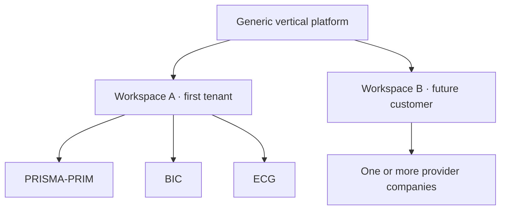

PRISMA-PRIM, BIC and ECG are initial configuration data. Code must use generic concepts such as `Workspace`, `Company`, `ClientAccount`, `Project` and feature/capability settings.

Do not write business behaviour such as:

```ts
if (company.name === 'BIC') {
  // special behaviour
}
```

Prefer an explicit capability or configuration:

```ts
if (company.features.certificateIssuance) {
  // behaviour enabled for this company
}
```

### 6.3 Productization now versus later

Design now for the costly-to-change boundaries:

- tenant ownership on all business data;
- database-enforced and application-enforced tenant isolation;
- company scopes and legal ownership;
- provider-independent integrations;
- configurable names, roles, templates, numbering and commercial settings;
- localization-ready user-facing text;
- no hard-coded first-tenant names or country assumptions.

Defer until real demand exists:

- public tenant registration;
- subscription billing and Stripe;
- plan entitlements;
- automated provisioning;
- complete white-labeling;
- marketplace or plugin platform;
- universal workflow builder;
- support for unrelated industries;
- advanced SaaS support impersonation.

## 7. Target domain boundaries

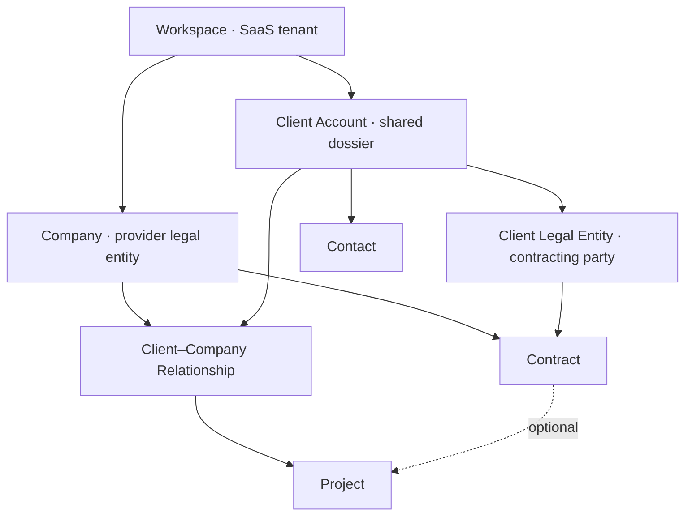

### 7.1 Workspace

Keep the existing technical name `Workspace`. It becomes the tenant boundary rather than introducing a redundant `Tenant` entity and migration.

Every business record must be owned by exactly one Workspace. Cross-Workspace references are invalid even when two tenants happen to serve the same real-world organization.

### 7.2 Company

A Company is a provider legal or operational entity inside the Workspace. It owns its legal identity, branding, numbering, tax/default currency settings, integrations, templates and user scopes.

### 7.3 Client Account

The Client Account is the tenant-level shared commercial and operational dossier. In the UI it may simply be labelled `Client`.

If SICOM works with PRISMA-PRIM and BIC, one SICOM dossier is related to both Companies. It is not duplicated per provider Company.

### 7.4 Client Legal Entity

A Client Legal Entity is the exact party identified for contracting, invoicing or certification, distinct from the shared Client Account. One Client Account may contain one or more Client Legal Entities.

Representative organization, branch and natural-person cases and their internal classification remain evidence dependencies owned by the [Tenant, Company, Client and Authorization PRD](tenant-company-client-authorization-prd.md) and [Shared Client PRD](release-1-shared-client-prd.md); this record does not decide a party-kind model.

For a simple Client Account, the application creates one primary Client Legal Entity and keeps the initial user experience simple.

### 7.5 Client–Company Relationship

This entity contains Company-specific commercial context such as account owner, local client code, relationship status, start date, normal payment terms, tags and external identifiers.

One active relationship exists per Client Account and Company pair.

### 7.6 Contract

In the initial model, a Contract has exactly one issuing provider Company and one contracting Client Legal Entity. PRISMA-PRIM and BIC normally create separate contracts even when serving the same shared Client Account.

Multi-party contracts are deferred until a concrete case justifies the additional model.

### 7.7 Project

A Project belongs to exactly one provider Company and one Client Account. It may identify the relevant Client Legal Entity when known.

A Project may exist before a Contract for migration, preparation, free/internal work or delayed paperwork. Pre-contract or active-without-contract conditions remain visible and auditable. They are not silently forbidden by the database.

If two provider Companies participate, use separate Projects under the same Client Account. A future `Engagement` grouping may be introduced only after a real cross-company case proves its value.

### 7.8 Core data invariants

1. Related records always belong to the same Workspace.
2. Business operations never run without an established Workspace context.
3. A Project has one owning Company.
4. A Contract has one issuing Company in the initial model.
5. A Project linked to a Contract must use the same provider Company.
6. A Client Account never crosses Workspace boundaries.
7. Critical changes create canonical Activity Log events.
8. Clients with operational history are archived, not hard-deleted.
9. Tax/legal identifiers help detect duplicates, but matching names never cause automatic merge.

## 8. Authorization model

Clerk authenticates an external identity. The application database and NestJS authorize business actions.

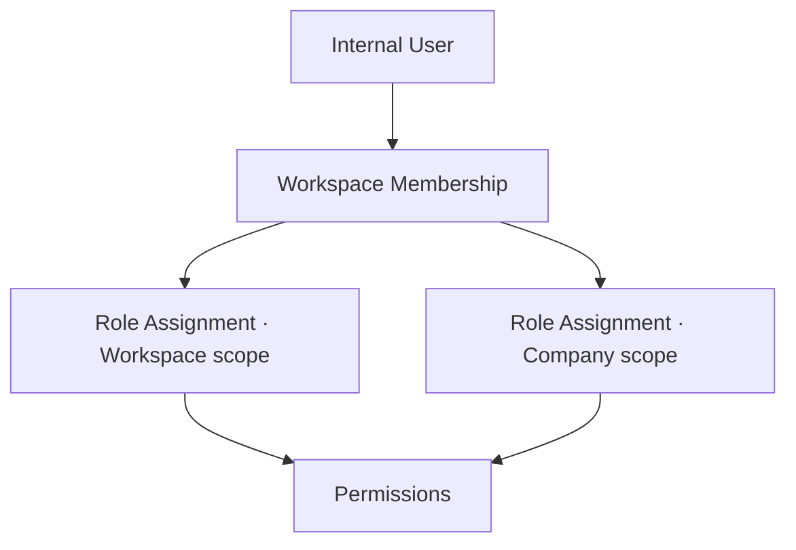

### 8.1 Initial role templates

| Role template        | Scope                | Main purpose                                        |
| -------------------- | -------------------- | --------------------------------------------------- |
| Workspace Owner      | Workspace            | Functional ownership and full administration        |
| Workspace Admin      | Workspace            | Members, Companies, settings and integrations       |
| Workspace Manager    | Workspace            | Consolidated operational management                 |
| Company Manager      | Company              | Clients, Projects and team activity for one Company |
| Project Professional | Company              | Authorized Project, Task and Document work          |
| Finance              | Workspace or Company | Contract, schedule, payment and finance visibility  |
| Read-only            | Workspace or Company | Consultation without mutation                       |

Roles are named permission bundles, not authorization conditions. Initial permissions include capabilities such as:

```text
company.read
company.manage
member.invite
member.assign_role
client.read
client.create
client.update_shared
client.update_relationship
client.archive
client.merge
project.read
project.create
project.update
project.close
task.read
task.manage
document.read
document.manage
contract.read
contract.manage
finance.read
finance.manage
activity_log.read
integration.manage
workspace.settings.manage
```

Authorization uses default deny and the union of granted permissions. Explicit deny rules are deferred because they make access harder to explain and test.

### 8.2 Shared Client visibility

A BIC-scoped user may see the shared identity of a Client related to BIC and all authorized BIC information. That does not reveal PRISMA-PRIM Contracts, Projects, finance, notes or other restricted activity.

Store information at the narrowest correct boundary:

| Information                                    | Owner                               |
| ---------------------------------------------- | ----------------------------------- |
| Official name, tax identifier, primary address | Shared Client / Client Legal Entity |
| BIC account manager                            | BIC Client–Company Relationship     |
| PRISMA-PRIM confidential note                  | PRISMA-PRIM relationship or Project |
| ECG Contract                                   | ECG + Client Legal Entity           |
| General Contact                                | Client Account                      |
| Mission-specific Contact                       | Project or relevant relationship    |

Workspace managers and authorized Company managers may update shared identity fields. Such mutations are logged. Merge and archive require elevated permissions.

### 8.3 Internal, external and platform actors

- `InternalUser`: a tenant collaborator.
- Future external/client users: a separate category with a narrower model; not part of Release 1.
- `PlatformOperator`: a SaaS operator outside tenant membership.

Platform operators receive no implicit access to customer business data. A future support-access mechanism must be explicit, time-limited, revocable and fully logged.

Project-specific membership may later support external auditors or temporary consultants. Release 1 primarily uses Workspace and Company scopes.

## 9. Project, workflow, standards and tasks

### 9.1 Lifecycle status versus workflow stage

Project lifecycle statuses are stable platform invariants:

```text
DRAFT
ACTIVE
ON_HOLD
COMPLETED
CANCELLED
ARCHIVED
```

Workflow stages depend on a Project Template. Example:

```text
Preparation
Document review
Audit Stage 1
Audit Stage 2
Decision
Certificate issuance
Surveillance
```

`Stage 1`, `Stage 2`, `S1` and `S2` are not global technical concepts until their exact business meanings are clarified.

### 9.2 Project categories and templates

Initial configurable categories may include certification, audit, consulting, training and other.

A Project Template may define:

- category;
- initial ordered stages;
- recommended Tasks or checklists;
- expected Document types;
- indicative timing;
- compatible Standards.

Template data is copied into a new Project. Later template edits do not mutate existing Projects retroactively.

This is deliberately smaller than a universal workflow engine.

### 9.3 Standards and editions

Distinguish the framework from its edition:

```text
Standard: ISO 9001
Edition: ISO 9001:2015
```

A Project may use multiple Standard Editions through an explicit relationship. Universal identifiers can be platform-supported while each Workspace controls activation and internal frameworks. Do not copy protected standard contents into the database without lawful authority.

### 9.4 Tasks

Every Task belongs to a Workspace and Company. A Task may be linked to a Project, Project Stage or Client, or be an internal Company Task.

Initial statuses:

```text
TODO
IN_PROGRESS
BLOCKED
DONE
CANCELLED
```

Essential fields include title, description, priority, assignee, due date, creator, completion date, scope and optional blockage information.

Subtask trees, complex dependencies, Gantt planning and advanced automation are deferred.

## 10. Document and storage architecture

A Document is a governed business artifact. A physical copy or external path is a Document Location.

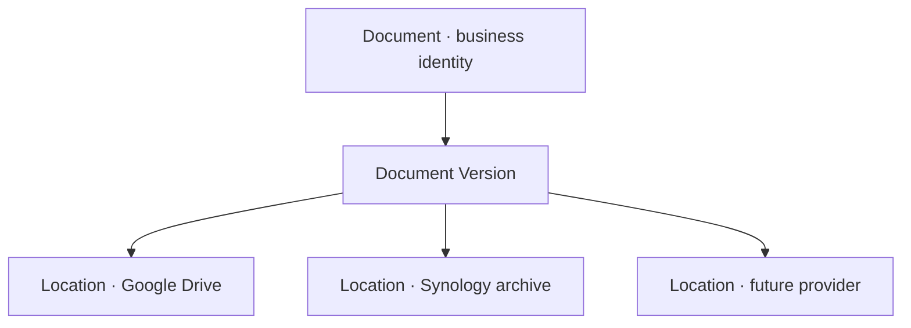

The minimal Document registry enters Release 1 with metadata, type, status, confidentiality, business links and an external URL/reference. Provider integration is not required for the core runtime.

`DocumentLocation` should eventually record provider, external identifier, path when needed, status, checksum, synchronization status and last verification time.

### 10.1 Synology decision

Synology must not initially host:

- the production PostgreSQL database;
- the primary API or web runtime;
- storage required for daily application availability;
- publicly exposed SMB shares.

The application runs independently in infrastructure Dan can operate remotely. Google Drive may support current operational documents. Synology is an optional later archive or backup destination behind an adapter and persistent retryable jobs.

If the NAS is offline, the core application continues working. Archive work remains pending and resumes later.

Before any integration, obtain the device model and configuration, assess connectivity and security, identify on-site operational ownership, and validate snapshots, independent off-site backup and restore tests. RAID or snapshots alone are not treated as a complete backup strategy.

### 10.2 Governed identity, versions, representations and locations

Document governance uses four distinct layers:

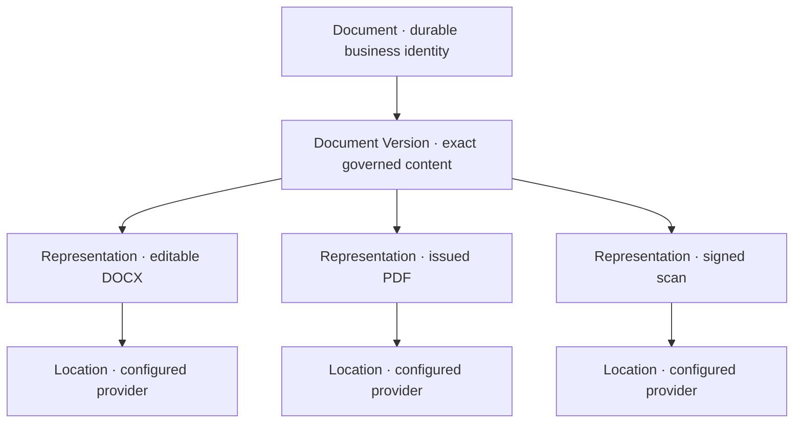

A file rename, folder move, provider change or lost synchronized copy does not change or erase the business identity, version history or evidentiary use of a Document. A representation records the concrete byte form of one version; a location records where a copy can be found.

Every Document belongs to one Workspace and has an explicit confidentiality and ownership scope. It may be Company-owned, deliberately Workspace-shared, linked to shared Client identity, supplied by an external party or approved for narrowly defined public publication. Access is never inferred only from a Drive folder or URL.

### 10.3 Formal versions and immutable use

Routine draft saves do not need to create formal business versions. A version is frozen when it enters review, approval, transmission, signature, official issuance, evidentiary use or replacement.

A version that has been approved, transmitted, signed, issued or used as evidence is immutable. A material correction creates a new version or linked corrective instrument and preserves the preceding version, reason, actor, time, approval and supersession relationship.

Content preparation, internal approval, transmission, receipt, signature, effective status, supersession, archival and storage synchronization are separate dimensions. One overloaded status must not claim all of them.

### 10.4 Template and generation governance

A `DocumentTemplate` is a durable identity. Every approved `DocumentTemplateVersion` is immutable, effective-dated and scoped to the Workspace or a Company. Controlled variants may cover language, branding, legal identity, Scheme, service, document type, signatory or approved clauses.

Shared templates and Company variants use explicit relationships and overrides rather than uncontrolled copies. Changing a template never rewrites a historical generated Document.

Every generated version preserves the exact template version, relevant source-data snapshot, responsible Company, locale, generating actor and time, generator version when material and checksums for material representations. Editable, rendered, signed and scanned representations remain related where factually correct, but are not treated as byte-identical.

### 10.5 Evidence and provenance

Evidentiary use points to an exact Document Version or representation, not a loose mutable URL. An evidence link records what it supports, source, acquisition channel and time, supplying party, verifier, verification state, confidentiality, permitted use and business context.

One governed Document may support several authorized contexts without duplicating its bytes. Its own access classification continues to apply; linking it to a less restricted resource never broadens access implicitly.

An externally received original is preserved unchanged. OCR, extraction, translation, summary, conversion and AI analysis are derived artefacts with explicit provenance.

Transmission, receipt and signature evidence are distinct facts. The platform records the exact version sent, recipient, channel, actor and time, then links receipt or signature evidence. Technical delivery or a visible signature image does not automatically establish sufficient legal acceptance without an approved business rule and human confirmation.

### 10.6 Retention, deletion and legal hold

Governed contractual, financial, Audit, certification, Training and evidentiary Documents are archived rather than deleted like ordinary files. Retention is configurable by Document type, Company and jurisdiction and remains subject to verified contractual, accreditation, privacy and legal obligations.

A legal, dispute, investigation, Audit or preservation hold prevents purge. Removing one physical location is separate from deleting the governed business record. Destructive purge requires explicit authority, traceability and verification that no active hold or dependency remains.

### 10.7 Numbering

Official numbering is configured by Company and Document type and is independent from the filename. Allocation is atomic and traceable. Year resets, series, reservation timing, abandoned numbers and reuse policy require real-practice validation.

## 11. Google integration architecture

Google Drive, Calendar and Gmail are three separate integrations with different authorization, security and productization costs. They must not be treated as one generic “Google integration” ticket.

PostgreSQL remains the system of record for Clients, Projects, Tasks, Documents, permissions, deadlines, statuses and business history. Google services expose replaceable external capabilities:

- Drive stores or exposes file bytes;
- Calendar mirrors selected operational events;
- Gmail may later expose selected messages and user-approved drafts.

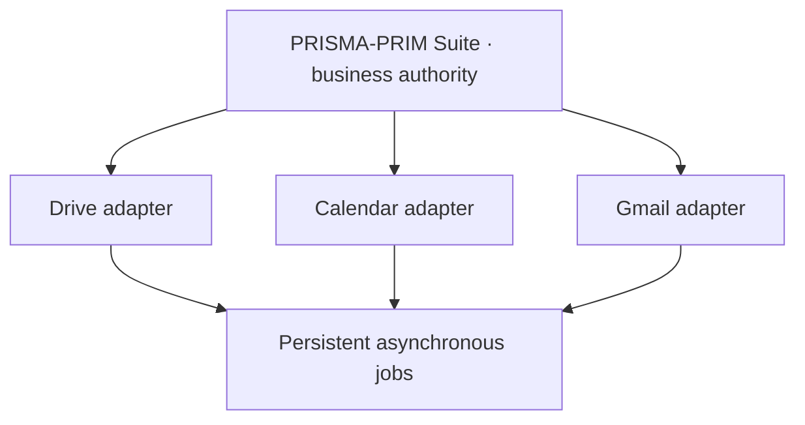

An external outage never rolls back an already committed business operation. The application records pending or failed synchronization visibly and retries it according to policy.

### 11.1 Connection ownership

Use three explicit levels rather than one shared token:

#### Workspace Integration Connection

An administrative provider connection owned by one tenant. It records provider, authentication mode, status, granted scopes, configuring actor, health, revocation state and a secure credential reference.

#### Company Integration Configuration

Configuration that maps one Company to its Shared Drive, root folder, shared calendar, permitted sender identity, folder conventions and enabled integration capabilities.

#### User Integration Connection

A user's explicit OAuth grant for capabilities that act on that user's mailbox or calendars. It records the Google account, scopes, status, revocation state and last synchronization without exposing token material.

This division prevents a token intended for one user or Company from becoming an implicit tenant-wide credential.

### 11.2 Drive topology

The preferred first-tenant topology is:

```text
Workspace: first tenant
├── Shared Drive PRISMA-PRIM
├── Shared Drive BIC
├── Shared Drive ECG
└── Shared Drive Group — optional and restricted to genuinely shared material
```

Separate Shared Drives provide a clear permission and operational boundary. The shared Client dossier remains primarily a PostgreSQL concept. A Document may have Company-scoped locations or an explicitly Workspace-shared location according to its confidentiality classification.

Google documents that service accounts do not have Drive storage quota and cannot own normal files. They should upload into Shared Drives or act through delegated OAuth. The initial design therefore uses a service identity only as an explicitly authorized member of configured Shared Drives. It does not receive domain-wide impersonation authority.

For user-selected files, prefer the narrow `drive.file` scope and a picker or explicit sharing flow. Broad Drive scopes are restricted scopes and require stronger verification. Application code stores Drive and file identifiers, not a display path as the durable identity.

```text
DocumentLocation
├── provider = GOOGLE_DRIVE
├── externalDriveId
├── externalFileId
├── parentFolderId
├── checksum
├── syncStatus
└── lastVerifiedAt
```

### 11.3 Calendar model

Calendar reflects business scheduling but never owns it. The preferred model is one secondary shared calendar per Company or operational team, for example:

```text
PRISMA-PRIM — Audits
BIC — Projects
ECG — Training
```

After a Project milestone, Audit, appointment or scheduled Task is committed:

1. the business transaction completes in PostgreSQL;
2. an idempotent synchronization job is persisted;
3. Calendar is called asynchronously;
4. the external event identifier and synchronization version are stored;
5. a failure becomes visible and retryable without deleting the business record.

Use the narrowest suitable scope. Google provides scopes for event-only access and for secondary calendars created by the application, including `calendar.app.created`. The exact scope follows the final user journey rather than being selected pre-emptively.

### 11.4 Gmail risk boundary

Gmail is materially more expensive to productize than Drive or Calendar. In a normal web application, scopes that read messages or manage drafts, including `gmail.readonly`, `gmail.compose`, `gmail.modify` and `gmail.metadata`, are restricted scopes. An external application that stores or transmits restricted-scope data can require Google's restricted-scope verification and a recurring security assessment.

The first email capability therefore remains provider-neutral and does not require mailbox access:

- prepare recipient, subject, body and intended attachments inside the application;
- show source data and the responsible actor;
- require human review;
- allow copy/open-in-client behaviour;
- do not send automatically;
- do not read or synchronize an entire mailbox.

A later Gmail OAuth capability may add:

- an individual user connection;
- explicit import of a selected message or thread;
- optional monitoring of a dedicated label;
- creation of a draft in that user's mailbox;
- human-triggered sending;
- revocation and deletion controls.

Do not use a shared password, silently read every mailbox, delete mail, train a model on Google user data, or transmit mailbox data to an AI provider without an explicitly approved user-facing purpose and compliant data handling.

Gmail push notifications require Cloud Pub/Sub, subscription handling and periodic watch renewal. They can be delayed or dropped, so a future synchronization design must retain recovery through history-based or periodic reconciliation.

### 11.5 No shared human credentials

Do not implement a common password or human account reused by several collaborators. A common address such as `office@...` should be a real managed Workspace mailbox or another officially supported shared-address pattern. Human users retain individual accounts and accountability.

Gmail delegation can support collaborators in the same Google Workspace organization. Programmatically administering delegation requires domain-wide authority and is not an initial application responsibility.

### 11.6 No initial Domain-Wide Delegation

Google Workspace Domain-Wide Delegation allows a service account to impersonate domain users. This is powerful and creates a large blast radius. Initial integrations instead use:

- explicit Shared Drive membership for the service identity;
- explicit per-user OAuth where a user capability is necessary;
- minimum scopes;
- no automatic access to every mailbox, Drive or calendar in the domain.

Domain-Wide Delegation requires a future, explicit security decision supported by a concrete administrative use case that cannot be met safely through narrower authorization.

### 11.7 Credential protection

Google access and refresh tokens:

- are never committed;
- are never stored in Clerk;
- are never written to Activity Log or application logs;
- are encrypted at rest;
- are isolated by Workspace and user or service identity;
- can be revoked;
- expose connection health without exposing secret material.

Refresh tokens may be stored as application-encrypted database values, with the encryption key held outside the database in the deployment secret manager. The integration boundary must permit a stronger secret-storage strategy later.

### 11.8 Asynchronous synchronization contract

Provider operations use persistent jobs with states such as:

```text
PENDING
RUNNING
SUCCEEDED
RETRYABLE_FAILURE
PERMANENT_FAILURE
CANCELLED
```

Every operation records an idempotency key, attempt count, next attempt, sanitized error, affected business resource, integration connection and external result identifier. Critical administrative or user-visible transitions also produce canonical Activity Log events.

Google API calls do not occur inside a PostgreSQL transaction that remains open while waiting for an external network response.

### 11.9 Official constraints used for this decision

- [Google Drive Shared Drives overview](https://developers.google.com/workspace/drive/api/guides/about-shareddrives)
- [Google Drive OAuth scopes](https://developers.google.com/workspace/drive/api/guides/api-specific-auth)
- [Google Calendar OAuth scopes](https://developers.google.com/workspace/calendar/api/auth)
- [Gmail OAuth scope classifications](https://developers.google.com/workspace/gmail/api/auth/scopes)
- [Gmail push notifications](https://developers.google.com/workspace/gmail/api/guides/push)
- [Gmail delegation](https://developers.google.com/workspace/gmail/api/guides/delegate_settings)
- [Google service accounts and Domain-Wide Delegation](https://developers.google.com/identity/protocols/oauth2/service-account)
- [Google OAuth verification FAQ](https://support.google.com/cloud/answer/13463817)

## 12. Financial architecture

### 12.1 Chosen boundary

PRISMA-PRIM Suite provides **operational financial control**, not general-ledger accounting or authoritative fiscal-document issuance in its initial financial release.

The platform records the commercial and operational reality needed by PRISMA-PRIM, BIC, ECG and comparable future tenants:

- Contract financial terms;
- expected payment schedules and instalments;
- references to invoices issued through an external authoritative process;
- received, refunded or reversed payments;
- explicit allocation of payments to invoices or expected instalments;
- remaining, overdue and unallocated balances;
- reminders, evidence and financial Activity Log events;
- Company-, Client-, Contract- and currency-scoped indicators.

It does not initially:

- maintain a general ledger;
- generate debit and credit journal entries;
- calculate or submit official tax declarations;
- provide payroll;
- perform complete accounting bank reconciliation;
- replace the tenant's accountant;
- become the legal source of fiscal invoices;
- assign authoritative fiscal numbering;
- submit fiscal invoices automatically to a tax administration.

These are initial product boundaries rather than permanent prohibitions. Any future accounting or fiscal capability requires an independently approved scope, evidence of business value and jurisdiction-specific validation.

### 12.2 Why tracking and fiscal issuance are separated

Moldova has the governmental `SIA e-Factura` service for creating, circulating and validating fiscal invoices. Its use is governed by tax rules and is mandatory for some transactions and taxpayer categories. The workflow involves legal identities, tax status, authorized access, fiscal numbering, corrections, cancellations, signatures or delegation, preservation and evolving portal or API behaviour.

Turning PRISMA-PRIM Suite into the legal issuer before the first tenant's real process is audited would combine three distinct responsibilities too early:

1. operational follow-up for Projects and Contracts;
2. accounting records and reconciliation;
3. legally authoritative fiscal-document issuance.

The initial integration boundary is therefore:

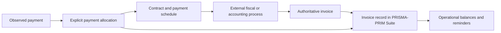

The platform stores the external number, source system, dates, monetary snapshots, status known to the business and governed Document reference. It does not silently claim that its internal operational state is the legal state held by the external fiscal authority.

Official sources used to establish this boundary:

- [Moldovan State Tax Service — e-Factura applicability and regulation](https://sfs.md/ro/intrebare-baza-de-date-generalizare/20);
- [Moldovan State Tax Service — official e-Factura usage guide](https://sfs.md/ro/document/ghid-de-utlizare-a-serviciului-e-factura);
- [Ministry of Finance — standardized primary document form order](https://mf.gov.md/ro/content/ordin-cu-privire-la-aprobarea-formularului-tipizat-de-document-primar-cu-regim-special-).

This record is a product and architecture decision, not tax advice. Before fiscal issuance or official tax calculation is implemented, the current requirements must be confirmed with Iurie, the responsible accountant and, where necessary, a Moldovan tax specialist.

### 12.3 Financial domain model

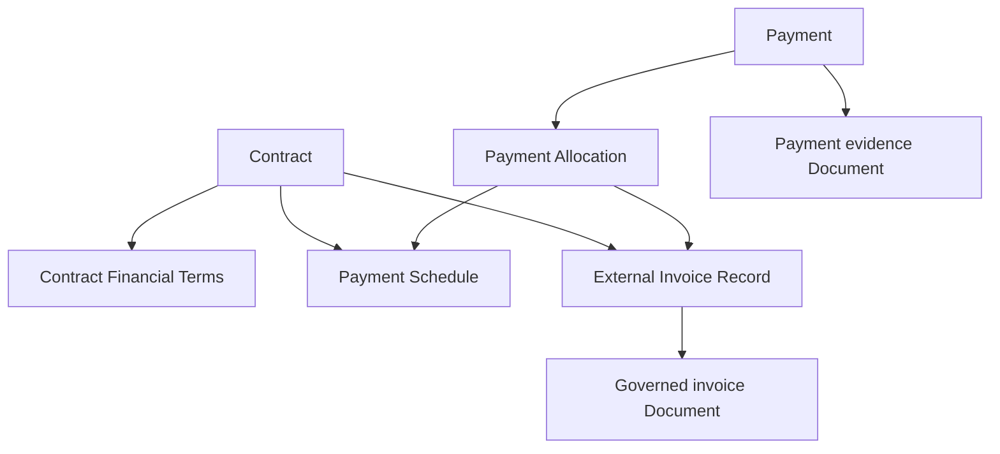

#### Contract Financial Terms

`ContractFinancialTerms` preserves the agreed commercial values for a specific Contract version:

- issuing provider Company;
- contracting Client Legal Entity;
- Contract version;
- original currency;
- net, tax and gross amount snapshots when known;
- payment terms;
- agreed instalment or milestone rules;
- penalties or exceptional terms when relevant.

The terms are versioned or snapshotted. A later Contract amendment, Company default change or tax-configuration change must not rewrite the financial meaning of an earlier signed version.

#### Payment Schedule

`PaymentSchedule` represents what is expected to be paid, independently from both the invoice eventually issued and the payment eventually observed. It supports advances, instalments, milestone payments, final balances and renewals.

Initial operational states are:

```text
PLANNED
DUE
PARTIALLY_PAID
PAID
OVERDUE
CANCELLED
```

#### External Invoice Record

`InvoiceRecord` references an invoice produced by e-Factura, accounting software or another approved external process. It includes:

- Workspace and issuing Company;
- receiving Client Legal Entity;
- related Contract;
- optional Project reference or references where the Company invariant remains valid;
- external number and source system;
- issue and due dates;
- original currency;
- net, tax and gross snapshots;
- governed Document reference;
- operational state known to the platform.

Initial operational states are:

```text
EXPECTED
ISSUED
PARTIALLY_PAID
PAID
OVERDUE
CANCELLED
CREDITED
```

These are application workflow states. They must not be presented as authoritative e-Factura states unless a verified synchronization contract is implemented later.

#### Payment

`Payment` represents money observed as received, refunded or reversed. It includes:

- Workspace and receiving Company;
- Client or payer context;
- amount and currency;
- effective date;
- payment method;
- bank or external reference when available;
- evidence Document;
- actor who recorded it;
- actor and time of confirmation.

Initial states are:

```text
DRAFT
CONFIRMED
REVERSED
```

Confirmation is a distinct permissioned action. A confirmed Payment is not silently overwritten. Errors use reversal or a traceable adjustment linked to the original record.

#### Payment Allocation

`PaymentAllocation` explicitly connects Payments to Invoice Records or Payment Schedules. The relation is many-to-many because real payment behaviour includes:

- one partial payment against one invoice;
- several payments against one invoice;
- one bank payment covering several invoices;
- advance payments before invoice issuance;
- overpayment or credit not yet allocated;
- later reallocation with an audit trail.

An invoice therefore never receives a simplistic mutable `paid = true` flag. Its paid amount and balance are derived from confirmed allocations.

### 12.4 Monetary precision and currencies

Money never uses binary floating-point values. Store monetary amounts using fixed-precision decimals or validated minor units together with an ISO 4217 currency code such as `MDL`, `EUR`, `RON` or `USD`.

Do not silently add unlike currencies. A dashboard may show:

```text
Outstanding: 120,000 MDL
Outstanding: 4,500 EUR
```

It must not show an unexplained combined value of `124,500`.

If consolidated reporting becomes necessary, every conversion preserves:

- original amount and currency;
- exchange rate;
- rate source;
- rate date;
- recorded or imported rate version;
- converted amount and reporting currency.

Conversion never replaces the original amount. A later rate change does not mutate a historical conversion used in an approved report.

### 12.5 Tax snapshots and effective configuration

Company configuration may eventually describe jurisdiction, tax registration, normal rates, exemptions and effective dates. The initial financial release primarily records the values present on the externally authoritative invoice as historical snapshots.

A later change to a tax rate or Company tax status must not recalculate an old Invoice Record. The platform may assist a human with calculations in a separately approved capability, but it does not initially claim that those calculations are legally authoritative.

No tax rate, VAT status, numbering rule or country-specific fiscal branch is hard-coded into the generic core.

### 12.6 Derived state and invariants

The API derives paid, partially paid and overdue state from confirmed allocations, amounts and due dates. Users cannot arbitrarily mark an invoice or schedule as paid without corresponding evidence in the financial model.

Core invariants include:

1. every financial record belongs to exactly one Workspace;
2. every Contract Financial Term, Schedule, Invoice Record and Payment has one responsible Company;
3. Invoice Record, Contract and Project links cannot cross Workspace or Company boundaries;
4. allocations cannot exceed the allocatable confirmed Payment amount unless an explicit approved adjustment model permits it;
5. amounts used in one allocation use compatible currencies or an explicit conversion record;
6. confirmed records are corrected through reversals or adjustments, not destructive edits;
7. historical monetary and tax snapshots are immutable;
8. financial records with history are archived or reversed, never hard-deleted;
9. external identifiers are not globally unique unless the external system guarantees that scope; uniqueness includes Company and source system where necessary.

### 12.7 Financial authorization and confidentiality

Financial permissions remain separate from general Project access and are scoped to Workspace or Company:

```text
finance.read
finance.manage
payment.record
payment.confirm
payment.reverse
finance.export
finance.configure
```

Membership in a Company does not automatically reveal all financial information. A Project Professional may receive only the minimum operational indicator needed for their work, such as whether a blocking payment condition is satisfied, without receiving all invoices, margins or Company-wide totals.

Workspace Owner and specifically authorized Finance roles may receive consolidated access. Platform operators receive no implicit financial access. Exports, confirmations, reversals and configuration changes are sensitive operations and must be logged.

### 12.8 Activity Log and correction model

Canonical Activity Log events cover at least:

- creation and versioning of Contract Financial Terms;
- Payment Schedule creation or cancellation;
- Invoice Record creation and external-reference change;
- Payment recording and confirmation;
- Payment allocation, deallocation or reallocation;
- reversal, refund, credit or adjustment;
- due-date changes;
- tax or currency configuration changes;
- financial export.

The log records the actor, Company scope, affected resource, time and safe change summary. It must not expose bank credentials or other secret material.

### 12.9 Initial reporting semantics

Initial indicators include:

- contracted amount;
- invoiced amount;
- collected amount;
- amount remaining to invoice;
- outstanding amount;
- overdue amount;
- next expected payments;
- unapplied payment or credit;
- breakdown by Company, Client, Contract, period and currency.

The product does not label an indicator as profit or profitability until reliable cost, expense, subcontractor and time data exists. Revenue, cash collected and profit are different measures and must not be conflated.

### 12.10 Integration sequence

Implement financial integrations only after real operational examples validate the model:

```text
controlled manual entry
    → reviewed CSV/XLSX import
    → accounting export
    → optional accounting-system adapter
    → optional bank-statement or payment-provider adapter
    → conditional e-Factura integration
```

Manual entry is not the final ambition. It is the lowest-risk way to discover numbering, currencies, instalments, partial payments, corrections and permission rules before automating an unknown process.

Any future e-Factura or accounting adapter must be provider-specific behind a stable financial integration boundary, asynchronous where external calls are involved, idempotent, observable and independently revocable.

## 13. Audit, certification and training architecture

### 13.1 Chosen separation of responsibilities

The platform uses a shared traceability foundation but keeps four business facts distinct:

```text
Audit
  = collection and evaluation of evidence

Certification Decision
  = formal decision based on authorized evidence and review

Certificate or Credential
  = governed assertion and document issued after an authorized decision

Training
  = learning session with participants, attendance and optional assessment
```

An Audit may exist without any certification decision, including an internal, supplier, diagnostic, readiness or extraordinary Audit. A Certification Decision may consider several Audits and other evidence. A Certificate may be corrected or reissued without rewriting the Audit. A Training Session may produce attendance or completion evidence without constituting certification of a person's competence.

This separation prevents the source requirement's convenient “Audit → Certificate” journey from becoming a database invariant that is false for internal audits, surveillance, denied decisions, training attendance and many other real cases.

### 13.2 Current normative context

The architecture is informed by current public normative context without attempting to reproduce or implement paid standards by assumption:

- [ISO 19011:2026](https://www.iso.org/standard/19011), published in May 2026, describes auditing principles, audit-program management, conducting management-system Audits and auditor competence. It does not itself provide certification.
- [ISO/IEC 17021-1:2015](https://www.iso.org/standard/61651.html) specifies principles and requirements concerning competence, consistency and impartiality for bodies auditing and certifying management systems. It remains published but is under review, so rules must be versioned rather than frozen in code.
- [ISO/IEC 17024:2026](https://www.iso.org/standard/17024), published in March 2026, concerns bodies operating certification of persons and schemes that assess defined competence. Ordinary course attendance must not be represented as this type of certification.
- [ISO's certification guidance](https://www.iso.org/certification.html) states that ISO does not certify organizations or issue certificates. External certification bodies perform that work, and ISO does not authorize use of its logo in connection with certification.
- [MOLDAC's accredited-body registers](https://acreditare.md/registre/) identify Moldovan conformity-assessment bodies and their annexes. [MOLDAC's general presentation](https://acreditare.md/despre-2/prezentarea-generala/) identifies ISO/IEC 17021-1 for management-system certification-body accreditation and emphasizes competence, impartiality, confidentiality and independent treatment of complaints and appeals.

These sources establish the need for adaptable schemes, traceable competence and impartiality controls, distinct human decisions and precise credential language. They do not establish which role or accreditation PRISMA-PRIM, BIC or ECG currently possesses; that remains a first-tenant evidence question.

### 13.3 Product capability differs from legal or accredited authority

Product configuration may activate capabilities such as:

```text
audit.delivery
system_certification.manage
system_certificate.issue
training.manage
person_certification.manage
public_verification.publish
```

A feature flag is not proof that a Company is legally, contractually or validly accredited to perform the corresponding activity.

`CompanySchemeAuthorization` or equivalent evidence records may later describe:

- accreditation or other authority type;
- issuing accreditation body;
- certificate number and governed evidence Documents;
- standards, schemes, sectors or codes covered;
- geographic scope;
- effective and expiry dates;
- suspension, restriction or withdrawal periods;
- authorized marks and public-register references.

The application may warn or block according to approved configuration, but it must not invent legal authority. PRISMA-PRIM, BIC and ECG capabilities are first-tenant configuration data and require documentary confirmation.

### 13.4 Scheme above Standard Edition

The existing `Standard` and `StandardEdition` model describes normative references. Add a configurable `SchemeDefinition` for the operational rules of an audit, certification or training service.

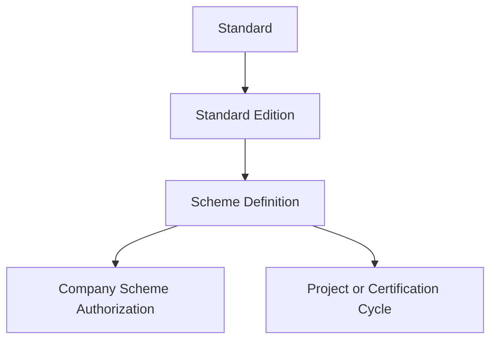

A Scheme may define:

- service and credential category;
- compatible Standards and Editions;
- allowed Audit types and required sequence;
- Finding taxonomy and severity labels;
- competence and role requirements;
- review and separation-of-duty rules;
- normal certification cycle and surveillance cadence;
- validity rules;
- numbering and reissue policy;
- report and Certificate templates;
- approved marks;
- publishable verification fields;
- reminders and human approval points.

This is a vertical product configuration model, not a universal compliance-programming language. Predictable choices use typed configuration; arbitrary user-authored code and unconstrained workflow logic remain out of scope.

### 13.5 Audit Program, Certification Cycle and individual Audit

An `AuditProgram` or `CertificationCycle` represents a coordinated series of activities. An `Audit` represents one planned and performed assessment.

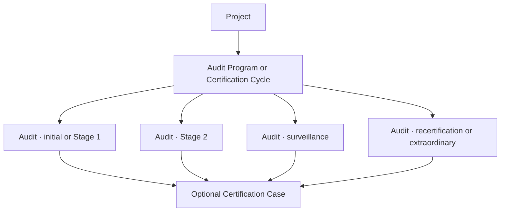

The model supports internal, initial, Stage 1, Stage 2, surveillance, recertification, extraordinary, supplier or other configured Audit types without making all of them mandatory for every Scheme.

`Stage 1`, `Stage 2`, `S1` and `S2` remain configurable labels until Iurie defines their exact first-tenant meaning. The platform stores stable technical identifiers and localized display labels rather than deriving behaviour from the literal label.

### 13.6 Individual Audit record

An Audit includes at least:

- Workspace and performing Company;
- Project and Client Legal Entity;
- Scheme and Audit Type Definition;
- objectives, criteria and scope;
- Standard Editions;
- covered sites and processes;
- on-site, remote or hybrid mode;
- planned and actual dates;
- audit leader and team assignments;
- approved duration assessment;
- checklist instances and evidence references;
- Findings and Corrective Action Cases;
- governed Audit Report versions.

Initial lifecycle:

```text
DRAFT
PLANNED
CONFIRMED
IN_PROGRESS
REPORT_DRAFT
UNDER_REVIEW
COMPLETED
CANCELLED
```

Completion is a controlled transition. A completed Audit is not silently reopened or edited; material corrections create linked, auditable amendments or new Document versions.

### 13.7 Versioned Audit Plan and duration assessment

`AuditPlanVersion` preserves the objectives, criteria, scope, sites, schedule, processes, assigned professionals, responsibilities, language and meetings communicated for a specific version. Sending or approving a later plan does not remove the previous one.

Audit duration is not one global formula. The calculation may depend on Scheme, Audit type, Standard, effective personnel, sites, complexity, sector, risk, integrated systems, remote work, history and applicable accreditation documents.

`AuditDurationAssessment` preserves:

- input facts and their provenance;
- calculation method and version;
- proposed duration;
- manual adjustment;
- adjustment rationale;
- reviewer and approval;
- final planned duration.

The first release may record and validate a human calculation. It must not claim that an unverified formula determines a compliant Audit duration.

### 13.8 Team assignment, competence and impartiality

`AuditTeamAssignment` references an internal professional or controlled external professional and records:

- Audit role such as leader, auditor, technical expert or observer;
- assigned Standard, sector, process, site or time period;
- relevant competence or authorization evidence;
- conflict or impartiality declaration;
- reviewer and assignment approval.

The initial capability is not a complete human-resources system. It nevertheless avoids placing unstructured names in a report with no durable actor, role or competence justification.

The platform must support Scheme-specific separation rules. A restrictive default prevents one actor from completing incompatible sensitive actions merely because that actor has broad Company access. Overrides, where legitimately permitted, require explicit policy, rationale and Activity Log evidence.

### 13.9 Checklist instances and evidence

`AuditChecklistTemplate` belongs to a Company and Scheme. Instantiating it for an Audit copies the applicable structure and version so a later template edit cannot rewrite historical results.

An item may reference:

- Standard and Edition;
- clause identifier or other criterion reference;
- Company-authored question and audit guidance;
- expected evidence categories;
- applicability conditions.

Evidence uses governed Document references or structured notes with provenance. Removing a physical Document Location does not silently remove the Audit evidence identity.

### 13.10 Checklist outcomes differ from Findings

The source document groups conforming, nonconforming, observation, opportunity and `N/A` as Finding values. The consolidated model corrects this ambiguity.

An item response may have an evaluation outcome such as:

```text
NOT_REVIEWED
CONFORMING
NONCONFORMING
NOT_APPLICABLE
NOT_VERIFIED
```

`NOT_APPLICABLE` is an applicability or evaluation outcome, not a Finding.

A separate `Finding` captures an auditor's formal statement and may use configured semantic categories such as:

```text
NONCONFORMITY
OBSERVATION
OPPORTUNITY
POSITIVE_PRACTICE
OTHER
```

Scheme-specific labels and severity, including major/minor distinctions where applicable, remain configured and versioned. A Finding may reference multiple criteria, responses, sites, processes and evidence records.

### 13.11 Nonconformity and corrective-action lifecycle

A Finding that requires corrective handling may open a distinct `CorrectiveActionCase`:

```text
Finding
  → immediate correction
  → cause analysis
  → corrective-action proposal
  → due date
  → submitted evidence
  → verification
  → effectiveness evaluation
  → closure or rejection
```

Initial operational states are:

```text
OPEN
ACTION_REQUESTED
ACTION_PROPOSED
EVIDENCE_SUBMITTED
VERIFICATION_PENDING
CLOSED
CANCELLED
```

The system preserves actor, dates, rationale, evidence and every material transition. Closing a Corrective Action Case does not erase its Finding, previous rejected proposals or evidence history.

Until an external Client portal is separately approved, authorized internal users record Client submissions and preserve their source and receipt date.

### 13.12 Human judgment and governed Audit Report

The platform may prepare plans, instantiate checklists, identify missing evidence, calculate deadlines, draft report sections and remind responsible actors. It does not autonomously:

- issue the auditor's final conclusion;
- assign final nonconformity classification;
- approve the Audit Report;
- declare corrective action effective;
- make a Certification Decision;
- suspend or withdraw a Certificate.

An `AuditReport` is a governed Document with author, responsible auditor, template version, source-data snapshot, review, approval, transmission and replacement history.

Initial Document workflow may use:

```text
DRAFT
UNDER_REVIEW
APPROVED
TRANSMITTED
SUPERSEDED
ARCHIVED
```

An approved report is never regenerated in place from current mutable data. Any material correction creates a new version linked to the approved historical artifact.

### 13.13 Certification Case and immutable Decision

`CertificationCase` groups the evidence considered for a formal decision:

- Client Legal Entity and responsible certification Company;
- Scheme and requested certification scope;
- sites, Standards and Editions;
- relevant Audits and Reports;
- Findings and Corrective Action status;
- additional reviewed Documents;
- review personnel;
- decision personnel or committee.

`CertificationDecision` is a distinct immutable business act rather than a mutable field on Audit or Certificate. Initial configurable decision semantics may include:

```text
GRANTED
DENIED
DEFERRED
MAINTAINED
SUSPENDED
RESTORED
SCOPE_REDUCED
WITHDRAWN
```

The exact first-tenant vocabulary must be confirmed. The decision record preserves actor or committee, authority, reviewed evidence set, decision date, rationale, conditions and effective date.

The model can enforce that auditors do not take the corresponding decision when the applicable Scheme or accreditation rule requires separation. A Project manager assignment never implies decision authority.

### 13.14 Shared Credential identity with type-specific records

Use a shared `Credential` identity for numbering, versions, lifecycle, verification and issuing Company, with specialized domain records:

```text
Credential
├── Management System Certificate
├── Training Attendance Credential
├── Training Completion Credential
└── Person Certification Credential
```

The common identity may contain:

- Workspace and issuing Company;
- credential type;
- holder reference;
- series and number;
- opaque verification identifier;
- issue, effective and optional expiry dates;
- status and status reason;
- Scheme;
- governed Document versions;
- optional public-verification publication.

Type-specific fields do not accumulate in one nullable mega-table.

`ManagementSystemCertificate` additionally snapshots the Client Legal Entity, certification scope, covered sites, Standard Editions, issuing Decision, certification cycle, permitted marks and languages.

### 13.15 Training credentials differ from person certification

The platform distinguishes:

- attendance evidence, confirming presence;
- training completion or achievement, confirming satisfaction of course criteria;
- certification of a person, asserting competence under a defined certification Scheme.

Only the third category is represented as person certification. A course completion Certificate must never be described as ISO/IEC 17024 certification unless the real Scheme and authorized process support that claim.

### 13.16 Credential identifiers, versions and status

A credential identifier is never reused for another Credential. Uniqueness is evaluated in the correct Company, Scheme and series scope. Imported historical identifiers are preserved with source metadata.

A correction or reissue creates a new immutable `CredentialVersion`, preserving:

- previous Document;
- reason for reissue;
- actor and approval;
- effective time;
- relationship to the preceding version.

The effective status is derived from authorized Decisions, dates and lifecycle events rather than an arbitrary editable `valid` flag.

Base semantic statuses are:

```text
DRAFT
ACTIVE
SUSPENDED
EXPIRED
WITHDRAWN
SUPERSEDED
```

`REVOKED`, requested in the source, may be a Scheme-specific label, withdrawal reason or specialized credential state after Iurie explains its operational meaning. Expiry, suspension, withdrawal, scope reduction and supersession remain different facts.

### 13.17 QR and minimum public verification

A QR code is a locator, not the source of truth. It points to a controlled verification page through a non-enumerable opaque identifier:


Depending on the Scheme, the public page may expose issuing Company, credential number, authorized holder identity, Standard Edition, publishable scope, dates, status and last update.

It does not expose contacts, identity documents, Audit Reports, Findings, finance or confidential Documents. Publication concerning a natural person is more restrictive and requires an approved privacy basis and policy.

This narrowly scoped public verification route is not an external Client portal.

### 13.18 External accreditation and certificate registers

The product may later export to or synchronize with an accreditation or certificate register. Such a register is a provider-specific adapter with explicit source-of-truth, publication, retry, discrepancy and revocation rules.

Do not hard-code an `IAF` provider throughout the domain. [Global Accreditation Cooperation Incorporated](https://global-aci.org/en/home/) began full operations on 1 January 2026 and assumed the former roles of IAF and ILAC. The institutional and technical integration landscape may continue to change even when underlying business facts remain stable.

No external register integration is implementation-ready until Iurie's actual obligations, current accounts, supported interfaces and authority to publish are verified.

### 13.19 Training domain

`CourseDefinition` is versioned and describes Company, title, objectives, content, duration, language, prerequisites, assessment method, pass criteria and credential types it may produce.

`TrainingSession` represents one delivery occurrence and includes:

- Course Definition version;
- organizing Company;
- optional Client and Project;
- trainers;
- dates, location or remote mode;
- participants and registration source;
- attendance evidence;
- assessments and validated results;
- learning-material references;
- status.

Initial Training Session states:

```text
DRAFT
SCHEDULED
IN_PROGRESS
COMPLETED
CANCELLED
```

Participant or enrollment outcomes may include:

```text
REGISTERED
ATTENDED
ABSENT
PASSED
FAILED
WITHDRAWN
```

Attendance and results are independently validated. Credential generation follows required human validation and never treats registration as proof of attendance or competence.

### 13.20 Standards content, copyright and marks

Checklist and future Knowledge Base functionality must not assume a right to reproduce the complete text of ISO publications. Store Standard and clause references, Company-authored or licensed checklist content, provenance, rights and allowed uses.

[ISO's copyright statement](https://www.iso.org/copyright.html) states that ISO publications are copyright protected, reproduction requires authorization and ISO content is subject to explicit restrictions concerning machine-learning or AI use. No purchased or received Standard content is automatically available for external RAG or model prompting.

[ISO's name and logo guidance](https://www.iso.org/iso-name-and-logo.html) prohibits unauthorized use of the ISO logo and misleading certification claims. Certificate templates therefore use `ApprovedMarkAsset` records with owner, authorized Company and Scheme, usage conditions, effective dates, evidence and approved template context.

### 13.21 Permissions, Activity Log and automation boundary

Initial permissions include:

```text
audit.read
audit.plan
audit.perform
audit.finding.manage
audit.report.review
audit.report.approve
certification.case.read
certification.review
certification.decide
certificate.issue
certificate.suspend
certificate.withdraw
certificate.publish
training.read
training.manage
training.attendance.validate
training.result.validate
training.credential.issue
scheme.manage
professional.competence.manage
```

Permissions are Company-scoped and do not erase Scheme competence, assignment or separation-of-duty checks.

Canonical Activity Log events include material scope changes, team assignments, conflict declarations, final Finding classification, Corrective Action closure, Report approval, Certification Decision, Credential issue or reissue, suspension, withdrawal, public publication and Training result validation.

Automations may instantiate checklists, create preparation Tasks, prepare Calendar events, calculate reminders, identify missing inputs and draft Documents. They cannot make or approve the sensitive judgments listed in section 13.12.

## 14. Commercial workflow architecture

### 14.1 Position of the original MVP

`docs/product/mvp-prd.md` contains a strong specification for assisted commercial work. Its human review, deterministic pricing, immutable versions, quality checks and evidence principles are preserved. It no longer defines the whole product or the next implementation release. It becomes the source specification for the commercial capability within the broader operational platform.

The canonical commercial journey is:

```text
Client Request
    │
    ├─ resolve or create shared Client dossier
    ├─ identify the exact Client legal entity when known
    └─ qualify separately for each responsible group Company
             │
             ▼
        Opportunity
             │
             ├─ structured assessment and confirmed facts
             ├─ selected Company service offerings
             ├─ deterministic pricing calculation
             └─ immutable pricing snapshot
                         │
                         ▼
                 Offer + Offer Versions
                         │
                         ├─ deterministic quality checks
                         ├─ internal approval
                         ├─ controlled transmission
                         └─ recorded Client response
                                      │
                                      ▼
                     Contract + governed instruments
                                      │
                                      └─ create or link Project
```

This sequence is a normal path, not a rigid requirement that every record be created only by its predecessor. Governed import, migration and direct Contract creation remain possible where the real business requires them.

### 14.2 Client Request before confirmed Client identity

A `ClientRequest` represents the original inbound demand and may exist before the requester has been matched to a shared `Client` dossier. It may begin in a restricted Workspace triage queue with no responsible Company. The original source, received time, sender, subject, body or file reference and source-provider identifiers are immutable evidence; corrections or interpretation are stored separately.

No separate `Prospect` master entity is required. A shared Client dossier may have a `PROSPECT` relationship with one or more Companies before becoming active. Duplicate resolution remains explicit and human-controlled.

### 14.3 Request and Opportunity are different facts

One request can produce no Opportunity, one Opportunity or several Opportunities. Each `Opportunity` belongs to exactly one provider `Company`, because ownership, confidentiality, service authorization, pricing, approvals, numbering and eventual contracting differ by Company. If one request could produce work for PRISMA-PRIM and BIC, it creates two Company-owned Opportunities linked to the same request rather than one ambiguously shared commercial record.

An Opportunity records the qualified commercial case, its owner, expected Client legal entity when known, scope, next action and outcome. Its durable lifecycle status is separate from the tenant-configurable sales stage:

- stable status: open, won, lost, disqualified, on hold or archived;
- configurable stage: the practical steps used by the tenant, such as qualification, technical review, pricing, offer preparation or negotiation.

This avoids making dashboards and automation depend on tenant-specific labels.

### 14.4 Structured assessment with optional AI assistance

The complete workflow must work through structured human input when AI is disabled or unavailable. Provider-neutral request evidence may optionally be processed by an `AnalysisRun`, which creates proposed facts, missing-information flags, contradictions or draft classifications. Those outputs are proposals, not canonical Client data or approved commercial facts.

A human reviews proposals into a structured `RequestAssessment`. Applying a confirmed fact to the shared Client dossier, a Client legal entity or an Opportunity is an explicit action with provenance. No analysis result may silently merge Clients, overwrite shared identity, select the responsible Company, set a final price or approve an Offer.

### 14.5 Shared service definition and Company offering

A reusable `ServiceDefinition` describes a business service at Workspace level. A `CompanyServiceOffering` states that a particular Company may sell or perform that service, with its own availability, authorization, commercial text, templates and pricing configuration. This preserves a common catalogue without falsely implying that every Company can provide every service under identical conditions.

### 14.6 Versioned tariffs and pricing rules

Tariffs and Pricing Rules are Company-scoped, versioned and effective-dated. A calculation uses only confirmed typed inputs and deterministic rules. The first implementation should support the recurring rule shapes observed in real services rather than inventing a universal pricing language.

Every calculation produces an immutable `PricingSnapshot` containing at least:

- the Company, service scope and Client context used;
- tariff and rule versions;
- confirmed input values;
- calculation lines, quantities, unit prices, adjustments and totals;
- currency, rounding and tax assumptions;
- calculation time and responsible actor.

Money follows the fixed-precision and currency rules in section 12. Discounts, overrides and exceptional adjustments are explicit lines with a reason, actor and any required approval. They never mutate the historical tariff or hide inside a manually replaced total.

### 14.7 Offer identity and immutable versions

`Offer` is the durable commercial identity. Each revision is a complete `OfferVersion` snapshot containing recipient legal identity, service scope, pricing snapshot, commercial conditions, validity, referenced documents, template version and generated artefact. An approved or transmitted version is immutable. Negotiation creates a new version and preserves the prior one.

Three dimensions are recorded separately:

1. internal preparation and approval state;
2. transmission state and evidence of what was sent, when, how and by whom;
3. Client outcome such as pending, accepted, rejected, expired or withdrawn.

This prevents a single overloaded `status` from claiming that internal approval means the Client received or accepted the Offer.

### 14.8 Deterministic quality checks and approval

Quality Checks are versioned deterministic rules. Their results are stored against the exact Offer Version and use `PASS`, `WARNING` or `ERROR` semantics. Errors block approval or transmission. Warnings require an acknowledgement or approved exception. AI may explain a failed check or draft missing text, but it does not decide whether a commercial control passed.

Internal approval is distinct from sending. Approval thresholds may depend on Company, service type, value, margin, discount or exception. Approval, rejection, return for changes and override are attributed Activity Log events.

### 14.9 Client response and acceptance evidence

Client acceptance requires evidence interpreted or confirmed by an authorized human. Evidence may include a signed copy, qualified electronic signature, explicit email, Client order or another approved form. Receipt of a message or a provider callback does not by itself establish legal acceptance unless the configured business rule and responsible reviewer confirm it.

The accepted Offer Version remains immutable and is linked to the resulting Contract. If terms change during negotiation, a new Offer Version is prepared; historical versions are never rewritten to resemble the final agreement.

### 14.10 Contract origins and relationship to Projects

A Contract may originate from an accepted Offer, a governed direct-creation flow, an imported historical agreement or a renewal. Direct creation is allowed because migration and exceptional work exist, but it requires explicit scope, parties, commercial terms, provenance and any additional review demanded by policy.

A Project may already exist before signature. Contract activation therefore either creates a Project or links an existing authorized Project. The system must search and present possible matches rather than blindly creating a duplicate. A Contract and Project remain distinct: the Contract governs legal/commercial obligations, while the Project governs operational delivery.

The exact cardinality for framework agreements, amendments and Projects remains subject to real-case validation; the model must not assume that one Contract always equals one Project.

### 14.11 Contract versions and post-signature instruments

Pre-signature drafts are `ContractVersion` records under one durable Contract identity. Once executed, the signed agreement is immutable evidence. Later legal changes are separate governed instruments—such as amendment, addendum, renewal, termination or suspension—not silent edits of the signed version.

The application records document workflow, execution/signature state and legal/operational lifecycle as separate dimensions. For example, a document may be approved internally but not signed, or signed but not yet effective.

### 14.12 Governed legal content

Legal clauses and Contract templates are approved, versioned and Company-scoped where necessary. Generated Documents record the exact template and clause versions used. AI may propose wording only as an identified draft for human and, when required, legal review. It may not invent an authoritative clause or silently alter approved legal text.

### 14.13 Signature evidence and conditional MSign integration

The initial product records external signature evidence rather than implementing an electronic-signature authority. Supported evidence categories can include paper signed scan, qualified electronic signature, external signature provider, Client order and other approved evidence.

Moldova's electronic-identification and trust-services framework includes Law no. 124/2022, and the governmental MSign service can be relevant to future integration. An MSign adapter is conditional on the real signing workflow, account ownership, supported integration interface, security obligations and desired user experience being verified. The first release does not claim to create qualified signatures itself.

References:

- [STISC — electronic identification and trust-services legal framework](https://stisc.gov.md/ro/cadrul-legislativ)
- [Moldova e-Government Agency — MSign governmental electronic-signature service](https://www.egov.md/ro/content/serviciul-guvernamental-de-semnatura-electronica)

### 14.14 Numbering and concurrency

Offer and Contract numbers are assigned per Company and document type using configurable schemes. Whether numbers reset by year and whether they are reserved at draft, approval or transmission time must be determined from real practice. Allocation must be atomic and concurrency-safe; cancelled or abandoned reservations remain traceable rather than being silently reused when legal or operational policy forbids reuse.

### 14.15 Permissions, auditability and dashboard semantics

Commercial permissions distinguish intake, assignment, assessment, pricing, discount, approval, transmission, Client-response confirmation, Contract preparation, signature confirmation and configuration. They are Company-scoped unless a clearly approved Workspace-level responsibility applies.

Critical changes—including Company assignment, confirmed Client identity, pricing override, approval, transmission, accepted evidence, Contract execution and post-signature instrument—produce attributed Activity Log events. Approved or signed records are never hard-deleted.

Dashboards derive stable business meaning from durable status and dates rather than configurable stage labels alone. At minimum they can distinguish unassigned requests, requests awaiting information, open Opportunities without next action, Offers awaiting approval, sent Offers awaiting response, expiring Offers, Contracts awaiting signature and accepted work not yet linked to a Project.

### 14.16 Commercial implementation boundary

Release 3 is split into independently testable capabilities:

- **R3A — Intake and Opportunity:** immutable request evidence, Client resolution, Company assignment, structured assessment, ownership and next actions;
- **R3B — Catalogue and deterministic pricing:** service definitions, Company offerings, versioned tariffs and rules, calculations, adjustments and immutable snapshots;
- **R3C — Offers:** complete versions, generated documents, quality checks, approval, transmission, response evidence and negotiation history;
- **R3D — Contracts:** controlled origins, versions, legal content, signature evidence, post-signature instruments and Project creation or linking.

Commercial readiness is evaluated per vertical slice. Real manually entered Requests and Opportunities may be implemented without later pricing or document material. When a decided slice needs unavailable Tariffs, calculation examples, Templates or clauses, versioned illustrative inputs may prove the reusable mechanics only when their provenance remains visible and every derived artifact is prevented from being represented as approved for real use. The same workflow may exercise its human approval, acceptance and signature-recording steps with clearly simulated evidence; those states retain provisional provenance and confer no real external or operational authority. Real evidence is still required before the affected configuration, approval threshold, numbering rule, generated artifact, acceptance or execution is approved for operational use. This is one architecture, not a separate demo mode, and real Requests or Opportunities are not labelled illustrative merely because a later input is provisional.

This scoped gate follows [Dan's Product Owner direction of 2026-09-20](https://github.com/Prisma-Prim/PRISMA-PRIM-Suite/issues/51#issuecomment-5749633981). The canonical observable behaviour and per-slice readiness assessment are owned by the [Release 3 Commercial Workflow PRD](release-3-commercial-workflow-prd.md). Mass marketing automation, a universal CRM or CPQ engine, AI-determined pricing, an internally implemented qualified-signature service and a Client portal remain outside this release.

## 15. Historical migration and global search architecture

### 15.1 Migration is a governed business process

Historical data does not become canonical merely because a spreadsheet, folder or legacy export was imported. Every migration runs through a persistent `ImportBatch` with source, owner, checksum, mapping version, actor, dates, counts and status.

```text
source inventory
  → immutable source capture
  → staging and mapping
  → validation and duplicate proposals
  → dry-run report
  → authorized approval
  → idempotent commit
  → reconciliation report
```

Rows with errors remain visible and correctable without forcing the batch into an unknown partial state. Re-running a batch does not duplicate committed records. Imported records retain source identifiers, batch provenance and uncertainty caused by missing or contradictory history.

Duplicate detection proposes candidates using identifiers, normalized names, contacts and contextual evidence. It never automatically merges Clients, legal entities, Contracts, Documents or Credentials. A merge is permissioned and preserves aliases, source records, links and Activity Log history.

Start with approximately ten representative Clients covering multiple Companies, languages, historical depths and exceptions. Expand toward the estimated 300 historical Clients only after reconciliation proves the model answers agreed completeness questions.

### 15.2 Search authority and derived indexes

PostgreSQL remains authoritative. Search indexes, normalized terms, extracted text and vector representations are derived, rebuildable projections.

Authorization is applied before returning results, counts, snippets, facets or suggestions. Search must not reveal unauthorized Company activity.

Global search distinguishes exact and normalized entity search; structured filters; authorized full-text search; and later semantic retrieval for approved Knowledge and dossier use cases.

Romanian, Russian and English require Unicode-safe, diacritic-aware and language-aware normalization. Transliteration or fuzzy matching may propose candidates but never changes identity or merges records.

### 15.3 Current, historical and completeness views

Current operational results are the default. Archived, superseded, expired or historical versions require explicit filters and visible labels.

A Client dossier completeness view distinguishes confirmed present, expected but missing, not applicable, not checked, inaccessible in another scope, and unresolved duplicate or contradiction.

“Everything held for SICOM” means a categorized, scoped account of governed records and known gaps, not an assertion that unindexed folders or unauthorized data do not exist.

### 15.4 Governed export and archive

Authorized exports preserve scope, filters, generation time, actor, format and source-version context. Large exports are asynchronous, time-limited, audited and protected like source data.

Standard formats and documented identifiers support portability. Synology may receive an optional archival copy after migration and search are proven; it is not the migration authority or only searchable source.

## 16. Knowledge Base, RAG and AI governance architecture

### 16.1 Approved Knowledge Sources

A `KnowledgeSource` references an exact governed Document Version and records owner, provenance, language, rights, confidentiality, permitted AI use, effective period, approval and supersession state.

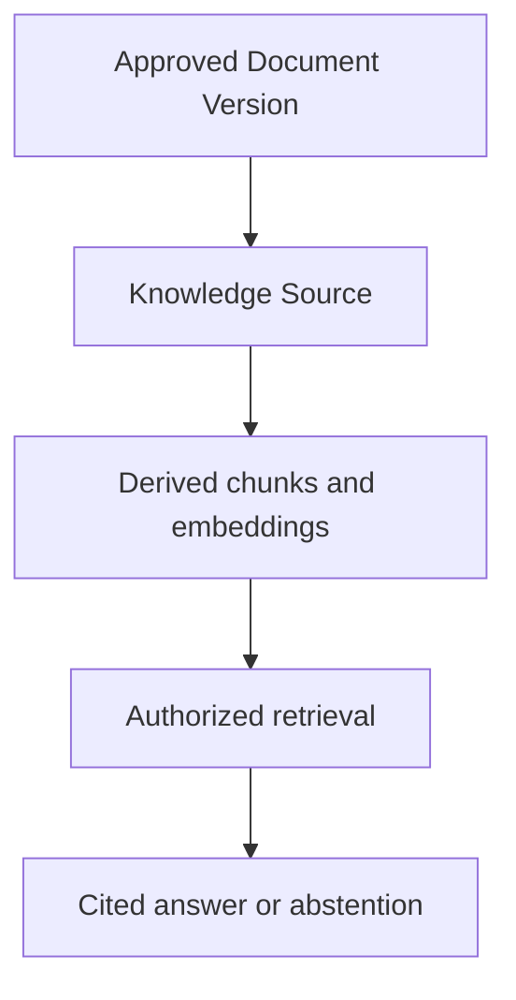

Chunks, embeddings, summaries and extracted metadata are derived projections that can be rebuilt. They never replace the governed source.

Sources whose rights do not permit reproduction, indexing, external model processing or machine-learning use remain excluded. Paid ISO publications and confidential Client Documents are not admitted by convenience or mere possession.

### 16.2 Version-aware and authorization-aware retrieval

Retrieval enforces Workspace, Company, Document, purpose and user permissions before content reaches a model. Post-generation filtering is not adequate access control.

Current answers exclude obsolete and superseded sources by default. Historical mode is deliberate and visibly identifies dates and status. The system preserves exact source version, fragment or locator, retrieval time and relevance evidence used for material claims.

A response distinguishes supported statements, uncertain inferences, contradictions and missing evidence. When authorized evidence is insufficient, it abstains or requests information rather than completing facts from model intuition.

### 16.3 AI Registry and interaction traceability

Every AI capability has an `AIRegistryEntry` describing purpose, owner, affected actors, provider, model family, configuration, allowed data classes, tools, risk level, evaluation set, approval state, effective period and shutdown control.

Material `AIInteraction` records preserve capability, actor, business context, model/configuration version, source references, output, validation, human disposition and resulting action. Logging is sanitized: secrets, tokens and unnecessary confidential prompt content are not copied into ordinary logs.

External provider use requires documented retention, training, region, subprocessor, deletion and security terms. Tenant data is not made available for provider training by default.

### 16.4 Untrusted inputs, outputs and tools

Documents, retrieved text, emails and user content are untrusted data, not instructions. Prompt injection and malicious embedded content cannot grant permissions, select hidden tools or override server policy.

Model output remains untrusted until schema, type, permission and business validation succeeds. An LLM does not directly write critical records, execute arbitrary code or call a provider with broad credentials.

Tool execution re-establishes actor, Workspace, Company, permission, object state and idempotency on the server. Sensitive actions remain proposals requiring the same human approval and deterministic controls as non-AI workflows.

### 16.5 Evaluation before autonomy

Each capability has a versioned representative evaluation set and task-specific metrics, including retrieval coverage, citation correctness, supported-claim rate, extraction accuracy, contradiction and missing-data detection, abstention, human correction, latency, cost and unsafe-action rate.

Romanian, Russian and English cases, access boundaries, outdated sources, adversarial instructions and known failures are tested. Material provider, model, prompt, embedding, chunking or tool-policy changes require regression evaluation before promotion.

The first production AI is the assistive ISO Project Copilot. It summarizes permitted dossier state, identifies missing or contradictory information and proposes three to five next actions or drafts. General autonomous multi-agent operation waits for measured value and safety.

The governance approach is informed by the [NIST AI RMF Generative AI Profile](https://www.nist.gov/publications/artificial-intelligence-risk-management-framework-generative-artificial-intelligence), [OWASP guidance for LLM applications](https://owasp.org/www-project-top-10-for-large-language-model-applications/) and the official [EU Artificial Intelligence Act](https://eur-lex.europa.eu/eli/reg/2024/1689/oj/eng). Product configuration is not a legal classification; applicability requires current review before release.

## 17. Platform, security and reliability architecture

### 17.1 Secure-by-design operating boundary

Development, test or preview, and production are separate environments with separate credentials, data stores and provider configurations. Production data is not copied into lower environments unless a specifically approved, minimized and sanitized dataset is required.

Identity uses the established Clerk boundary, strong session controls and MFA where required. Authorization remains server-side, default-deny and scoped to Workspace, Company and resource. Database constraints and automated cross-tenant tests provide defense in depth; PostgreSQL Row-Level Security may be added where its operational implications are verified, but no single mechanism is the only isolation boundary.

Secrets use a deployment secret manager, least privilege, rotation and revocation. They never enter source control, client bundles, Activity Log, ordinary logs or AI prompts.

### 17.2 Data and file protection

Transport uses current TLS. Managed infrastructure encrypts persistent data and backups at rest; application-level encryption protects provider tokens and other narrowly identified sensitive values.

Uploads are quarantined until type, size, checksum and malware controls complete. File names, MIME declarations, archives, previews, OCR and generated documents are untrusted input. Download and preview authorization is checked at access time.

Privacy follows data minimization, purpose limitation, accuracy, retention, controlled deletion and demonstrable accountability. The product supports inventories, exports, correction, holds and governed deletion without claiming configuration alone guarantees legal compliance.

### 17.3 Secure development and supply chain

Every material capability includes threat modeling, authorization tests, validation, dependency and secret scanning, code review and security acceptance criteria. Releases use reproducible CI evidence and controlled migrations. High-impact dependencies and providers are inventoried; vulnerabilities receive owned remediation and exception records.

The verification baseline follows the [OWASP Application Security Verification Standard](https://owasp.org/www-project-application-security-verification-standard/), [NIST Secure Software Development Framework](https://csrc.nist.gov/pubs/sp/800/218/final) and [CISA Secure by Design guidance](https://www.cisa.gov/securebydesign). The official [GDPR text](https://eur-lex.europa.eu/eli/reg/2016/679/oj/eng) informs privacy-by-design review where EU personal data is processed.

### 17.4 Observability, incidents and recoverability

Structured logs, metrics, traces and correlation identifiers expose service health, security events, job failures, provider degradation and tenant-impacting errors without recording secrets or unrestricted business content.

Activity Log is business evidence; operational logs are diagnostic evidence. Security-relevant logs have protected retention and access. Alerts have an owner, severity, escalation route and documented response.

Backups are automated, encrypted, monitored and independently restorable. Before production acceptance, define and test recovery-point and recovery-time objectives for the database, governed documents, configuration and integration credentials.

External outages do not corrupt committed state. Persistent jobs, idempotency and reconciliation support recovery. Schema and deployment changes have forward and rollback or corrective migration plans appropriate to risk.

Platform support receives no standing tenant access. Future support access is explicit, time-limited, purpose-bound, revocable and fully logged. Tenant data and governed Documents remain exportable through standard formats.

## 18. UX, localization and configuration architecture

### 18.1 Client-centered and context-safe navigation

The shared Client dossier is the central operational view, but uses progressive disclosure instead of placing every module in one permanently expanded screen. Users reach the relevant overview, Projects, Tasks, Documents, commercial work, Audits, finance, communications, Credentials and AI according to permission and task.

Workspace and Company context remain visible. “All Companies” is a consolidated viewing and filtering context; a user cannot create a Company-owned Project, Contract, Offer, Payment or Document until one responsible Company is explicit.

Role-oriented home views prioritize overdue Tasks, approvals, missing evidence, failed synchronization, expiring Documents or Credentials, unanswered commercial work and financial follow-up. Dashboards are not substitutes for actionable queues.

### 18.2 Responsive, accessible and complete states

Critical journeys work on desktop and responsive mobile web. A native mobile application is deferred until evidence shows responsive web is insufficient.

The product targets [WCAG 2.2 AA](https://www.w3.org/TR/WCAG22/) for new user-facing experiences. Keyboard use, visible focus, contrast, labels, error association, target size, zoom, responsive reflow and non-colour status cues are acceptance concerns.

Every screen specifies loading, empty, success, validation, permission-denied, unavailable-provider, retryable-failure, archived/read-only, conflict and partial-data states. Errors explain what happened, what remains saved and the next safe action.

### 18.3 Localization and business vocabulary

The localization foundation exists from Release 1. Romanian is the default interface language when no valid explicit choice exists, independently of browser or operating-system language. The supported interface choices are Romanian, Russian, French and English. A supported explicit choice controls the interface; an invalid or unsupported saved choice falls back to Romanian. Interface locale, Document language, Client communication language and Company default language are separate settings.

Stable semantic identifiers drive logic. Display labels, stage names, notifications, document templates and help are localized resources. Changing a translation or tenant label never changes stored business meaning.

Dates, numbers, accessible names and errors respect the chosen interface locale while canonical values, business content, prices, currencies, timezone rules, permissions and identifiers remain unchanged. Missing interface translations fall back to Romanian and are reported by release checks. The repository, code, API and technical specifications remain English.

### 18.4 Bounded configuration

Configuration covers Company identity, capabilities, roles, project stages and templates, Document templates, numbering, Scheme definitions, notification policies, calendars, integrations, locale and terminology. It does not become arbitrary executable code or a universal BPM engine.

Workspace defaults and Company overrides are explicit. A missing override inherits intentionally rather than copying values invisibly.

Configuration that changes historical interpretation, authorization, numbering, calculation, generated content or regulated workflow is versioned or effective-dated. High-impact changes expose a preview or diff, validation, approval where required and Activity Log evidence.

### 18.5 Notifications, dashboards and bulk work

Business events create durable application state first. Notifications are derived deliveries with deduplication, recipient rules, severity, escalation, quiet hours and user preferences. Email or Calendar delivery failure does not erase the underlying Task or deadline.

Every dashboard measure has an owner, definition, scope, date basis, currency rule and drill-down. Consolidated views do not mix currencies, Companies or confidential activity without explicit meaning and authorization.

Bulk import and bulk actions provide preview, selection, validation, permission checks, partial-failure reporting and Activity Log evidence. Destructive or high-impact operations require explicit confirmation and cannot hide their target scope.

First-tenant acceptance uses real roles, Romanian and Russian terminology, Company switching, representative desktop and mobile sizes and recovery from errors—not only static happy-path mockups.

## 19. Release roadmap

### Release 0 — Technical foundation

Existing or nearly complete:

- monorepo and database foundation;
- React/NestJS boundaries;
- production shell and Atlas Blue baseline;
- Clerk authentication;
- Workspace and Internal User;
- provider-neutral identity;
- initial tests and delivery governance;
- first Activity Log slice through issue #22.

### Release 1 — Operational multi-tenant core

- **R1A:** multi-tenant Workspace boundary, Company and RBAC;
- **R1B:** shared Client, Contacts, Client Legal Entity and Company relationships;
- **R1C:** Projects, Standards, stages, templates and Tasks;
- **R1D:** minimal provider-independent Document registry;
- **R1E:** operational dashboard and complete acceptance journey.

Acceptance journey:

> sign in → choose authorized Company → create one Client → relate it to two Companies → create separate Projects and Tasks → reference Documents → update shared identity → verify scoped visibility and Activity Log events

### Release 2 — Google and document integrations

- **R2A — Drive:** connection inventory, Shared Drives by Company, controlled folder creation, Document upload/linking, retryable synchronization and permission audit;
- **R2B — Calendar:** Company calendars, selected operational events, conflict visibility, retries and reminders;
- **R2C — provider-neutral assisted email:** templates, recipients, content, attachments, human review and copy/open-in-client behaviour without broad mailbox access;
- **R2D — Gmail OAuth, conditional:** selected message import, dedicated-label synchronization and mailbox drafts only after the scope, verification, security and ROI decision;
- Document versions;
- DOCX/XLSX/PDF templates and generation.

### Release 3 — Commercial workflow

- **R3A — Intake and Opportunity:** immutable Client Request evidence, shared Client resolution, Company-owned Opportunity, structured assessment, responsibility and next actions;
- **R3B — Catalogue and pricing:** shared Service Definitions, Company Service Offerings, versioned Tariffs and Pricing Rules, explicit adjustments and immutable Pricing Snapshots;
- **R3C — Offers:** complete Offer Versions, deterministic Quality Checks, human Approval, transmission evidence, Client response and negotiation history;
- **R3D — Contracts:** controlled creation or import, versioned legal content, external signature evidence, post-signature instruments and Project creation or linking.

The workflow must function with structured human input even when AI Analysis is disabled.

### Release 4 — Audit, training and certification

- **R4A — Scheme and Audit foundation:** Scheme Definitions, Audit Programs or Certification Cycles, Audit Types, Plans, duration assessments, sites and team assignments;
- **R4B — Audit execution:** instantiated checklists, evidence, responses, Findings, Corrective Action Cases and governed Reports;
- **R4C — management-system certification:** Certification Cases, human review and Decisions, Certificate issuance, immutable versions, lifecycle and minimum public QR verification;
- **R4D — Training:** versioned courses, Training Sessions, participants, attendance, assessments and attendance/completion credentials;
- **R4E — conditional advanced capabilities:** person certification, external certificate registers, complaints and appeals, and deeper accreditation-rule automation after the real process is verified.

### Release 5 — Financial tracking

- versioned Contract Financial Terms;
- Payment Schedules and instalments separate from invoices;
- references and governed Documents for externally issued invoices;
- received Payments, confirmation and reversal;
- explicit allocations supporting partial, grouped and unapplied payments;
- balances, overdue state and reminders derived by the server;
- fixed-precision, multi-currency reporting without silent currency aggregation;
- Company-scoped finance permissions, exports and Activity Log events;
- controlled manual entry and reviewed import before accounting, banking or fiscal integrations.

Authoritative fiscal invoice generation, general-ledger accounting and e-Factura submission are outside the initial Release 5 boundary.

### Release 6 — History and global search

- consolidated metadata search;
- import of approximately 300 historical Clients;
- optional Synology adapter;
- prototype on ten Clients;
- completeness test such as “everything held for SICOM”;
- gradual extension after validation.

### Release 7 — AI/RAG and copilots

- approved Knowledge Base;
- source-cited RAG;
- obsolete-version exclusion;
- dossier analysis;
- missing-document and contradiction detection;
- recommendations and drafts;
- ISO Project Copilot;
- advanced agents only after measurable evaluation.

## 20. Approved decision register

### Product scope, preservation and documentation

#### DEC-001 — Consolidated vision, not one sprint

The received requirements describe the global target product. They are not one implementation issue, one sprint or one monolithic MVP. The target must be divided into deliverable releases and capability PRDs.

#### DEC-002 — Reposition the original MVP

The original AI-assisted commercial pilot remains useful but becomes a narrower later capability. Its requirements must be redistributed without losing traceability rather than treated as the whole product.

#### DEC-003 — Preserve the technical foundation

Reuse the current monorepo, frontend, backend, PostgreSQL/Drizzle, Clerk boundary, Workspace, Internal User, Atlas Blue baseline and quality infrastructure unless concrete repository evidence proves a specific part unsuitable.

#### DEC-004 — Structured operations before AI

Build the operational data model and deterministic workflows before RAG or advanced agents. AI should consume governed operational data, not compensate for its absence.

#### DEC-005 — Synology is optional infrastructure

Synology is a possible archival or backup adapter. It does not host the primary production runtime or PostgreSQL before a technical and operational audit validates that option.

#### DEC-006 — Runtime independence from Synology

The application must remain usable and deployable when the NAS is absent, offline or replaced. Archive synchronization is asynchronous and retryable.

#### DEC-007 — Original and external report stay outside the repository

The original DOCX and final Romanian report for Iurie remain outside the repository. The source may be identified by title, date and hash without committing confidential source material.

#### DEC-008 — One normative owner per fact

Product behaviour belongs in PRDs, language in `CONTEXT.md`, durable architecture in ADRs and execution in GitHub Issues. This record preserves reconciliation rationale and must point to normalized authorities after they exist.

#### DEC-009 — One intentional living record

Intermediate analysis does not automatically become permanent documentation. This single record is an approved exception created to prevent context loss during reconciliation. Do not fragment it into many chronological notes.

### Business versus academic identity

#### DEC-010 — Business product identity

PRISMA-PRIM Suite is currently a business product for PRISMA-PRIM, BIC and ECG and possible future customers.

#### DEC-011 — No academic claim in product authorities

No PRD, ADR or issue should call it a Master's product, annual project or approved academic subject.

#### DEC-012 — Academic possibility remains separate

Possible future use for an ESGI annual project is unconfirmed and outside the current roadmap.

#### DEC-013 — Separate academic scope if later approved

If an academic supervisor approves it later, create separate AI research questions, experiments, metrics and academic deliverables without distorting the business roadmap.

### Productization and tenancy

#### DEC-014 — Sellable multi-tenant vertical platform

Design the platform for multiple customer organizations from the beginning, focused on audit, certification, ISO consulting and training firms.

#### DEC-015 — First tenant, not hard-coded product

PRISMA-PRIM/BIC/ECG are the first tenant and design partner. Their names and current organization are initial data, not application branches or global constants.

#### DEC-016 — First-tenant utility before SaaS commerce

Prioritize operational utility for the first tenant. Public registration, billing, plan management and advanced white-labeling are deferred.

#### DEC-017 — Vertical SaaS, not universal ERP

Support comparable domain organizations. Do not generalize for arbitrary sectors without validated demand.

#### DEC-018 — Tenant isolation is foundational

Every business record belongs to a Workspace and tenant isolation must be enforced and tested from the first operational release.

#### DEC-019 — Configuration over tenant-name conditions

Predictable tenant differences use settings, templates, roles and capabilities. Do not build a universal extension engine or hard-code first-tenant names.

### Core domain model

#### DEC-020 — Workspace is the tenant boundary

Keep the existing `Workspace` technical concept and redefine it as one SaaS customer organization. Avoid a redundant rename to `Tenant`.

#### DEC-021 — Company is a provider entity

`Company` represents a provider legal or operational entity inside a Workspace, including PRISMA-PRIM, BIC and ECG for the first tenant.

#### DEC-022 — One shared Client per Workspace

A Client Account is shared at Workspace level and related to every provider Company that serves it. Do not duplicate the core dossier per Company.

#### DEC-023 — Dossier and legal entity are distinct

Distinguish `ClientAccount` from `ClientLegalEntity`. Keep the simple-client UI streamlined by creating one primary legal entity automatically.

#### DEC-024 — One issuing Company per Contract initially

A Contract has one provider Company and one Client Legal Entity in the initial model. Multi-party contracts are deferred.

#### DEC-025 — One responsible Company per Project

A Project has exactly one owning provider Company. Cross-company work uses related Projects under the shared Client until a concrete need justifies an Engagement grouping.

#### DEC-026 — Projects may precede Contracts

Permit Projects before Contract signature for preparation, migration, free/internal work and delayed paperwork. Make the condition visible through status, warnings and traceability.

#### DEC-027 — Shared identity does not imply shared activity access

Access to a shared Client identity does not reveal Projects, Contracts, finance or confidential notes belonging to unauthorized Companies.

#### DEC-028 — Archive and trace critical records

Operational records with history are archived rather than physically deleted. Merge and archive are elevated, logged actions.

### Authorization

#### DEC-029 — Clerk authenticates; the application authorizes

Clerk verifies identity and sessions. NestJS and the application database own business authorization through provider-neutral actor context.

#### DEC-030 — Permission bundles with Workspace or Company scope

Roles are named permission bundles. Assignments apply to the whole Workspace or one Company.

#### DEC-031 — Default deny and additive grants

No permission means refusal. Granted permissions combine by union. Explicit deny rules are deferred.

#### DEC-032 — Shared and Company-specific Client data are separate

Store common identity on the shared Client/Legal Entity and Company-confidential data on the relationship, Project, Contract or other scoped resource.

#### DEC-033 — Company scope protects activity

Finding a shared Client through an authorized Company does not reveal the existence or contents of unauthorized Company activity.

#### DEC-034 — Separate internal and external users

Internal tenant collaborators and future client/external users use distinct authorization categories. Do not overload `InternalUser` for an extranet.

#### DEC-035 — No implicit operator access

SaaS platform operators do not automatically become tenant members or gain routine access to tenant business data.

#### DEC-036 — Prepare, but defer advanced customization

Keep the model extensible for custom roles and Project-specific membership, but do not implement advanced role design or external Project access without a real requirement.

### Projects, tasks and documents

#### DEC-037 — Lifecycle status and workflow stage differ

Use stable Project lifecycle states and separately configurable operational stages.

#### DEC-038 — Templates without a universal BPM engine

Project Templates define initial stages, suggested Tasks, expected Documents and timing. Do not build a general-purpose workflow language.

#### DEC-039 — Do not globalize ambiguous stage names

`Stage 1`, `Stage 2`, `S1` and `S2` remain configurable labels until their exact business meanings and distinctions are confirmed.

#### DEC-040 — Projects support multiple Standard Editions

Model a Standard separately from its edition and allow Projects to reference multiple editions or frameworks.

#### DEC-041 — Tasks always have Company scope

Every Task belongs to a Workspace and Company and may be linked to a Project, Project Stage, Client or internal Company activity.

#### DEC-042 — Instantiate templates by copy

Copy the relevant template configuration into a new Project. Editing a template later must not silently rewrite active or historical Projects.

#### DEC-043 — Minimal Document registry in Release 1

Because Documents are part of the urgent operational core, Release 1 includes provider-independent metadata and external references even before full storage integration.

#### DEC-044 — Google automation in Release 2

Drive, Gmail, Calendar, version synchronization and document generation follow the core Client/Project/Task/Document model.

#### DEC-045 — Document identity differs from physical locations

A governed Document and Document Version are business records; Google Drive, Synology or future copies are replaceable Document Locations.

### Google integrations

#### DEC-046 — PostgreSQL remains the business authority

Google services are external adapters. Clients, Projects, Tasks, Documents, permissions, deadlines and lifecycle state remain authoritative in PostgreSQL.

#### DEC-047 — Connections have explicit ownership levels

Separate Workspace administrative connections, Company configurations and user OAuth connections. Do not reuse one undifferentiated token across scopes and Companies.

#### DEC-048 — No shared human Google credentials

Do not design around a common password or a human Google account reused by the team. Use individual accounts, managed shared addresses and official delegation patterns.

#### DEC-049 — Prefer Google Workspace without coupling the core

Google Workspace is the preferred operational environment for the first tenant because it supports managed identities, Shared Drives and administration. The application's core business model remains deployable without Google.

#### DEC-050 — One Shared Drive per Company by default

Use separate Shared Drives for PRISMA-PRIM, BIC and ECG. Add a group-wide Shared Drive only for information deliberately shared across Companies.

#### DEC-051 — Narrow service-account access and no initial domain impersonation

A service identity may access explicitly configured Shared Drives. It receives no initial Domain-Wide Delegation and cannot silently impersonate all users.

#### DEC-052 — Minimum OAuth scopes

Choose the narrowest scope that completes an approved journey. Prefer per-file Drive authorization and restricted operational scopes over entire-account access.

#### DEC-053 — Protect and revoke token material

Tokens are encrypted, revocable, isolated, absent from logs and Clerk, and referenced through the integration boundary rather than exposed to business modules.

#### DEC-054 — External synchronization is asynchronous and idempotent

Persist jobs, retries, failures and external identifiers. Never keep a business transaction open while waiting for a Google API response.

#### DEC-055 — Calendar mirrors, but does not own, business schedules

The database owns deadlines and events. Calendar receives synchronized representations whose failures remain visible and recoverable.

#### DEC-056 — No initial global mailbox ingestion

The first Gmail-related capability does not read or synchronize every user's mailbox. Broad mail access is neither an implicit requirement nor a shortcut for intake.

#### DEC-057 — Human-reviewed provider-neutral email first

Prepare email content and attachments in the application and require a human action before sending. Deliver useful assisted drafting before requesting restricted Gmail scopes.

#### DEC-058 — Full Gmail OAuth is conditional

Selected message import, label synchronization and mailbox draft creation require a separate decision on scopes, Google verification, security assessment, data handling and expected business value.

#### DEC-059 — Split Release 2 into four Google capabilities

Drive, Calendar, provider-neutral assisted email and conditional Gmail OAuth are separately scoped sub-capabilities with independent acceptance criteria and dependencies.

#### DEC-060 — Inventory before Google implementation tickets

No Google integration ticket becomes `ready-for-agent` until the first tenant's real accounts, domains, administrator, Shared Drives, folders, mailboxes, calendars and required actions have been inventoried.

### Finance

#### DEC-061 — Operational financial control, not general-ledger accounting

Release 5 tracks Contract values, expected instalments, external Invoice Records, Payments, allocations, balances and overdue state. It does not initially maintain a general ledger, payroll, tax declarations or complete accounting reconciliation.

#### DEC-062 — Reference externally authoritative invoices first

The initial platform records invoices issued through e-Factura, accounting software or another approved process and links their governed Documents. It does not initially become the legally authoritative fiscal-invoice issuer.

#### DEC-063 — Explicit Company and Client Legal Entity

Every Invoice Record and applicable financial commitment identifies exactly one issuing or responsible Company and the relevant Client Legal Entity. Financial ownership is never inferred from a display name or a user's current screen.

#### DEC-064 — Version and snapshot Contract Financial Terms

Preserve the monetary, currency, tax and payment terms associated with a specific Contract version. Later configuration or Contract amendments must not silently rewrite historical financial meaning.

#### DEC-065 — Separate schedules, invoices and payments

A Payment Schedule expresses what is expected, an Invoice Record expresses what was externally issued and a Payment expresses money observed. Do not collapse these different business facts into one status or table.

#### DEC-066 — Allocate Payments explicitly

Use explicit many-to-many Payment Allocations so partial payments, several payments per invoice, one payment across several invoices, advances and unapplied balances are supported without redesigning the core.

#### DEC-067 — Correct confirmed records through reversal or adjustment

Confirmed financial records are not silently overwritten or hard-deleted. Corrections reference the original through reversal, refund, credit or another traceable adjustment.

#### DEC-068 — Fixed-precision money and ISO currency

Never use binary floating point for monetary values. Every amount has validated fixed precision and an explicit ISO 4217 currency.

#### DEC-069 — No unexplained cross-currency totals

Report each currency separately unless an explicit, dated and sourced conversion is stored. Preserve both original and converted amounts and never replace the original value.

#### DEC-070 — Snapshot taxes without initial authoritative calculation

Record net, tax and gross values from the authoritative external document and preserve their historical snapshot. Do not hard-code rates or claim official tax calculation in the initial release.

#### DEC-071 — Derive financial state on the server

Paid, partially paid, outstanding and overdue states are derived from confirmed allocations, amounts and due dates. Users cannot set these states arbitrarily without corresponding financial evidence.

#### DEC-072 — Separate Company-scoped financial permissions

Finance access is not implied by ordinary Company or Project membership. Reading, managing, recording, confirming, reversing, exporting and configuring finance use explicit permissions at the narrowest correct scope.

#### DEC-073 — Audit critical finance actions and prevent hard deletion

Financial creation, confirmation, allocation, correction, due-date change, configuration and export actions create canonical Activity Log events. Historical finance records are archived, credited or reversed rather than physically deleted.

#### DEC-074 — Manual entry and reviewed import before external automation

Validate the financial model with controlled manual entry and real anonymized examples, then add reviewed import and export. Bank, payment-provider and accounting automation follow only after the process is understood.

#### DEC-075 — Fiscal and accounting integrations require a separate audit

Any e-Factura, accounting or authoritative tax capability is conditional on a current workflow, legal, security and API audit with Iurie and the responsible accountant. Do not create implementation-ready integration tickets from assumptions.

### Audit, certification and training

#### DEC-076 — Separate Audit, Decision, Credential and Training facts

Model Audit evidence, Certification Decision, issued Credential and Training delivery as distinct business facts. They may participate in one journey but do not imply one another.

#### DEC-077 — Product capability is not legal or accredited authority

Enabling a Company feature does not prove authorization or accreditation. Record verified Scheme scope, evidence, issuer, dates, restrictions and status separately before enforcing or claiming authority.

#### DEC-078 — Scheme complements Standard Edition

Use a configurable Scheme Definition for service sequence, roles, Findings, cycle, validity, templates, numbering, marks and approval rules. Do not place these changing operational rules directly on a Standard Edition.

#### DEC-079 — Keep ambiguous Audit types configurable

`Stage 1`, `Stage 2`, `S1` and `S2` are configured labels with stable technical identities until Iurie confirms their exact meanings and relationships.

#### DEC-080 — Separate Program or Cycle from individual Audit

An Audit Program or Certification Cycle coordinates multiple activities. Every performed Audit remains its own scoped, dated and auditable record.

#### DEC-081 — Version or snapshot Audit scope and planning

Preserve Audit Plan versions, criteria, Standard Editions, sites, duration inputs, approved adjustment and communicated schedule. Later configuration changes do not rewrite an historical Audit.

#### DEC-082 — Record team role, competence and conflicts

Audit Team Assignments use durable actors and roles with relevant competence or authorization evidence and explicit conflict or impartiality declarations. Do not rely on names embedded only in Documents.

#### DEC-083 — Instantiate checklist templates by copy

Copy the approved checklist template and version into an Audit. Later template edits must not rewrite answers, evidence or Findings from a performed Audit.

#### DEC-084 — Checklist outcome and Finding are distinct

`NOT_APPLICABLE` and other item outcomes describe evaluation. A Finding is a separate formal statement with configured category, criteria, evidence and classification history.

#### DEC-085 — Separate Finding, nonconformity and corrective action lifecycle

A Finding may open a Corrective Action Case with correction, cause analysis, action, evidence, verification, effectiveness and closure. Closing the action never deletes the Finding or prior history.

#### DEC-086 — Preserve human final judgment

The responsible authorized person retains final Audit conclusion, Finding classification, Report approval, corrective-action effectiveness and closure. AI and deterministic automation may assist but do not decide.

#### DEC-087 — Approved Audit Reports are governed immutable versions

An approved Audit Report is a governed Document built from a traceable snapshot. Material correction or regeneration creates a linked new version rather than overwriting the approved artifact.

#### DEC-088 — Certification Decision is separate and immutable

Certification review and Decision are distinct from the Audit and the issued Certificate. Preserve the reviewed evidence set, actor or committee, authority, rationale, conditions, date and effective time.

#### DEC-089 — Enforce configurable separation of duties with a restrictive default

Scheme rules may prevent one actor from auditing, reviewing, deciding and issuing in incompatible combinations. Broad Company permissions do not bypass these checks; justified exceptions remain explicit and logged.

#### DEC-090 — Shared Credential identity with specialized records

Share numbering, lifecycle, versions and verification through a Credential identity while keeping management-system, Training and person-certification fields in specialized domain records.

#### DEC-091 — Do not conflate system, Training and person credentials

Management-system Certificates, attendance evidence, course-completion credentials and certification of persons make different assertions. Never market ordinary Training completion as person certification.

#### DEC-092 — Never reuse Credential identity and preserve reissues

A series and number identify one Credential within their configured scope and are never reassigned to another holder. Corrections and reissues create immutable Credential Versions with reason and approval history.

#### DEC-093 — Derive effective Credential status

Effective status follows Decisions, dates, suspension, restoration, withdrawal, scope changes and supersession. Do not expose an arbitrary mutable `valid` flag as authoritative.

#### DEC-094 — QR resolves to minimum approved public data

A QR code points through an opaque identifier to an approved verification publication. It reveals only Scheme-authorized fields and never exposes Audit, Finding, finance, contact or confidential dossier data.

#### DEC-095 — Respect rights for Standards, content, marks and logos

Store provenance, license and allowed uses for checklist content, Standard excerpts, AI access and marks. Do not reproduce ISO publications or use ISO and accreditation logos by assumption.

#### DEC-096 — Use distinct Company-scoped permissions for sensitive assurance work

Audit planning and performance, Finding management, Report approval, certification review and Decision, Credential issue and lifecycle, Training result validation and Scheme administration require distinct permissions at the narrowest correct scope.

#### DEC-097 — Automation prepares and reminds, but does not decide

Automations may create Tasks, Calendar proposals, checklist instances, reminders, consistency warnings and draft Documents. They do not finalize Audit conclusions, nonconformity classification, Report approval, Certification Decisions or Credential lifecycle actions.

#### DEC-098 — External certificate and accreditation registers are conditional adapters

Do not couple the domain to MOLDAC, IAF, Global ACI or another registry name or API. Integrate a verified provider only after authority, supported interface, published fields, discrepancy policy and revocation behaviour are approved.

#### DEC-099 — Inventory real assurance workflows before implementation tickets

No detailed Audit, certification, Certificate or Training ticket becomes `ready-for-agent` until the first tenant's Companies, accreditations, Schemes, terminology, role separation, templates, numbering, cycles, Findings and representative cases have been inventoried.

### Commercial workflow

#### DEC-100 — Reposition the original MVP as the commercial capability source

The existing MVP PRD remains valuable but no longer defines the entire product or immediate delivery order. Its approved principles and requirements are inputs to a dedicated commercial capability PRD within the operational platform.

#### DEC-101 — A Client Request may precede confirmed Client identity

An inbound request may be preserved and triaged before a shared Client dossier or exact legal entity is identified. No separate Prospect master entity is required.

#### DEC-102 — Preserve original Request evidence immutably and provider-neutrally

The original received content and source metadata are immutable evidence independent of Gmail or another provider. Interpretation, correction and enrichment are separate attributed facts.

#### DEC-103 — Client Request and Opportunity are distinct

One request may create zero, one or several Opportunities. Every Opportunity belongs to exactly one responsible Company, including when several Company-owned Opportunities originate from the same request.

#### DEC-104 — Stable Opportunity status differs from configurable Sales Stage

Durable outcome and lifecycle semantics remain stable for authorization, reporting and automation. Tenant-specific commercial steps remain configurable stage definitions.

#### DEC-105 — The full commercial workflow works without AI

Structured human entry, validation, pricing, approval, Offer and Contract processing remain complete when AI is disabled, unavailable or not permitted.

#### DEC-106 — Analysis proposals do not become canonical facts automatically

AI or rule-based analysis outputs are proposals. A human must resolve and explicitly apply them before they change a shared Client dossier, legal entity, Opportunity, price, Offer or Contract.

#### DEC-107 — Shared Service Definition differs from Company Service Offering

The Workspace may share service vocabulary while each Company separately declares what it can provide and under which authorization, text, template and commercial configuration.

#### DEC-108 — Tariffs and Pricing Rules are versioned, effective and Company-scoped

Historical pricing must reproduce the exact configuration applicable at calculation time. Rules are scoped to the selling Company and use effective dates rather than mutable global values.

#### DEC-109 — Pricing uses confirmed typed inputs and deterministic rules

AI does not calculate or choose the authoritative price. The initial rules support verified recurring business cases rather than attempting a universal pricing language.

#### DEC-110 — Every Pricing Snapshot is immutable

The snapshot preserves inputs, tariff and rule versions, calculation lines, adjustments, currency, rounding, tax assumptions, actor and time. Approved monetary precision rules apply.

#### DEC-111 — Discounts and adjustments are explicit and governed

Every commercial exception has a visible line, reason and actor, with approval when a configured threshold requires it. It does not overwrite a tariff or hide inside a final total.

#### DEC-112 — Offer has durable identity and complete versions

Each Offer Version snapshots the recipient, scope, price, conditions, validity, template, clauses and generated artefact. Approved or transmitted versions are immutable.

#### DEC-113 — Offer Quality Checks are deterministic and versioned

Quality results use pass, warning and error semantics. Errors block progression and warnings require acknowledgement or an approved exception. AI may assist but does not decide the result.

#### DEC-114 — Internal approval, transmission and Client response are distinct

The product separately records whether an Offer was approved internally, actually sent and accepted or rejected by the Client. One overloaded status cannot represent these facts safely.

#### DEC-115 — Negotiation creates a new Offer Version

An approved or sent version is never rewritten to match later negotiations. Each revision preserves the prior commercial proposition and its evidence.

#### DEC-116 — Client acceptance requires governed evidence and human confirmation

A signed copy, electronic signature, explicit email, Client order or other approved evidence is recorded against the exact Offer Version. Technical receipt alone does not establish acceptance without the configured business interpretation and responsible human confirmation.

#### DEC-117 — Contract supports controlled origins and existing Projects

A Contract may originate from an accepted Offer, governed direct creation, import or renewal. It may create a Project or link an authorized existing Project, with duplicate detection and explicit confirmation.

#### DEC-118 — Pre-signature versions differ from post-signature instruments

Contract drafts are versions. Once executed, the signed agreement is immutable evidence; amendments, addenda, renewals, terminations and similar later changes are separate governed instruments.

#### DEC-119 — Legal clauses and templates are approved and versioned

Generated Contracts retain the exact approved legal-content versions used. AI may only propose identified drafts for appropriate review and cannot invent authoritative legal language.

#### DEC-120 — Record external signature evidence before integrating signature providers

The initial product records paper, qualified electronic, external-provider, Client-order or other approved evidence. MSign or another signing integration is conditional on verified business need, authority, interface and security obligations.

#### DEC-121 — Commercial numbering is Company-scoped and concurrency-safe

Offer and Contract numbering is configurable by Company and document type. Allocation is atomic, traceable and subject to real-policy validation for resets, reservation timing and reuse.

#### DEC-122 — Separate sensitive commercial permissions and audit critical actions

Intake, pricing, discount, approval, transmission, acceptance confirmation, Contract execution and configuration are distinct Company-scoped capabilities. Critical actions produce attributed Activity Log events and governed records are not hard-deleted.

#### DEC-123 — Scope commercial evidence readiness to the affected slice

The original 2026-08 decision required the complete real commercial inventory before any detailed Release 3 ticket became `ready-for-agent`. [Dan's Product Owner direction of 2026-09-20](https://github.com/Prisma-Prim/PRISMA-PRIM-Suite/issues/51#issuecomment-5749633981) replaces that blanket gate while preserving its reason: illustrative prices, clauses, calculations and Templates must never be mistaken for approved business rules.

Effective rule: evaluate each vertical slice against only the business evidence it consumes. A decided reversible slice may use explicit versioned illustrative inputs when their provenance propagates to every derived artifact and the product prevents those inputs or artifacts from being represented as approved for real use. It may exercise the same internal workflow end to end with clearly simulated evidence, without a parallel mode or real external side effect. Real evidence remains required before the affected configuration, document, approval, transmission, acceptance or execution is authorized operationally. Missing later commercial material does not block manual Request/Opportunity work or the reusable version/provenance architecture.

### Evidence and interview protocol

#### DEC-124 — Iurie answers business questions; Dan and agents own technical decisions

Iurie provides first-tenant workflow facts, desired behaviour, roles, exceptions and evidence in understandable business language. Dan and the implementation agents translate those answers into product and architecture decisions and independently research technical systems. A technical-looking question reaches Iurie only when it asks for an inaccessible operational fact or a business choice that materially changes implementation; internal model terms must first be explained through a recognizable business situation.

### Document governance, templates, versions and evidence

#### DEC-125 — Separate Document, Version, Representation and Location

A governed Document is a durable business identity, a Document Version is exact governed content, a representation is one concrete file form and a Document Location is a replaceable physical copy or provider reference.

#### DEC-126 — Define ownership, sharing and confidentiality explicitly

Every Document belongs to one Workspace and declares its Company, deliberately shared, Client-supplied, external or narrowly public scope. Access is never inferred only from a storage folder, path or URL.

#### DEC-127 — Do not treat every draft save as a formal version

Create and preserve a formal version when content enters review, approval, transmission, signature, official issuance, evidentiary use or governed replacement.

#### DEC-128 — Freeze every officially used version

Approved, transmitted, signed, issued or evidentiary versions are immutable. Corrections use a new linked version or corrective instrument with reason, actor, time, approval and supersession history.

#### DEC-129 — Keep document workflow dimensions separate

Content preparation, review, approval, transmission, receipt, signature, effectiveness, supersession, archival and storage synchronization are distinct facts.

#### DEC-130 — Give templates durable identity and immutable versions

Templates have durable identities and approved, effective versions. Changing a template never rewrites a previously generated Document.

#### DEC-131 — Govern shared templates and Company variants explicitly

Templates may be Workspace-shared or Company-owned and may have controlled language, branding, legal, Scheme, service and signatory variants.

#### DEC-132 — Preserve reproducible generation context

Every generated Document Version records the exact template version, relevant source-data snapshot, Company, language, actor, time and generator version when material.

#### DEC-133 — Relate editable, rendered and signed representations

DOCX, PDF, scan and signed forms may represent one governed version while remaining distinct byte artefacts with preserved relationships and checksums.

#### DEC-134 — Link evidence to an exact version with provenance

Evidence records what an exact version supports, its source, acquisition time, supplying party, verifier, verification state, confidentiality and business context.

#### DEC-135 — Preserve externally received originals

Keep the received original unchanged. OCR, extraction, translation, conversion, summary and AI analysis are derived artefacts with provenance.

#### DEC-136 — Separate Document content, transmission and signature evidence

Record the exact version sent, recipient, channel, actor and time separately from receipt and signature evidence.

#### DEC-137 — Govern retention, archival, purge and legal hold

Governed historical Documents are archived rather than casually deleted. Retention and preservation holds protect contractual, financial, accreditation, privacy, dispute and evidentiary obligations.

#### DEC-138 — Govern official numbering independently from filenames

Numbering is Company- and Document-type-scoped, atomic and traceable. Reset, series, reservation and reuse behaviour require real-policy validation.

#### DEC-139 — Inventory real document practice before detailed tickets

No detailed document ticket becomes `ready-for-agent` until real document families, templates, variants, actors, numbering, correction paths, evidence and exceptions have been inventoried.

### Historical migration and global search

#### DEC-140 — Treat historical import as governed migration

An uploaded spreadsheet, export or folder is a source to reconcile, not canonical truth. Migration uses persistent batches, mapping, validation, review and reconciliation.

#### DEC-141 — Preserve source and batch provenance

Every imported record retains source identity, batch, mapping version, actor, time and available external identifiers.

#### DEC-142 — Make imports idempotent, previewable and recoverable

Imports provide dry-run results, row-level errors, authorized commit and safe reprocessing without uncontrolled duplication or ambiguous partial state.

#### DEC-143 — Preserve unknown and uncertain historical facts explicitly

Missing, inferred, contradictory and unverified values remain distinguishable from confirmed facts. Migration does not fill history through silent assumptions.

#### DEC-144 — Propose duplicates but never merge automatically

Matching identifies candidates. An authorized human confirms merge, and the system preserves aliases, source records, relationships and Activity Log history.

#### DEC-145 — Prove migration on ten representative Clients first

Use approximately ten varied Clients to validate mapping, duplicate handling, Company scope, documents and completeness before expanding toward the estimated 300 Clients.

#### DEC-146 — Keep search indexes derived and rebuildable

PostgreSQL remains authoritative. Full-text, normalized and vector indexes are projections that can be rebuilt from governed records.

#### DEC-147 — Apply authorization before search results

Permissions filter results, snippets, facets, suggestions and counts before they reach the user or AI. Post-search hiding is insufficient.

#### DEC-148 — Prevent search metadata leakage

Search does not reveal the existence of unauthorized Company Projects, Contracts, Findings, finance, Documents or correspondence.

#### DEC-149 — Distinguish entity search, content search and semantic retrieval

Exact and structured operational search, permitted full-text search and later semantic retrieval have different behaviour, evidence and acceptance criteria.

#### DEC-150 — Support multilingual and normalized matching without changing identity

Romanian, Russian and English normalization, fuzzy matching and optional transliteration may propose results but never merge or rewrite canonical identity.

#### DEC-151 — Default to current records and expose history deliberately

Current operational records are the default. Archived, superseded, expired and historical results require visible filters and labels.

#### DEC-152 — Represent dossier completeness as governed state

Distinguish present, missing, not applicable, unchecked, inaccessible and contradictory information. Search absence alone never proves business absence.

#### DEC-153 — Govern export and portability

Exports are authorized, scoped, time-stamped, auditable and protected like source data. Standard formats and documented identifiers support tenant portability.

#### DEC-154 — Inventory historical sources and search questions before tickets

No Release 6 ticket becomes `ready-for-agent` until sources, volumes, languages, identifiers, duplicates, access rules and representative retrieval questions are inventoried.

### Knowledge Base, RAG and AI governance

#### DEC-155 — Build Knowledge Sources from exact governed versions

Every Knowledge Source references an approved Document Version with provenance, language, rights, confidentiality, purpose and effective status.

#### DEC-156 — Admit content according to rights and classification

Possession is not permission for indexing or model use. Confidential, licensed, copyrighted or restricted sources enter only approved operations.

#### DEC-157 — Enforce authorization before retrieval and generation

Workspace, Company, Document, purpose and user permissions are checked before source content reaches a model.

#### DEC-158 — Make retrieval version-aware and current by default

Superseded sources are excluded from current answers. Historical retrieval is explicit and visibly identifies date and status.

#### DEC-159 — Cite exact source versions and locators

Material answers preserve the exact source, version and fragment or locator used rather than showing a generic document title.

#### DEC-160 — Distinguish support, uncertainty, contradiction and absence

AI must abstain or request information when evidence is insufficient and expose contradictions rather than resolve them silently.

#### DEC-161 — Keep chunks, embeddings and summaries derived

Knowledge projections are rebuildable and never become the authority over their governed source.

#### DEC-162 — Register every AI capability

Each AI capability records purpose, owner, provider, model, allowed data, tools, risk, evaluation, approval, effective period and shutdown control.

#### DEC-163 — Trace material AI interactions without logging secrets

Preserve model/configuration, source references, validation, human disposition and resulting action while excluding secrets and unnecessary confidential prompt content from ordinary logs.

#### DEC-164 — Minimize data sent to AI providers

Send only data required for an approved purpose and enforce tenant, Company and confidentiality controls before transmission.

#### DEC-165 — Do not permit provider training on tenant data by default

External-provider retention, training, region, subprocessor, security and deletion terms require documented review before use.

#### DEC-166 — Treat retrieved content as untrusted data

Documents, emails and retrieved text cannot grant permissions, override policies or instruct tools. Prompt injection is an explicit threat.

#### DEC-167 — Treat model output as untrusted

Validate schemas, types, citations, permissions and business constraints before any output affects canonical state.

#### DEC-168 — Re-authorize every AI tool action on the server

Tool execution re-establishes actor, tenant, Company, permission, object state and idempotency. The model never carries authority by itself.

#### DEC-169 — Preserve human approval for sensitive actions

AI may propose but cannot autonomously approve, send, sign, delete, price, pay, classify Findings, approve Reports, decide certification or change Credential lifecycle.

#### DEC-170 — Evaluate each capability with representative cases

Use versioned datasets and task-specific metrics for retrieval, citations, extraction, contradictions, abstention, human correction, cost, latency and unsafe actions.

#### DEC-171 — Evaluate Romanian, Russian and English behaviour

Language quality, retrieval, citations and safety boundaries are tested in the languages used by the first tenant.

#### DEC-172 — Requalify material model or pipeline changes

Provider, model, prompt, embedding, chunking, retrieval or tool-policy changes require regression evaluation before promotion.

#### DEC-173 — Start with an assistive ISO Project Copilot

The first Copilot summarizes permitted dossier state, detects missing or contradictory information and proposes three to five next actions or drafts.

#### DEC-174 — Review AI regulatory and risk obligations per use case

The AI Registry supports current legal and risk review. Product labels or feature flags do not establish legal classification or compliance.

### Platform, security and reliability

#### DEC-175 — Separate development, test and production environments

Credentials, data stores and provider configurations are separated. Production operations do not depend on a development or preview environment.

#### DEC-176 — Do not copy production data into lower environments by default

Test data is synthetic or sanitized. Any exceptional production-data use is minimized, authorized, time-limited and recorded.

#### DEC-177 — Enforce strong identity and least privilege

Use secure sessions, MFA where required, server-side default-deny authorization and the narrowest Workspace, Company and resource scope.

#### DEC-178 — Use defense in depth for tenant isolation

Application authorization, database constraints, query patterns and automated cross-tenant tests jointly enforce isolation. Evaluate PostgreSQL Row-Level Security as an additional control, not an unquestioned sole boundary.

#### DEC-179 — Manage secrets outside code and business records

Secrets use a deployment secret manager, least privilege, rotation and revocation and never enter source control, client bundles, logs, Activity Log or prompts.

#### DEC-180 — Encrypt transport, storage and selected sensitive fields

Use current TLS, managed encryption at rest and application-level encryption where database compromise must not expose provider credentials or equivalent secrets.

#### DEC-181 — Quarantine and validate uploaded files

Treat file names, declared types, archives, previews, OCR and generated files as untrusted. Enforce type, size, checksum, malware and access controls.

#### DEC-182 — Adopt a secure software-development baseline

Threat modeling, review, dependency and secret scanning, authorization tests, security acceptance and owned vulnerability remediation are part of delivery.

#### DEC-183 — Separate business audit evidence from diagnostic logs

Activity Log preserves canonical business events. Operational and security logs support diagnosis and detection, exclude secrets and have protected access and retention.

#### DEC-184 — Make observability tenant-safe and actionable

Metrics, traces, correlation identifiers and alerts expose health and failures without leaking unrestricted tenant content. Alerts have severity, owner and escalation.

#### DEC-185 — Prepare an incident-response process before production

Define detection, containment, evidence preservation, communication, credential revocation, recovery and post-incident improvement responsibilities.

#### DEC-186 — Define and test backup recovery objectives

Backups are automated, encrypted, monitored and restorable. Production acceptance requires tested recovery-point and recovery-time objectives for critical assets.

#### DEC-187 — Keep the core operable through provider outages

Drive, Calendar, Gmail, Synology, AI and other providers degrade visibly without corrupting committed business state.

#### DEC-188 — Make external and long-running work durable

Persistent jobs use idempotency, retries, reconciliation, sanitized failure detail and operator-visible recovery.

#### DEC-189 — Govern schema and deployment change

Migrations, compatibility, rollback or corrective-forward plans and data validation match the risk of each release.

#### DEC-190 — Support privacy and data lifecycle without claiming automatic compliance

Data inventories, minimization, correction, export, retention, holds and governed deletion support tenant obligations that still require jurisdiction-specific review.

#### DEC-191 — Give platform support no standing tenant access

Future support access is explicit, time-limited, purpose-bound, revocable and fully logged.

#### DEC-192 — Preserve data portability and provider exit

Tenant records, governed documents and configuration can be exported through standard formats and documented identifiers.

### UX, localization and configuration

#### DEC-193 — Use the Client dossier as the central operational view

Organize authorized Projects, Tasks, Documents, commercial work, Audits, finance, communications, Credentials and AI around the shared Client without one overloaded screen.

#### DEC-194 — Keep Workspace and Company context visible

Users always understand the tenant and Company scope of the information and action in front of them.

#### DEC-195 — Make “All Companies” a consolidated view, not ambiguous ownership

A Company-owned record cannot be created until one responsible Company is explicit, even from a consolidated dashboard.

#### DEC-196 — Prioritize role-based action queues

Home views emphasize overdue work, approvals, missing evidence, failed synchronization and other actionable responsibilities rather than vanity metrics.

#### DEC-197 — Use progressive disclosure

Keep frequent journeys simple while exposing complex legal, audit, financial and historical detail when needed and authorized.

#### DEC-198 — Deliver responsive web before a native application

Critical workflows work on desktop and mobile web. A dedicated mobile app requires later evidence that responsive web is insufficient.

#### DEC-199 — Target WCAG 2.2 AA

Accessibility is part of acceptance for new user-facing work, including keyboard, focus, contrast, labels, errors, zoom, target size and responsive reflow.

#### DEC-200 — Establish localization from Release 1

Romanian is the default interface language when no valid explicit choice exists, independently of browser or operating-system language. The supported interface choices are Romanian, Russian, French and English. A supported explicit choice controls the interface; an invalid or unsupported saved choice falls back to Romanian. Interface locale, Document language, Client communication language and Company default are distinct. This supersedes the earlier current rule that deferred French, based on Dan's explicit instruction on 2026-09-26; it does not rewrite historical evidence or attribute a new decision to Iurie.

#### DEC-201 — Separate stable semantics from labels and translations

Logic uses stable identifiers. Tenant vocabulary, status labels, stages, notifications, help and templates are localized display resources.

#### DEC-202 — Keep configuration bounded and typed

Configure Companies, capabilities, roles, stages, templates, numbering, Schemes, notifications, integrations and terminology without arbitrary executable code or a universal BPM engine.

#### DEC-203 — Make Workspace defaults and Company overrides explicit

Inheritance is visible and inspectable. A Company override does not create an unexplained independent copy.

#### DEC-204 — Version configuration that affects historical meaning

Authorization, numbering, calculation, generated content and regulated workflow configuration uses versions or effective dates when history must remain reproducible.

#### DEC-205 — Preview, validate and audit high-impact configuration changes

Expose a diff and consequences, require approval where appropriate and create Activity Log evidence.

#### DEC-206 — Use a readiness checklist for tenant and Company setup

A Company is not operationally ready until required identity, roles, numbering, templates, integrations, locale and capabilities are complete.

#### DEC-207 — Specify non-happy-path UI states

Every critical screen covers loading, empty, permission denial, provider outage, retryable failure, partial data, conflict, archived and read-only behaviour.

#### DEC-208 — Derive notifications from durable business events

Notifications use recipient rules, deduplication, escalation, quiet hours and preferences. Delivery failure never removes the underlying Task or deadline.

#### DEC-209 — Give dashboards governed metric definitions

Every measure declares scope, date basis, currency rule, confidentiality and drill-down. Consolidation never silently mixes incompatible values.

#### DEC-210 — Make bulk actions previewable and traceable

Bulk import and mutation show targets, validation and partial failures, recheck permissions and log material outcomes.

#### DEC-211 — Test UX with real roles, languages, sizes and failures

First-tenant acceptance includes Romanian and Russian vocabulary, Company switching, representative mobile and desktop sizes, role restrictions and recovery from realistic errors.

#### DEC-212 — Use a minimal Role Assignment for Company context access

The Workspace-scoped `company.assignment.manage` permission authorizes grant and revocation, and the controlled bootstrap Workspace Owner bundle receives that permission. Its holder may grant or revoke the named `Company Context Access` permission bundle as a Company-scoped Role Assignment for an existing active Workspace Membership and an active Company in the same Workspace. The recipient bundle contains only `company.context.use`, which permits listing and selecting that Company through server-authoritative context resolution. It grants no Client, Project, Document, finance, administration or other business-domain capability. Grant and revocation are attributable Activity Log events, and absence of the assignment remains denial.

This reuses the canonical Role Assignment authorization path rather than introducing a parallel Company-membership relationship. It unlocks the generic assignment and revocation seam without inventing first-tenant roles or business permissions. The alternatives were to wait for the complete first-tenant permission matrix, which would unnecessarily block this reversible foundation, or to create a separate context-access relationship, which would contradict ADR 0006 and fragment authorization. Every broader role bundle, every other real assignment, consolidated view, deactivation policy and exceptional-access rule remains evidence-dependent.

#### DEC-213 — Resolve Shared Client duplicates through reversible, scope-complete human authority

Dan approves a conservative boundary: duplicate signals are advisory; only the same non-empty exactly normalized IDNO/tax identifier may enter human review in the first slice; names and supporting fields never establish identity; missing, conflicting, branch or distinct-legal-entity cases remain blocked. Candidate review, union and reversal require one resolver with complete current authority across the owning scope, and disagreement means no union.

Union is non-destructive, history-preserving and reversible under the approved guards. It never auto-merges, silently discards Contacts or relationships, reuses a historically reserved identifier, expands a legacy assignment in place or exposes another Company's confidential activity. Email notifications, fuzzy matching, Document-backed identity evidence, asynchronous multi-person approval and complete branch/legal-entity modeling remain deferred.

The [Shared Client PRD](release-1-shared-client-prd.md#11-governed-duplicate-resolution) solely owns candidate/reference behavior, identifier reservation, affected and review scope, comparison, canonical selection, Contact/relationship consequences, union and reversal. The [Tenant/Authorization PRD](tenant-company-client-authorization-prd.md#8-initial-permission-families) solely owns versioned permission capture, migration and fail-closed authorization. The [Activity Log PRD](activity-log-accountability-prd.md#8-retention-correction-and-export) solely owns operation records, projections, redaction, attribution and restricted detail.

This decision is Product Owner synthesis approved by Dan on 2026-08-24, not a direct Iurie answer or first-tenant evidence claim. It applies conservative and reversible product design to the already approved human-only, no-erasure duplicate boundary. The owning Shared Client, Tenant/Authorization and Activity Log PRDs define the observable contract; issue #81 comment 5398442293 preserves its provenance.

## 21. Normalization effects and remaining consequences

These effects are applied through their owning authorities; this rationale records durable consequences and does not report current work status:

- [The original MVP PRD](mvp-prd.md) is retained as a superseded historical pilot specification; current navigation uses the [Product Requirements Index](prd-index.md) and owning PRDs.
- [The Access and Accountability PRD](access-and-accountability-prd.md) records the delivered Release 0 identity and accountability foundation; [ADR-0006](../adr/0006-workspace-tenancy-and-company-scoped-authorization.md) supersedes the initial singleton and equal-permission assumptions for the current operational core.
- `CONTEXT.md` defines the Workspace, Company, Internal User, Workspace Membership and Role Assignment foundation; the canonical Client Account, Client Legal Entity and Client–Company Relationship boundaries; and the stable Project term. Representative branch and natural-person party kinds and their internal classification remain evidence dependencies owned by the [Tenant, Company, Client and Authorization PRD](tenant-company-client-authorization-prd.md) and [Shared Client PRD](release-1-shared-client-prd.md). Shared-versus-Company-specific fields are already normalized, and governed duplicate-resolution authority now follows DEC-213 and the owning PRDs. Observable Project/Task behaviour, first-release categories, exact Stage meanings, representative template contents, required Task sets, start-evidence gates and lifecycle exceptions remain owned by the [Project and Task PRD](release-1-project-task-prd.md).
- [ADR-0006](../adr/0006-workspace-tenancy-and-company-scoped-authorization.md) captures Workspace tenancy, Company hierarchy, identity and membership scope, isolation strategy and migration constraints.
- The [Product Vision PRD](product-vision-prd.md) and capability PRDs own observable product behaviour; the [Product Requirements Index](prd-index.md) owns navigation, while live GitHub issues own current work status.
- Existing Access work should be extended rather than rewritten.
- The Romanian [question bank](iurie-business-question-bank-ro.md) and [interview handoff](iurie-business-interview-agent-handoff.md) translate the discovery registers; [issue #81](https://github.com/Prisma-Prim/PRISMA-PRIM-Suite/issues/81) and the [coverage matrix](iurie-business-answer-coverage.md) own the received-evidence inventory and semantic mapping. Technical inventories and architecture choices remain separate agent work.
- The cross-cutting PRDs own governed Documents, historical migration and search, AI governance, platform security/reliability and UX/localization/configuration.
- Search, AI and reporting PRDs must inherit Workspace/Company authorization and must not define independent access rules.
- Infrastructure decisions affecting topology, tenancy, encryption, recovery or provider lock-in require ADR ownership before implementation issues.
- The Atlas Blue baseline remains a design reference, but final UX specifications must include role, language, mobile, accessibility, error and permission states.
- Every future PRD must identify its business interview dependencies and separate technical discovery dependencies.

## 22. Open product questions

These are not implementation-ready decisions:

1. What exact meanings distinguish `Stage 1`, `Stage 2`, `S1` and `S2` in Iurie's terminology?
2. What exact permission matrix should the first tenant assign to named real users?
3. Which data fields require stronger separation between PRISMA-PRIM, BIC and ECG beyond the general Company-scope rule?
4. Which external accounting and fiscal systems must Release 5 reference, import from or export to after the real workflow audit?
5. Which Company legally issues each type of Certificate?
6. Which Certificate types, numbering rules, QR verification rules and revocation rules are authoritative?
7. What Synology model, DSM version, network path, backup configuration and on-site support are actually available?
8. Which current real Projects and Clients should become acceptance examples for the operational core?
9. Which project categories and workflow templates are genuinely needed for the first release?
10. What data-retention and deletion obligations apply in Moldova and future target markets?
11. When, if ever, should an external Client portal enter the roadmap?
12. Which historical systems, folders, spreadsheets and identifiers are authoritative enough to migrate?
13. Which Romanian, Russian and English terminology must be tenant-configurable rather than globally translated?
14. Which dashboard questions and notification thresholds matter for each real role?
15. Which operating periods are business-critical, and what recovery delay and acceptable data loss can the first tenant tolerate?
16. Which personal, confidential, accreditation and Client data categories require stronger handling or restricted AI use?
17. Which AI providers and deployment regions may be used after contractual, security and data-protection review?

## 23. Internal discovery register for Google

These questions must be preserved for the first-tenant configuration audit. This is not a questionnaire to send verbatim. Apply section 1.3: ask Iurie only for current practices, desired behaviour, account ownership and evidence in ordinary language; Dan, an agent or the Google administrator verifies editions, OAuth scopes, APIs, security and integration design.

### 19.1 Accounts, domains and administration

1. **Which Google email addresses are currently used by every collaborator involved in PRISMA-PRIM, BIC and ECG?** Record the address, person, Company and whether it is an individual or shared identity.
2. **Does the group currently pay for Google Workspace?** If yes, identify the Workspace edition and the organization name visible in the Admin console.
3. **Which internet domains are attached to Google Workspace?** Identify the primary domain, aliases and which Company uses each domain.
4. **Who has the Google Workspace super-administrator role?** The integration cannot assume that Dan or Iurie can authorize domain-level settings.
5. **Are any accounts personal `@gmail.com` accounts?** Personal accounts change Shared Drive availability, internal OAuth configuration and administrative control.

Why these answers matter: they determine whether managed Shared Drives, internal-only OAuth, centralized administration and official delegation are available. They also identify the person who can approve integration changes.

### 19.2 Drive and document ownership

6. **Do Shared Drives already exist, or is all content stored in individual My Drives?** List every relevant Drive and its current owner.
7. **What is the current top-level folder structure for PRISMA-PRIM, BIC and ECG?** Do not reorganize it yet; capture it as evidence.
8. **Are Company documents already separated, or are they mixed in shared folders?** Identify deliberately shared folders and accidental mixtures.
9. **Who currently owns the approximately 300 historical Client folders and documents?** Note inaccessible, duplicated or orphaned material.
10. **Which files must remain editable directly in Google formats, and which may remain DOCX/XLSX/PDF?**
11. **Which documents are genuinely shared across the three Companies?** Distinguish group master data from Company-confidential Projects, Contracts, finance and certificates.
12. **What naming and numbering conventions are currently used for Client and Project folders?** Capture real examples, including exceptions.

Why these answers matter: they decide the Shared Drive topology, migration strategy, Document Location model, permission mapping and first pilot sample. They prevent the application from automating an unknown or already inconsistent folder structure.

### 19.3 Gmail and email workflow

13. **What does “Gmail integration” mean operationally to Iurie?** Ask him to rank these separately: attach selected email to a Client, import attachments, read a full thread, monitor a label, create a draft, send, detect replies, or search old email.
14. **Which mailboxes are individual and which addresses are used communally?** Record whether communal access uses a shared password, delegation, forwarding, Google Group or another mechanism.
15. **Must the application ever send automatically, or is human-reviewed draft creation sufficient?** Identify any legally or commercially sensitive email classes that always require manual approval.
16. **Should the application access every email or only messages explicitly selected or labelled by a user?** The recommended answer is explicit selection or a dedicated label.
17. **Which messages or attachments may be retained in the application, and for how long?** Clarify whether the authoritative copy remains in Gmail, Drive or the application.
18. **May email content be sent to an external AI provider for a user-requested analysis or draft?** This requires an explicit data-protection decision and must never imply model training.

Why these answers matter: Gmail read and compose scopes are restricted. The requested behaviour determines whether Google verification and an external security assessment become necessary. “Integrate Gmail” is not sufficiently precise for a ticket.

### 19.4 Calendar workflow

19. **Which calendars currently exist and who owns them?** Capture shared calendars, individual calendars and Company-specific calendars.
20. **Which business objects should create events?** Examples include Audits, Project stages, Training sessions, Contract deadlines, certificate expiry and Tasks.
21. **Should users be allowed to modify synchronized events directly in Google Calendar?** If yes, define whether Google changes update the business record, create a proposed change or are overwritten.
22. **Who should receive invitations, reminders and notifications?** Separate internal users, Client Contacts and external auditors.
23. **Are there confidentiality cases where an event title or Client name must not appear in a shared calendar?**

Why these answers matter: they determine scope, conflict policy, calendar topology, privacy of event content and whether synchronization is one-way or partially bidirectional.

### 19.5 Required evidence from Iurie

When practical, ask for screenshots or exports rather than relying only on memory:

- Google Admin organization and domains, without secrets;
- list of users and roles, with unnecessary personal data removed;
- Shared Drives and folder roots;
- example Client and Project folder trees;
- list of shared/individual mailboxes and current delegation pattern;
- list of calendars and sharing model.

Never request passwords, recovery codes, private keys, OAuth tokens or unrestricted document archives by email or chat.

## 24. Internal discovery register for Finance

These questions must be answered before creating authoritative fiscal, accounting, bank or automated-payment integration tickets. This is not a questionnaire to send verbatim. Iurie and the responsible accountant describe the real workflow, responsibilities, exceptions, expected outputs and available evidence. Dan and the agents verify APIs, data formats, security and adapter design after the actual tools have been identified. Answers should distinguish PRISMA-PRIM, BIC and ECG rather than assuming that all three Companies use the same process.

### 20.1 Current systems and responsibility

1. **Which accounting software, spreadsheet or manual process does each Company use today?** Record the product, edition, hosting model and responsible person without collecting credentials.
2. **Who legally issues fiscal invoices for each Company?** Distinguish the person preparing data, the person authorized to issue or sign, and the accountant verifying it.
3. **Who records, verifies and confirms received Payments?** Identify whether the source is a bank statement, cash record, accountant notification or another process.
4. **Which Companies currently use e-Factura, and for which transaction categories?** Do not infer one Company's status from another's.
5. **Who has the relevant e-Factura access and signature or delegation authority?** Record roles and organizational ownership, never passwords, tokens or signing secrets.
6. **Which invoices, if any, are issued outside e-Factura?** Capture the reason, document type and authoritative system.
7. **Does Iurie expect tracking, assisted preparation, export, import or legally authoritative issuance from PRISMA-PRIM Suite?** Rank each capability separately instead of accepting the ambiguous phrase “finance integration.”

Why these answers matter: they establish where legal authority resides, which system remains the source of record and whether any future adapter is read-only, export-oriented or capable of submission.

### 20.2 Numbering, tax and legal context

8. **What numbering conventions are currently used per Company, document type and year?** Capture real anonymized examples, prefixes, sequences, resets and correction documents.
9. **What is the current VAT or other relevant tax status of each Company?** Confirm this with the responsible accountant.
10. **Which rates, exemptions, reverse-charge cases or foreign-client scenarios occur in practice?** Separate frequent cases from theoretical possibilities.
11. **Which legal identifiers and registered addresses must appear on financial documents?** Identify their authoritative source and who may change them.
12. **What retention, correction, cancellation and audit requirements does the accountant apply?** Record both formal obligations and the evidence normally requested during review.

Why these answers matter: numbering and tax assumptions are dangerous to hard-code, and historical documents must retain the context applicable at their issue date.

### 20.3 Currencies and payment terms

13. **Which currencies are actually used by each Company?** Confirm the frequency of MDL, EUR, RON, USD and any other currency.
14. **Which exchange-rate source and date convention does the accountant use?** Examples include invoice date, payment date, central-bank rate or an accounting-system rate.
15. **Which payment structures occur in real Contracts?** Capture advances, instalments, milestone payments, monthly payments, final balances, retention and late penalties.
16. **Can one invoice cover several Projects or Contracts?** Identify the common case and exceptions.
17. **Can one bank payment cover several invoices?** Confirm how the allocation is decided and documented.

Why these answers matter: they validate the Payment Schedule, multi-currency and many-to-many allocation model against real work rather than an idealized happy path.

### 20.4 Payment evidence and exceptions

18. **How are Payments received?** Distinguish bank transfer, cash, card, payment provider and any other method.
19. **How are bank statements or payment notifications obtained and reviewed?** Record available file formats and normal delay.
20. **How are partial payments, overpayments and unapplied amounts handled today?**
21. **How are refunds, credit notes, cancelled invoices and correction invoices represented?**
22. **What evidence must be retained for a Payment confirmation or reversal?**
23. **Who may correct an error, and is a second-person approval required for sensitive actions?**

Why these answers matter: exception handling determines whether the financial history remains auditable and whether confirmation requires separation of duties.

### 20.5 Access, reports and integrations

24. **Who may see Contract values, invoices, Payments, overdue balances and consolidated Company totals?** Define access for named real roles before assigning templates.
25. **Who may record, confirm, reverse, export or configure financial information?**
26. **Which reports are currently prepared, for whom and how often?** Request examples with sensitive data removed.
27. **Which reminders are useful, and who should receive them?** Separate internal reminders from Client communications.
28. **Which imports or exports would remove the most manual work?** Rank CSV/XLSX, accounting software, bank statements and e-Factura separately.
29. **Does the current accounting or fiscal system expose a documented API or supported import/export format?** Verify current official documentation before designing the adapter.

Why these answers matter: they determine the permission matrix, Release 5 acceptance criteria, first reports and the ROI order of later integrations.

### 20.6 Required anonymized examples

Ask for at least five representative examples with unnecessary personal and banking data removed:

1. one simple Contract paid in full;
2. one Contract paid in several instalments;
3. one overdue or partially paid invoice;
4. one foreign-currency transaction with the applied exchange-rate method;
5. one cancellation, refund, credit note or correction.

For each example, preserve the sequence of events, actors, dates, expected amounts, issued documents, observed Payments and corrections. Screenshots or exports are preferable to recollection when they can be shared safely.

Never request passwords, bank-login credentials, unrestricted bank statements, private signing keys, OAuth tokens or fiscal certificates through chat or email.

## 25. Internal discovery register for Audit, certification and Training

These questions must distinguish PRISMA-PRIM, BIC and ECG. This is not a questionnaire to send verbatim. Iurie describes services, responsibilities, real cases, exceptions, desired results and supporting evidence; Dan and the agents decide the internal model, authorization design and technical implementation. Do not infer legal roles, accreditation or impartiality arrangements from Company names or the source document's simplified end-to-end journey.

### 21.1 Company roles, authorization and accreditation

1. **Which Company provides consulting or implementation support?** List the actual service categories rather than using one general “ISO” label.
2. **Which Company performs internal, supplier, readiness or other non-certification Audits?**
3. **Which Company performs third-party certification Audits?**
4. **Which Company reviews evidence and makes Certification Decisions?**
5. **Which Company legally issues management-system Certificates?**
6. **Which Company organizes Training and issues attendance or completion credentials?**
7. **Does any Company operate a genuine person-certification Scheme?** Distinguish it from Training and course examinations.
8. **Which Companies are accredited or otherwise authorized, by whom and under which certificate number?**
9. **What annexes, Standards, sectors, codes, countries and sites are included in each scope?** Obtain the current evidence rather than an oral summary alone.
10. **Are any services non-accredited, suspended, restricted or subcontracted?** Identify how this must be represented to Clients.
11. **How is impartiality between consulting and certification protected today?** Identify legal separation, personnel separation, reviews, committees and documented controls.
12. **Which marks, accreditation logos or public claims may each Company use?** Preserve the supporting authorization and conditions.

Why these answers matter: product features and role permissions cannot establish accreditation. They determine Company capabilities, Scheme authorization, templates, marks, separation-of-duty rules and truthful public wording.

### 21.2 Audit terminology, cycle and scope

13. **What do `Stage 1`, `Stage 2`, `S1` and `S2` mean in Iurie's current terminology?** Provide real examples and their position in the cycle.
14. **Which Audit types are actually performed?** Include internal, initial, surveillance, recertification, extraordinary, transfer, supplier or readiness cases where applicable.
15. **What is the normal initial, surveillance and recertification sequence for each Scheme?**
16. **Can one Audit cover several Standards or an integrated management system?**
17. **Can one Audit cover several legal entities or sites?** Explain sampling, central function and temporary or virtual sites if they occur.
18. **Which Audits may be on-site, remote or hybrid?**
19. **Can an Audit exist without a Project or Contract in current operations?** Identify migration and exceptional cases.
20. **How are certification scope, exclusions, sites and Standard Editions worded and approved?**

Why these answers matter: they validate Audit Program, Certification Cycle, multi-site, integrated-Audit and scope snapshots without hard-coding one Scheme's sequence.

### 21.3 Duration, planning and team competence

21. **How is Audit duration currently calculated?** Request the spreadsheet, form, rules or external documents actually used.
22. **Which inputs and adjustment factors are retained?** Include personnel, complexity, sector, risk, sites, integration, remote work and history where relevant.
23. **Who proposes and who approves duration adjustments?**
24. **Which fields and approvals appear in the Audit Plan?**
25. **Which team roles exist?** Distinguish leader, auditor, technical expert, observer, translator and trainee where applicable.
26. **Are external or subcontracted professionals used?** How are identity, contract, confidentiality and authority recorded?
27. **How are competence and sector authorization evaluated and renewed?**
28. **How are conflicts of interest and impartiality declarations collected and reviewed?**
29. **May one person plan, perform, review, decide and issue?** Document every prohibited or conditionally allowed combination by Scheme.

Why these answers matter: they define Duration Assessment, professional profiles, team assignments and separation-of-duty enforcement. A generic `Auditor` role alone is insufficient.

### 21.4 Checklists, evidence and Findings

30. **Where do the current checklists come from and who owns their content?**
31. **Do they reproduce ISO or other copyrighted text, and under which license?**
32. **How are Standard Editions and clause references represented?**
33. **Which checklist response outcomes are used?** Distinguish applicability, conformity, missing evidence and inability to verify.
34. **Which formal Finding categories and severity levels are used per Scheme?**
35. **Do major/minor or equivalent classifications exist, and who may finalize them?**
36. **Can one Finding reference several clauses, processes, sites or pieces of evidence?**
37. **Which evidence types are retained and where are they stored?**
38. **What is communicated to the Client at the closing meeting and what may change afterward?**

Why these answers matter: they prevent `N/A` from becoming a Finding, preserve licensed content boundaries and establish the historical checklist and evidence model.

### 21.5 Corrective actions and Report approval

39. **Which Findings require correction, cause analysis and corrective action?**
40. **Which deadlines apply and who may extend them?**
41. **How does the Client submit plans and evidence today?**
42. **Who accepts or rejects the proposed action?**
43. **Who verifies implementation and who evaluates effectiveness?**
44. **When may a Finding or Corrective Action Case be closed?**
45. **Which open cases block Report approval, Certification Decision or Certificate maintenance?**
46. **Which Audit Report templates, languages, reviewers and signatories are used?**
47. **What happens when an approved or transmitted Report contains an error?**

Why these answers matter: they establish separate Finding, Corrective Action and Report lifecycles and prevent silent historical changes.

### 21.6 Certification review and Decision

48. **Who prepares the Decision dossier?**
49. **Who performs technical review and who takes the final Decision?**
50. **Is the Decision taken by one person or a committee?**
51. **What evidence must be complete before a case is ready for review?**
52. **Which Decisions occur in practice?** Confirm grant, deny, defer, maintain, suspend, restore, reduce scope and withdraw rather than assuming the proposed list.
53. **May a Decision contain conditions or a delayed effective date?**
54. **How are negative Decisions and reasons communicated?**
55. **How are appeals and complaints received, assigned, reviewed and resolved?**
56. **Which separation rules apply between auditor, reviewer, decision maker and Certificate operator?**

Why these answers matter: Certification Decision is a legally and operationally sensitive act that cannot remain a status field on an Audit.

### 21.7 Management-system Certificates and public verification

57. **Which exact fields appear on every Certificate type?**
58. **How are series and numbers assigned per Company, Scheme, year or language?**
59. **Which identifier must never change, and which Document fields may change on reissue?**
60. **Which languages and bilingual combinations are required?**
61. **Which certification, accreditation and Company marks appear, and under which rules?**
62. **What is the normal validity period and how is it related to the certification cycle?**
63. **How are expiry, suspension, restoration, scope reduction, withdrawal and replacement handled?**
64. **What does `REVOKED` mean in Iurie's current workflow?** Determine whether it is distinct from withdrawal.
65. **How is a Certificate corrected or reissued without losing the previous version?**
66. **Does a QR or public verification registry already exist?** Obtain examples and identify its authority.
67. **Which Certificate data must or may be public?** Separate legal-entity credentials from natural-person privacy.
68. **Must Certificates be sent to MOLDAC, Global ACI or another external registry?** Identify the current supported process and account owner.

Why these answers matter: they define immutable Credential identity, versions, effective state, QR privacy and any conditional external adapter.

### 21.8 Training and possible person certification

69. **What is the current course catalogue and which Company owns each course?**
70. **Who versions and approves course objectives, content and materials?**
71. **How are registrations, attendance and absences recorded?**
72. **Which courses include tests or examinations?**
73. **What pass thresholds, retakes, appeals and result validations apply?**
74. **Which output does each course produce: attendance, completion, achievement or another credential?**
75. **Which personal identifiers are required on the credential and in the private record?**
76. **Who may validate attendance, validate results and issue the credential?**
77. **Are external trainers used, and how is their competence approved?**
78. **How long must attendance, assessment and issued-Credential evidence be retained?**
79. **Is public verification of a natural person's credential required and legally permitted?**
80. **If person certification is claimed, what exact Scheme, assessment, Decision, surveillance and authorization distinguish it from Training?**

Why these answers matter: a Training Session, completion Certificate and certification of a person's competence require different assertions, evidence and privacy controls.

### 21.9 Required anonymized examples and evidence

Request representative material with unnecessary personal, confidential and licensed Standard text removed where appropriate:

- one internal Audit;
- one real Stage 1 and one Stage 2;
- one surveillance or recertification Audit;
- one multi-site or multi-Standard case if it exists;
- one duration calculation and approved adjustment;
- one Audit Plan and team-competence record;
- one checklist structure without unauthorized Standard reproduction;
- one nonconformity with correction, cause, action, evidence and closure;
- one approved Audit Report and one corrected version;
- one Certification Decision dossier;
- one active management-system Certificate;
- one suspended, withdrawn, scope-reduced or reissued Certificate;
- one Training attendance case and one assessed course result;
- current accreditation certificates and annexes;
- current Certificate templates, permitted marks, QR and public-register examples.

Never request private signing keys, passwords, unrestricted personnel files, complete licensed Standards, accreditation-portal credentials or bulk confidential Client archives through chat or email.

## 26. Business interview source for the commercial workflow

This section deliberately uses ordinary operational language. It can be translated and edited into the Romanian interview for Iurie. Parenthetical explanations clarify the situation; internal entity names are not required from him. The interviewer should ask for concrete recent examples rather than abstract definitions.

These answers configure and approve the affected first-tenant behaviour; they are not a blanket prerequisite for unrelated Release 3 slices. Until a requested Tariff, calculation or Template is supplied, DEC-123 permits only explicit replaceable illustrative input with provisional derived artifacts. It does not convert a demonstration example into Iurie evidence.

### 22.1 Incoming requests and responsibility

1. **How can a new request for work arrive today?** For example by phone, email, recommendation, website, messaging application or an existing Client conversation.
2. **What information do you preserve when the request first arrives?** Identify what is essential even when the person or organization is not yet fully known.
3. **Who initially reads and sorts new requests?** Explain whether this changes depending on PRISMA-PRIM, BIC or ECG.
4. **At what point do you consider an incoming request serious enough to track as a commercial case with an owner and a next action?** Describe what must be known or confirmed at that moment.
5. **Can one incoming request lead to separate work for more than one group company?** Give a real example if possible.
6. **Can responsibility for a potential job move from PRISMA-PRIM to BIC or ECG after review?** Explain who decides and what history must remain visible.
7. **Which requests should be rejected or left without follow-up, and which reasons do you want to record?**
8. **Which steps do you currently use from first contact to accepted work?** Use the words used by the team today and explain what must happen before moving to the next step.
9. **Which pending requests require reminders, and after how much time?** Distinguish reminders for the team from messages to the potential Client.

Internal consequence for agents: the answers configure intake channels, triage visibility, Company assignment, stable outcome mapping, tenant-specific commercial stages, next-action rules and reminders. Iurie is not being asked to design `ClientRequest`, `Opportunity` or status tables.

### 22.2 Client dossier and exact contracting party

10. **When a request arrives, how do you recognize that this organization or person is already known?** Describe the identifiers and search habits that work in practice.
11. **What information should be shared across PRISMA-PRIM, BIC and ECG about the same Client?** Examples may include general identity and Contacts.
12. **What commercial or confidential information must remain visible only to the group company handling the work?**
13. **Can one Client group contain several companies, branches or other legal entities that receive different Offers or sign different Contracts?** Provide an example and explain how the team chooses the correct recipient.
14. **What should happen when two records appear to describe the same Client?** Who is allowed to confirm that they are the same and which information must be preserved?
15. **May work begin before the exact legal name or signing entity is confirmed?** If yes, at which later step must it become mandatory?

Internal consequence for agents: the answers refine shared Client matching, duplicate review, Client legal-entity selection, field visibility and blocking validation. Iurie is not being asked to validate the internal names `Client Account` or `Client Legal Entity`.

### 22.3 Services and real pricing practice

16. **Which services does each of PRISMA-PRIM, BIC and ECG actually sell today?** Identify services shared in name but different in responsibility, authorization, deliverables or price.
17. **For each frequent service, what information is needed before a reliable price can be calculated?** Use real examples such as number of employees, sites, Standards, audit days, language, travel or urgency where they actually apply.
18. **Which parts of a price are fixed and which are calculated?** Describe the current rule or spreadsheet in plain language.
19. **Which taxes, currencies, rounding conventions, travel costs or other additions appear in commercial quotations?**
20. **Which discounts or exceptional prices occur in practice?** Who may propose them, who must approve them and above which practical threshold?
21. **Can the same service have different prices by Company, Client category, country, year or other condition?** Give representative cases.
22. **When a tariff or calculation method changes, must an earlier Offer keep the old calculation?** Describe how the team handles this today.
23. **Which missing or contradictory information must block calculation, and which may remain an explicit assumption?**

Internal consequence for agents: real examples determine service offerings, typed pricing inputs, effective tariff versions, deterministic rule shapes, adjustment approvals and quality checks. The agent designs the calculation model; Iurie explains how the business reaches a price.

### 22.4 Offer preparation, review and negotiation

24. **What exact documents do you currently call an Offer, quotation or commercial proposal?** Identify differences by Company or service.
25. **Which information and attachments must appear before an Offer may be sent?**
26. **Who prepares, checks and approves an Offer?** Explain when a second approval is required because of value, discount, legal wording or another exception.
27. **Which mistakes must always prevent sending?** Which less serious warnings may be accepted, by whom and with what explanation?
28. **How are Offers numbered, and when is the number assigned?** Explain whether sequences restart and what happens to an abandoned draft number.
29. **How may an Offer be sent today, and what proof do you keep that the Client received the exact document?**
30. **How long is an Offer valid and who may extend or withdraw it?**
31. **When the Client asks for changes, do you create a new dated document or modify the previous file?** Describe how the team later knows exactly which proposal was accepted.
32. **What counts as acceptance in practice?** For example a signed copy, clear email, purchase order or another act. Who confirms that the evidence is sufficient?
33. **How are rejection, no response, expiry and a decision not to pursue recorded?**

Internal consequence for agents: the answers configure complete Offer revisions, deterministic checks, approval thresholds, numbering, transmission evidence and Client-outcome rules. In the interview, “new dated version of the Offer” is preferable to the unexplained term `OfferVersion`.

### 22.5 Contract, signature and start of work

34. **Does every accepted Offer produce a Contract, or are there cases where work starts from another document or agreement?** List the common path and the legitimate exceptions.
35. **Can a Contract be entered when there was no Offer in the application?** Examples may include old Contracts, framework agreements, renewals or migrated records.
36. **Which Client organization or legal entity signs, and which group company signs?** At what point must both be confirmed?
37. **Who prepares, reviews and authorizes the Contract?** Identify any legal review or second-person approval.
38. **Which clauses or templates are approved today, who owns them and how are changes authorized?**
39. **How are Contracts numbered, and when is the number assigned?** Explain resets, unused numbers and Company differences.
40. **How are Contracts signed today?** Distinguish paper, scanned copies, electronic-signature services, purchase orders or other accepted evidence.
41. **If an electronic-signature service is used, what is its name, who controls the organizational account and what would you like the application to make easier?** Iurie is not asked to evaluate its API; the agent researches integration after the service is identified.
42. **How do you decide that a Contract is fully signed and may take effect?** Who confirms this and what evidence must be retained?
43. **What later changes occur after signature?** Give examples of addenda, scope changes, renewals, suspensions, termination or corrections and explain which need a newly signed document.
44. **May the operational Project already exist before the Contract is signed?** If yes, how should the team recognize and link it instead of creating a duplicate?
45. **Can one Contract cover several Projects, or can one Project be governed by several contractual documents?** Provide representative real cases rather than an abstract rule.

Internal consequence for agents: the answers refine Contract origins, parties, reviews, numbering, signature evidence, post-signature instruments and Contract–Project cardinality. Dan and the agents decide the storage, state model and integration architecture.

### 22.6 Access, oversight and representative evidence

46. **Who may see new requests before they are assigned to a group company?**
47. **Who may see prices, discounts, Offers and Contracts for each Company?** Identify real responsibilities, including people with oversight across the group.
48. **Who may change a price, approve an exception, confirm Client acceptance or confirm signature?**
49. **Which commercial numbers does Iurie want on the daily dashboard?** Ask how each number should be interpreted—for example open potential work, value awaiting approval, sent Offers awaiting response or accepted work not yet started.
50. **Which actions must always show who did what and when?** Request examples of disputes or corrections where this history matters.

Request anonymized examples, with unnecessary personal and confidential content removed where practical:

- three incoming requests: one converted, one rejected and one involving more than one group Company;
- the current service list for each Company;
- five representative price calculations, including a discount or exception;
- one current tariff or calculation spreadsheet with its explanation;
- two Offers showing a negotiation or revision;
- one rejected, expired or withdrawn Offer;
- one Contract created from an accepted Offer and one exceptional or historical Contract;
- one signed Contract and one later addendum or renewal;
- current Offer and Contract templates and numbering examples;
- the practical approval matrix, even if it is currently informal.

Never request passwords, electronic-signature secrets, private keys, full unrestricted mailbox exports or bulk confidential Client archives through chat or email.

### 22.7 Technical follow-up owned by Dan and agents

The following are not questions for Iurie to decide. After he identifies the real tools, administrators and desired behaviour, Dan or an agent must verify:

- provider APIs, authentication methods, permission scopes, quotas and security review requirements;
- supported file formats, imports, exports, webhooks and idempotency behaviour;
- electronic-signature legal and technical integration boundaries;
- database entities, identifiers, relationships, state machines and concurrency control;
- encryption, secrets, retention, tenancy isolation and audit-event implementation;
- calculation-engine representation, numerical precision and test strategy;
- synchronization, retry, error-recovery and observability architecture.

If this verification exposes a business choice—for example whether users want one-way synchronization or whether a failed external signature should block operational work—the choice returns to Iurie in plain language with concrete consequences. The technical mechanism does not.

## 27. Business interview source for Document governance

This is source material for the Romanian interview, not a technical questionnaire. Iurie describes recognizable Documents, responsibilities, corrections, sharing, evidence and desired outcomes.

### 27.1 Documents, templates and responsibility

1. **Which main Documents are used today by PRISMA-PRIM, BIC and ECG?**
2. **For each family, which Company prepares, reviews, signs, sends and preserves it?**
3. **Which Documents may be shared across Companies and which must remain separated?**
4. **Which are working drafts and at what moment do they become official or locked?**
5. **Who may authorize a template change?**
6. **Which common and Company-specific variants, languages, logos, signatories or marks exist?**
7. **Which Documents require official numbers, and when are numbers assigned?**
8. **What happens to unused or abandoned numbers?**

### 27.2 Corrections, evidence and retention

9. **What happens when an error is found before approval, after sending or after signature?**
10. **How does the team identify a replacement and make clear which version is current?**
11. **Which proof shows that one exact Document was sent, received, accepted or signed?**
12. **Which externally received originals must be preserved unchanged?**
13. **May one received Document support several Projects or Companies?** Request permitted and prohibited examples.
14. **Which Documents are confidential even from collaborators in another group Company?**
15. **Which Documents must not be deleted, and how long are they currently kept?**
16. **What happens when a dispute, complaint or inspection requires older material?**

Request anonymized examples of templates, approved variants, draft-to-approved history, correction or reissue, transmission evidence, signed evidence, numbering and current archive practice. Never request passwords, signing secrets, private keys, unrestricted Drive exports, bulk Client archives or licensed Standard contents.

Technical follow-up by Dan and agents covers formats, volumes, generation tools, provider identifiers, malware scanning, checksums, OCR, signature validation, encryption, backup, retention law and provider APIs.

## 28. Business interview source for historical migration and search

### 28.1 Historical sources and trust

1. **Where is historical Client and Project information currently kept?** List spreadsheets, applications, email, Drive folders, paper archives and personal files.
2. **Which source is normally trusted when two sources disagree?**
3. **Which identifiers help recognize the same Client, legal entity, Contract, Project or Certificate?**
4. **Which information is known to be incomplete or outdated?**
5. **Who may decide that two old records describe the same Client?**
6. **Which old records must remain as originally written even after a correction?**
7. **Which ten Clients best represent simple, multi-Company, long-history and problematic cases for a pilot?**

### 28.2 Search questions and completeness

8. **What do users normally remember when searching: name, IDNO, person, number, Standard, filename or another clue?**
9. **Do Romanian, Russian, Cyrillic, Latin or spelling variants occur for the same Client or person?**
10. **Which historical or archived results should appear by default and which only on request?**
11. **What must be visible when asking for “everything we have for this Client”?**
12. **How should the screen distinguish missing information from information not yet checked?**
13. **Which search information must remain hidden between Companies?**
14. **Which exports are needed in practice, by whom and for what purpose?**

Request source inventories, representative exports, duplicate examples, naming variants and ten concrete search questions. Dan and agents own mapping, encoding, staging, indexes, authorization tests, performance and rollback.

## 29. Business interview source for Knowledge Base, RAG and AI

### 29.1 Knowledge and permitted use

1. **Which sources should the team trust for current answers?**
2. **Who approves a procedure, interpretation, checklist, form or training material for use?**
3. **How does the team know that a source is obsolete or replaced?**
4. **Which materials are Company-owned, licensed, confidential, Client-specific or forbidden for AI use?**
5. **May information from one Company or Client ever support work for another?** Ask for concrete boundaries.
6. **Which languages must be understood and answered for each use case?**
7. **What should the assistant do when two approved sources disagree or no source answers the question?**

### 29.2 Useful assistance and human control

8. **Which three to five dossier questions would save the most time today?**
9. **Which missing Documents, contradictions or deadlines should the ISO Project Copilot identify?**
10. **Which drafts would be useful, and who must review each type?**
11. **Which suggestions would be helpful but must never be applied automatically?**
12. **Which AI mistakes would be merely inconvenient and which could create serious business, legal or accreditation harm?**
13. **What explanation or source must users see before trusting a recommendation?**
14. **How should users correct, reject or report a poor answer?**
15. **Which measurable improvement would justify keeping each AI capability?**

Request approved and obsolete source pairs, known-answer questions, contradictions, missing-data cases, Romanian/Russian/English examples and unacceptable answers. Dan and agents own provider choice, retrieval architecture, tool permissions, evaluation, security and legal assessment.

## 30. Business interview source for infrastructure, security and continuity

These questions concern business impact and operational reality, not technical architecture.

1. **Who currently administers the domains, Google Workspace, Drive, Synology and other important accounts?**
2. **Who must be contacted when the application or an integration stops working?**
3. **Which periods or activities cannot tolerate a long interruption?**
4. **If the system stopped, what work could continue manually and what would be blocked?**
5. **How much recently entered work could the business tolerate re-entering after a serious incident?**
6. **How quickly must Clients, Projects, audits, Certificates and financial follow-up be restored?**
7. **Which information would cause the most harm if seen by the wrong collaborator, Company or outsider?**
8. **Which users work from personal devices, shared computers, remote locations or mobile phones?**
9. **What should happen immediately when a collaborator leaves or loses a device?**
10. **Which external professionals or temporary collaborators require limited access?**
11. **Which existing backups have actually been restored and checked?**
12. **Who may authorize exceptional support access to business data?**
13. **Which records must remain available if Google, Synology or an AI provider is unavailable?**
14. **Which standard exports would be required if the group changed software provider?**

Request organizational ownership and recovery evidence, not passwords, secrets, full account exports or sensitive incident details through chat. Dan and agents own security controls, threat models, encryption, environment design, backup technology, monitoring and incident procedures.

## 31. Business interview source for UX, localization and configuration

### 31.1 Roles, navigation and daily work

1. **Which people use the platform and what are the first three things each must accomplish on a normal day?**
2. **Which questions should the Client overview answer immediately?**
3. **When is a consolidated group view useful, and when must one Company remain the only visible context?**
4. **Which actions are commonly performed from a phone during visits, audits or travel?**
5. **Which approvals or exceptions need a dedicated queue?**
6. **Which complex details should remain hidden until needed?**
7. **Which mistakes are currently caused by confusing screens, folders or terminology?**

### 31.2 Language, terminology and notifications

8. **Who requires Romanian, Russian or English, and for which screens and Documents?**
9. **Which words does the team actually use for stages, audits, certificates, Offers and Contracts?**
10. **Which Company-specific terms must differ without changing the underlying business meaning?**
11. **Which reminders must be visible inside the application?**
12. **Which reminders also require email or Calendar delivery?**
13. **When should reminders repeat or escalate, and when would they become noise?**
14. **Which dashboard numbers are genuinely used to make decisions?**
15. **How should each number be interpreted by Company, date and currency?**

Request real role examples, daily journeys, mobile situations, terminology lists, dashboard questions, alert rules and errors users must recover from. Dan and agents own component architecture, responsive breakpoints, accessibility, localization implementation and configuration storage.

## 32. Consolidation and PRD preparation

### 32.1 Reconciliation completion

Decisions `DEC-001` through `DEC-212` complete the conceptual reconciliation requested after the 2026-08-14 source. Remaining open questions are evidence dependencies, first-tenant configuration or later-scope choices; they do not justify returning to rejected architecture assumptions.

The next documentation hierarchy is:

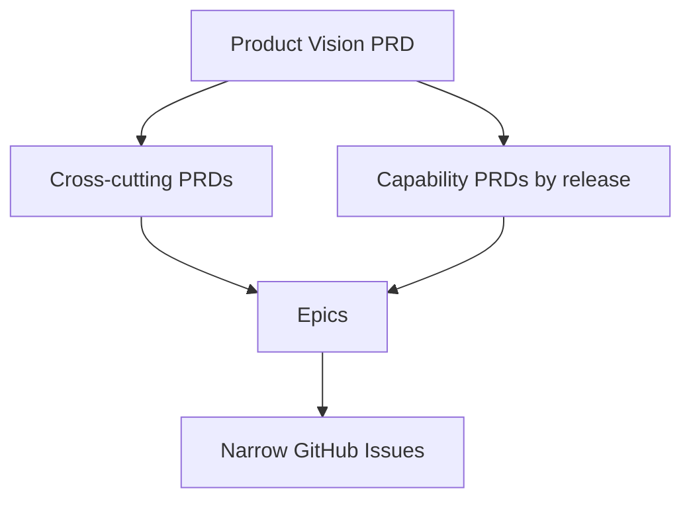

### 32.2 Required cross-cutting PRDs

1. Tenant, Company, shared Client and authorization.
2. Activity Log and accountability.
3. Governed Documents, templates, versions, evidence and integrations.
4. Historical migration, global search and export.
5. AI, Knowledge Base, RAG, evaluation and tool governance.
6. Platform security, privacy, reliability and operations.
7. UX architecture, accessibility, localization and bounded configuration.

### 32.3 Capability PRDs

Capability PRDs follow the approved roadmap boundaries:

- Release 1: Company/RBAC; shared Client; Project/Task; Document registry; operational dashboard and acceptance journey.
- Release 2: Drive; Calendar; assisted email; conditional Gmail; document generation.
- Release 3: intake/Opportunity; catalogue/pricing; Offers; Contracts.
- Release 4: Scheme/Audit foundation; execution/Findings; certification; Training; conditional advanced assurance.
- Release 5: operational finance.
- Release 6: historical migration and search.
- Release 7: Knowledge Base, RAG and measured copilots.

### 32.4 Mandatory PRD content

Every PRD identifies:

- business problem, outcome and measurable value;
- actors, Workspace/Company scope and permission matrix;
- in-scope, out-of-scope and deferred behaviour;
- entities, lifecycle, invariants and historical rules;
- Documents, evidence, approvals and Activity Log events;
- configuration and localization;
- integrations, source of truth and failure recovery;
- migration and compatibility;
- security, privacy, accessibility, performance and observability;
- happy path, exceptions, empty/error/permission states;
- acceptance journey and testable criteria;
- business evidence still required from Iurie;
- technical research and ADR dependencies owned by Dan and agents.

### 32.5 Readiness gates

A PRD may be drafted with open questions, but an epic or issue is not `ready-for-agent` until:

1. the observable business outcome is unambiguous;
2. Company and tenant scope are explicit;
3. required actors, permissions and approvals are known;
4. lifecycle, versions, corrections and deletion behaviour are testable;
5. source-of-truth and provider boundaries are explicit;
6. representative inputs exist for the slice: real evidence where the behaviour claims real-use approval, or explicit versioned illustrative inputs when the slice keeps them and every derived artifact visibly provisional and replaceable;
7. security, audit, observability and failure behaviour are included;
8. dependencies and migration consequences are identified;
9. acceptance criteria cover success and important exceptions;
10. unresolved business dependencies are scoped to the behaviour they affect and remain explicit blockers, configuration dependencies or deferred choices rather than hidden assumptions.

This record now preserves the complete reasoning needed for a context-free future agent to verify the analysis, make evidence-based adjustments and begin the PRD hierarchy without reconstructing the reconciliation conversation.

## 33. Current work-status authority

This rationale record does not own current backlog or delivery status. Use the [Product Requirements Index](prd-index.md) for PRD navigation and stable delivered history, the [Specification and Vertical Ticketing Standard](specification-and-ticketing-standard.md) for readiness gates, live GitHub tracker issues for current readiness, status, blockers, progress and delivery children, and owning PRDs for observable behaviour.

Apply the readiness gates in section 32.5 before creating an implementation issue.

## 34. Iurie business interview evidence reconciliation

### 34.1 Provenance and completion status

The structured interview evidence is preserved in [issue #81](https://github.com/Prisma-Prim/PRISMA-PRIM-Suite/issues/81). The [coverage and provenance matrix](iurie-business-answer-coverage.md) owns the semantically audited scope, coverage metrics and provenance status against the 278 official questions. Read its scope banner together with live issue #81 for the current received-evidence inventory and addressable range; this rationale record does not assert live interview completion.

The audited snapshot separates source-declared status from semantic coverage of the official wording. Later comments and independently numbered items remain evidence inputs until they are semantically mapped; their numbers are not interchangeable with official question-bank IDs, and no numerical endpoint proves completion of the 278 official questions.

Iurie's interview agent is an intermediary. It may explain concepts, reformulate questions and ask for examples. Iurie remains the authority on business reality and desired application needs. Evidence must distinguish: a direct or faithfully paraphrased Iurie answer; an agent-framed proposition explicitly accepted by Iurie; an agent interpretation without acceptance; and a point delegated to Dan or the agents for product or technical decision. An agent formulation or interpretation alone is never a business requirement. Explicit acceptance applies only to the scope actually asked.

### 34.2 Normalized confirmed business evidence

The following evidence is explicit and is reflected in the owning Draft PRDs:

- Iurie requires authorized consolidated oversight across PRISMA-PRIM, BIC and ECG.
- Initial named actors are Iurie, Dan and Valentin; Valentin's ordinary access is technical, and Dan may access real data when required for development or intervention.
- Future Company users are restricted to their Company's activity.
- The Client uses one shared general dossier while Company activity remains separated.
- Projects may begin before Contract signature.
- Official Documents and received originals preserve version/evidence history and are not silently overwritten.
- Operational dashboards prioritize attributable next actions and may have Company-specific and authorized consolidated scopes.
- Personnel records must cover both employees and service-contract collaborators.

These are business evidence statements, not new `DEC-...` entries. The update protocol still requires Dan's explicit product approval before creating a new numbered decision when alternatives or observable consequences remain material.

### 34.3 Refinement and overlap in sessions 59–60

Session 59 establishes that the personnel concept cannot be limited to employees and leaves service-contract fields open. Session 60 answers that clarification by confirming contract period, remuneration, payment dates, allocation eligibility, termination, expiry blocking, confidentiality records and contract history.

The sessions overlap but do not contradict each other. Session 60 refines session 59. The personnel/collaborator capability remains outside the current Release 1 PRDs and requires its own approved capability boundary before ticketing.

### 34.4 Unresolved arbitrations

The following remain decisions or evidence requests, not inferred rules:

1. exact initial permission bundles and “All Companies” interaction;
2. remaining first-tenant Client Legal Entity and branch practice;
3. first Release 1 Project categories, Tasks, evidence gates and lifecycle exceptions;
4. representative Document families, confidentiality, officialization authority and Representation mechanism;
5. the difference between general Project lifecycle and current workflow stage, plus complete Stage 1/Stage 2/S1/S2 examples;
6. dashboard action/metric definitions;
7. mapping or versioning strategy for the independent interview sequence;
8. revalidation of compound “yes” answers before they create permissions, financial/legal enforcement or irreversible workflow behaviour.

Formal question-bank completeness is not the same as evidence sufficiency. A partial official ID does not make an answer to a narrower question insufficient. The answered sub-part is preserved; the other components are recorded as `not asked / deferred remainder` and must not cause the full question to be repeated. The receiving agent classifies it as sufficient, sufficient with a documented reversible assumption, interviewer clarification, targeted Iurie follow-up, or Dan/technical decision. Only gaps affecting a business rule, exception, authorization, legal/financial effect, blocking automation or a difficult-to-reverse choice require targeted Iurie follow-up. Low-risk reversible gaps may proceed with an explicit assumption and confidence. Technical mechanisms remain with Dan and the agents.

Implementation issues must continue to derive from the owning canonical PRD after material blockers are closed, never directly from the raw interview.

For the bounded [ordinary service complaint intake](company-complaints-intake-prd.md),
[Dan's explicit 2026-10-19 decision](https://github.com/Prisma-Prim/PRISMA-PRIM-Suite/issues/51#issuecomment-6273448507)
settles separate Company consultation/recording access without expanding existing
rights or assigning real people. [Iurie's session43 item226](https://github.com/Prisma-Prim/PRISMA-PRIM-Suite/issues/81#issuecomment-5307431470)
supports intake and factual action/response history; items227–230 remain later
reminder, investigation, corrective-action/effectiveness and reporting needs.
The capability PRD owns the bounded immutable original, self-responsibility,
declared/unknown severity and deadline, and motivated append-only corrections;
Authorization section8 owns exact independent grants; Activity section7 owns
restricted internal recording. This is reversible product synthesis with sourced
access authority, not a new Iurie answer, numbered decision, legal deadline,
external transmission, assurance closure or whole-module credit. The Ideas and
ordinary-complaint access decision does not decide HR, purchasing or risk permissions.

The **2026-10-20 normalization** under [#731](https://github.com/Prisma-Prim/PRISMA-PRIM-Suite/issues/731)
uses explicit reversible agent synthesis for the bounded factual journey.
[Dan's delegated review instruction](https://github.com/Prisma-Prim/PRISMA-PRIM-Suite/issues/51#issuecomment-6283507237)
removes the former mandatory human PRD-review gate. After ordered Standards then
Spec PASS with zero findings, [root's actual 2026-10-20 product disposition](https://github.com/Prisma-Prim/PRISMA-PRIM-Suite/issues/731#issuecomment-6284035912)
approves bounded v0.2; this is agent approval of the frozen contract, not Dan's
personal review or runtime delivery. The [coordination
instruction](https://github.com/Prisma-Prim/PRISMA-PRIM-Suite/issues/51#issuecomment-6283696600)
permits independent one-issue preparation while retaining canonical dependencies
and exact-head review/CI gates. These are instructions, not Dan's personal review
of this diff or approval of new business authority. The capability readiness owner
records the explicitly authorized local preparation/implementation exception with
fresh seam, ownership and fit checks; canonical publication still precedes runtime
publication or merge.

### 34.5 October controlled commercial sources

The [October source reconciliation](commercial-source-reconciliation-2026-10.md), delivered under #493, preserves generic provenance from the new dossier package and the separate acceptance/numbering clarification. The primary dossier is selected by Iurie; its historical price was commercial judgement before the formal method, with no standardized workbook. Representative document receipt now reduces collection gaps without validating reusable content or operational use.

[Commercial Workflow §22](release-3-commercial-22-controlled-evidence-2026-10.md#22-controlled-commercial-evidence-october-2026-493) owns the case-specific acceptance evidence, the unresolved conflict with C1's prior acceptance gate and separate numbering configuration direction. [Governed Documents §14](governed-documents-prd.md#14-evidence-dependencies) owns received-example/approved-Template boundaries. The [confirmed-cost PRD §3](release-3-confirmed-cost-profitability-estimate-prd.md#3-controlled-source-provenance-and-handling) preserves its existing source and historical-calibration limit. No new numbered decision is approved; no interview coverage metric, illustrative history, permission or release boundary changes.

### 34.6 Bounded confirmed-cost first-journey approval — 2026-10-01

Under Dan's 2026-10-01 delegation to complete priority 4, coordinating root product review in [#497](https://github.com/Prisma-Prim/PRISMA-PRIM-Suite/issues/497) approves the existing reversible Draft choices and the bounded version/concurrency conventions needed to make them executable. The [Confirmed-Cost Profitability Estimate PRD §11](release-3-confirmed-cost-profitability-estimate-prd.md#11-decision-provenance-and-implementation-boundary) owns the dated decision provenance; its first-journey contract owns observable behavior. Dan's separate 2026-09-30 Contributor/Director permission decision remains owned by the authorization PRD. The Activity Log owner normalizes internal recording only, with no projection or access expansion.

This is product-contract approval, not source evidence of a rounding/fiscal policy and not implemented runtime. The controlled E08 bytes, confidential-case boundary, existing illustrative history and October dossier evidence remain unchanged. No default target, business range, automatic fiscal/overhead/price formula, Offer authority, new numbered decision or functional MVP gain is asserted.

### 34.7 Bounded Ideas intake and access separation — 2026-10-19

[Dan's explicit access decision](https://github.com/Prisma-Prim/PRISMA-PRIM-Suite/issues/51#issuecomment-6273448507)
approves choosing, per Company, who consults Ideas/ordinary complaints, who records
them and who may defer/reject an Idea. Existing assignments never expand
automatically; actual people are chosen later. This is an access-separation
choice, not a real grant, work/funding approval, complaint closure or full roadmap.

Iurie's [session70 addition](https://github.com/Prisma-Prim/PRISMA-PRIM-Suite/issues/81#issuecomment-5308298781)
requests an Ideas register; that source's business interpretation separates it
from corrective actions. [Session71 items360–362](https://github.com/Prisma-Prim/PRISMA-PRIM-Suite/issues/81#issuecomment-5308306511)
support retained defer/reject reasons, attribution, optional reconsideration and
Company/source classification. Their wider scoring, benefits, work conversion
and reporting remain deferred; these source statements are not silently erased.

The bounded [Company Ideas intake PRD](company-ideas-intake-prd.md) owns one bounded
record/reopen and attributed defer/reject journey; [Authorization section8](tenant-company-client-authorization-prd.md#8-initial-permission-families) owns
its exact independent captured grants, [Activity section7](activity-log-accountability-prd.md#7-authorization-and-privacy) its restricted internal
recording. Low-risk choices (plain-text source, field/page limits, immutable
original with append-only review and no deletion) are explicit reversible product
synthesis under section34.4, not new first-tenant evidence. This normalization
adds no numbered decision, real assignment, runtime assertion or functional credit.
On 2026-10-20, [Dan delegated routine documentation/PRD review to agents](https://github.com/Prisma-Prim/PRISMA-PRIM-Suite/issues/51#issuecomment-6283507237),
removing the separate human document-review prerequisite. Following both passing
Standards and Spec axes, the [coordinator approved this bounded contract](https://github.com/Prisma-Prim/PRISMA-PRIM-Suite/issues/726#issuecomment-6283532399).
This records agent product review under delegated authority, not personal review
by Dan, runtime delivery or broader business approval.
The separate ordinary-complaint contract still requires its own normalization.
