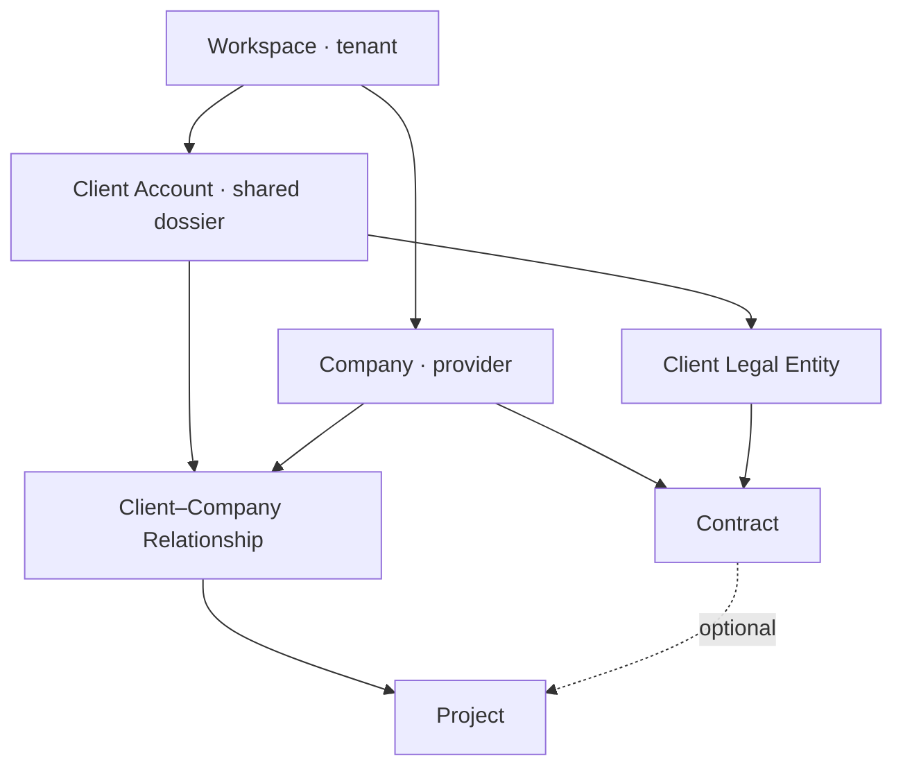

# PRD — PRISMA-PRIM Suite Product Vision

**Status:** Ready for product review  
**Version:** 0.1  
**Owner:** Dan Popescu  
**Business authority:** Iurie Popescu for first-tenant reality and desired outcomes  
**Decision authority:** docs/product/consolidated-product-decision-record.md (DEC-001–DEC-211)

## 1. Purpose and authority

This PRD defines the product-level problem, position, principles, target operating model, release sequence and success criteria for PRISMA-PRIM Suite.

It supersedes docs/product/mvp-prd.md as the complete product vision. The original MVP remains historical source material for the later commercial capability. It does not govern tenancy, Company, Client, Project, Document, assurance, finance, search or AI sequencing.

Downstream cross-cutting and capability PRDs own detailed behaviour. They inherit this vision and the consolidated decision record.

## 2. Problem statement

Audit, certification, ISO consulting and training organizations coordinate Clients, legal entities, commercial work, Projects, Tasks, Documents, audits, credentials, Training and financial follow-up across disconnected folders, email, calendars, spreadsheets and individual memory.

The resulting work is difficult to:

- share without exposing the wrong Company's confidential activity;
- reproduce after staff changes;
- verify against the exact document, rule or approval used at the time;
- correct without losing history;
- search across languages and inconsistent historical sources;
- automate safely without allowing AI or external providers to become the business authority.

PRISMA-PRIM, BIC and ECG need one operational platform that first makes structured work reliable and later adds integrations, search and measured AI assistance.

## 3. Product vision

PRISMA-PRIM Suite is a sellable multi-tenant vertical operational platform for organizations that provide audit, certification, ISO consulting and Training services.

The first tenant is the PRISMA-PRIM group. PRISMA-PRIM, BIC and ECG are provider Companies configured inside that tenant; they are not hard-coded product architecture.

The platform makes the Client dossier the operational center, separates shared identity from Company-confidential activity, preserves governed versions and evidence, and gives every important automated or human action a deterministic, attributable boundary.

Structured operations precede AI. AI proposes, cites, detects and drafts; the business application authorizes, validates and preserves final decisions.

## 4. Desired outcomes

1. One shared, protected Client identity can support separate Company relationships and activity.
2. Users can see the correct Company context and only the information their permissions allow.
3. Projects, Tasks and Documents can be operated before advanced integrations or AI exist.
4. Officially used information remains historically reproducible after templates, prices, rules or providers change.
5. Critical approvals, corrections and transitions are attributable.
6. Google and later providers improve work without becoming the business source of truth.
7. Historical information can be migrated, searched and exported without silently inventing certainty.
8. Audit, certification and Training facts remain separate and truthful to actual authority.
9. Operational finance tracks Contracts, invoices and Payments without pretending to be a general ledger.
10. AI assistance is authorization-aware, source-cited, evaluated and human-controlled.

## 5. Success measures

Product and capability PRDs define exact metrics. At product level, success means:

- representative users complete the Release 1 acceptance journey without hidden spreadsheets or synthetic UI actions;
- no tested cross-Workspace or unauthorized cross-Company data disclosure occurs;
- every critical acceptance example preserves its actor, Company, source documents and history;
- users can distinguish current, historical, missing, uncertain and contradictory information;
- each later integration has a tested degraded mode;
- each AI capability demonstrates measurable time or quality improvement on representative Romanian, Russian and English cases;
- the first tenant can export governed business data without proprietary lock-in.

## 6. Product principles

1. One Workspace is one tenant and one isolation boundary.
2. Company represents a provider legal or operational entity inside a Workspace.
3. Shared Client identity does not imply shared Company activity visibility.
4. PostgreSQL and NestJS own business facts, permissions, workflows and final decisions.
5. Documents have provider-independent identity; storage locations are replaceable.
6. Formal versions and evidence remain reproducible.
7. Default deny and least privilege apply to business authorization.
8. Critical history is append-only or corrected through explicit governed actions.
9. Configuration is typed, bounded, effective-dated where historical meaning changes, and audited.
10. External synchronization is asynchronous, idempotent and recoverable.
11. AI input, retrieval, output and tool actions are untrusted until authorized and validated.
12. Responsive, accessible and localization-ready UX begins in Release 1.

## 7. Actors

| Actor                 | Product-level responsibility                                       |
| --------------------- | ------------------------------------------------------------------ |
| Workspace Owner       | Functional ownership and ultimate tenant administration            |
| Workspace Admin       | Members, Companies, settings and integrations                      |
| Workspace Manager     | Authorized consolidated operational oversight                      |
| Company Manager       | Company-scoped Clients, Projects, team and capability work         |
| Project Professional  | Authorized Project, Task, Document and assurance work              |
| Finance user          | Company or Workspace-scoped financial follow-up                    |
| Read-only user        | Authorized consultation without mutation                           |
| External professional | Explicitly limited temporary or case-specific participation        |
| Client Contact        | External business participant; no initial portal                   |
| Platform support      | No standing tenant-data access                                     |
| AI capability         | Registered proposal-producing automation, never an approving actor |

Exact first-tenant role assignments and sensitive-field boundaries remain business evidence dependencies.

## 8. Target domain

The full domain adds Tasks, governed Documents, commercial Requests and Offers, audits, certification cases, credentials, Training, operational finance, historical migration, Knowledge Sources and AI interactions through their owning PRDs.

## 9. Core user journeys

### 9.1 Operational foundation

An authorized user enters the correct Workspace and Company context, finds or creates one shared Client, records the Company relationship, creates an operational Project, completes Tasks, registers Documents and sees attributable history.

### 9.2 Commercial work

A request is preserved, assessed with optional AI assistance, assigned to the responsible Company, priced deterministically, converted into governed Offer versions, accepted with evidence and related to a governed Contract and existing or new Project.

### 9.3 Assurance and Training

Authorized users plan and execute audits, preserve evidence and Findings, manage corrective actions, produce governed Reports, separate certification review and Decision, issue historically correct credentials and operate Training without conflating its assertions with certification.

### 9.4 Finance

Authorized users preserve Contract financial terms, schedules, externally authoritative invoice references, Payments and explicit allocations, including corrections and exceptions.

### 9.5 History, search and AI

Governed migration preserves source provenance and uncertainty. Authorized users search current and historical entities or content. Later AI capabilities retrieve only permitted approved versions, cite exact sources and require human approval for sensitive outcomes.

## 10. Product scope

### In scope

- multi-tenant Workspace isolation;
- multiple provider Companies per Workspace;
- shared Client dossier and exact legal entities;
- permission-based Workspace/Company access;
- Projects, Tasks, Standards and templates;
- governed Documents and evidence;
- Google integrations and document generation;
- commercial intake, pricing, Offers and Contracts;
- audit, certification and Training;
- operational financial tracking;
- historical migration, global search and export;
- approved Knowledge Base, RAG and measured copilots;
- security, reliability, accessibility, localization and bounded configuration.

### Out of scope for the current roadmap

- universal ERP or general-ledger accounting;
- public self-service tenant signup and subscription billing;
- universal workflow builder;
- unrelated industries;
- automatic certification, legal, pricing or approval decisions by AI;
- general mailbox surveillance;
- hard dependency on Synology, Google or one AI provider;
- native mobile application before responsive web proves insufficient;
- advanced support impersonation;
- claims of automatic regulatory, privacy or accreditation compliance.

## 11. Release roadmap

| Release | Product outcome                                                                                                     |
| ------- | ------------------------------------------------------------------------------------------------------------------- |
| 0       | Reusable technical, access, UI and accountability foundation                                                        |
| 1       | Operational multi-tenant core: Company/RBAC, shared Client, Project/Task, Document registry and operational journey |
| 2       | Drive, Calendar, assisted email, conditional Gmail and document generation                                          |
| 3       | Commercial intake, catalogue/pricing, Offers and Contracts                                                          |
| 4       | Audit, Findings, certification, credentials and Training                                                            |
| 5       | Operational financial tracking                                                                                      |
| 6       | Historical migration, global search and export                                                                      |
| 7       | Approved Knowledge Base, RAG and measured copilots                                                                  |

Release numbers define dependency order, not one monolithic delivery. Each release decomposes into capability PRDs, epics and narrow tracer-bullet issues.

## 12. Cross-cutting product authorities

The following PRDs govern every relevant capability:

1. Tenant, Company, shared Client and authorization.
2. Activity Log and accountability.
3. Governed Documents, templates, versions and evidence.
4. Historical migration, global search and export.
5. AI, Knowledge Base, RAG and evaluation governance.
6. Platform security, privacy, reliability and operations.
7. UX architecture, accessibility, localization and bounded configuration.

Capability PRDs may specialize these rules but may not create independent tenancy, authorization, Document, search, AI, security or UX semantics.

## 13. Implementation decisions

- Preserve React, Vite, TypeScript, NestJS, PostgreSQL, Drizzle and Clerk behind the current boundaries.
- Extend the existing Workspace and Internal User foundation rather than restarting it.
- NestJS owns business modules and their deep public interfaces.
- Add a separately deployable Python worker only for a concrete specialized workload.
- Preserve /ui-baseline as the evolving Atlas Blue visual reference.
- Select provider adapters only when a capability requires them.
- Use reviewed migrations; never use schema push against production.

Costly schema-level tenancy and Company isolation decisions require an ADR after current implementation implications are verified.

## 14. Testing decisions

- Prove behaviour at the highest stable seam, preferring public REST and browser journeys over private implementation tests.
- Use PostgreSQL for persistence, transaction, isolation and authorization behaviour.
- Test tenant and Company isolation negatively, including metadata and search leakage.
- Give each capability representative business cases and important exceptions.
- Test responsive, permission, empty, loading, error and provider-outage states.
- Preserve deterministic evidence for browser acceptance.
- Evaluate AI separately from deterministic business acceptance.

## 15. Acceptance journey for the Product Vision

The vision is proven incrementally when:

1. a first Workspace contains configured PRISMA-PRIM, BIC and ECG Companies;
2. users with different scopes see the correct context and permissions;
3. one shared Client supports separate Company relationships;
4. an operational Project with Tasks and Documents completes through real UI and API boundaries;
5. critical actions are attributable;
6. later commercial, assurance, finance, integration, search and AI capabilities attach to the same boundaries without redefining them;
7. the tenant can recover and export governed information.

## 16. Business evidence dependencies

The Product Vision is not blocked by every interview answer. The following evidence configures the first tenant and gates affected capability tickets:

- real users, roles and cross-Company visibility;
- representative Clients and Project categories;
- first-release stages, Tasks and completion evidence;
- sensitive information categories;
- business-critical periods and acceptable recovery outcomes;
- required Romanian, Russian and English terminology;
- dashboard questions and notification thresholds.

The complete question bank is docs/product/iurie-business-question-bank-ro.md.

## 17. Technical research dependencies

Dan and agents own:

- current schema and module-impact analysis;
- tenancy and Company-isolation ADR;
- provider inventories and official API/security research;
- threat model, recovery design and operational topology;
- performance budgets;
- test seams and vertical ticket decomposition.

## 18. Readiness

This Product Vision is ready to govern cross-cutting and Release 1 PRDs.

It is not itself an implementation contract. No issue becomes ready-for-agent from this document alone. Each capability must pass the specification and ticketing gates in docs/product/specification-and-ticketing-standard.md.
