# Canonical acceptance states

The unmodified certification-journey acceptance test passed at both widths on fresh fictional databases. These sixteen inspected region captures supplement the new Romanian/Russian viewport sequence. Their UI locale is English, as configured in the existing acceptance suite. The canonical fixture seeds business acts through the API before its UI checks; this is not proof that all those acts were entered through forms.

Some narrow region captures include a focused “Skip to content” overlay from the canonical capture method; use the full-09 viewport sequence to assess the final layout.

## certificate-release-changes-requested

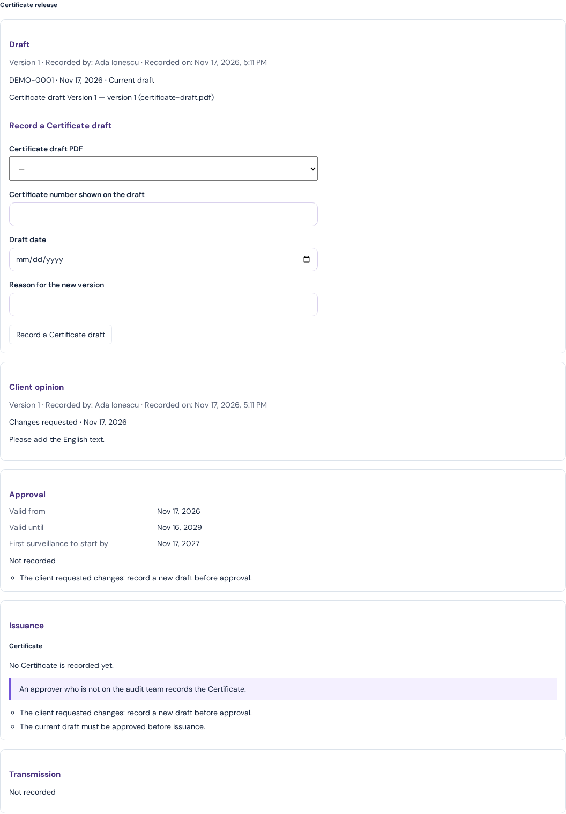

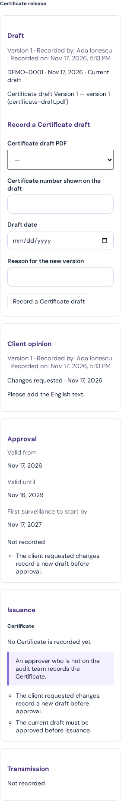

## certificate-release-draft-2-skipped

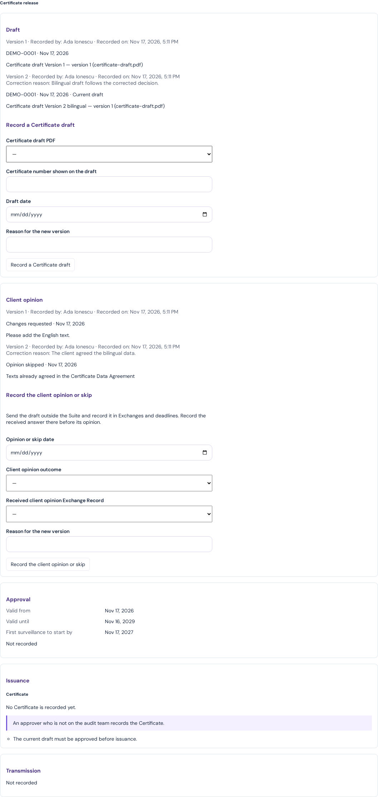

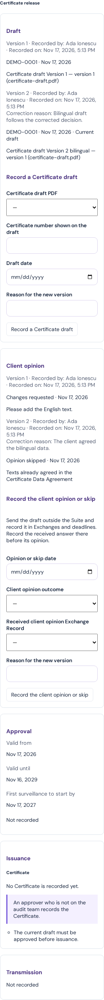

## certificate-revision-unmarked-reader

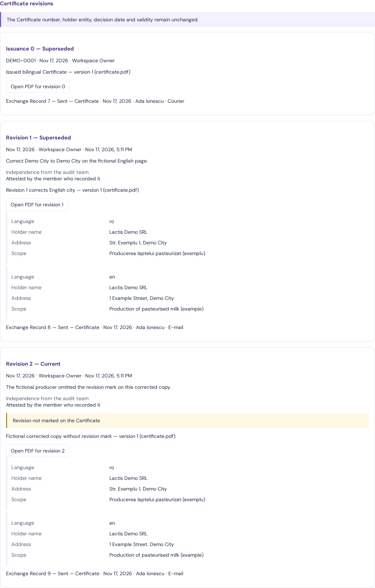

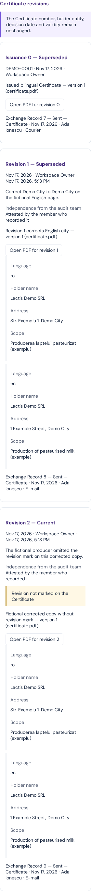

## decision-preconditions-blocked

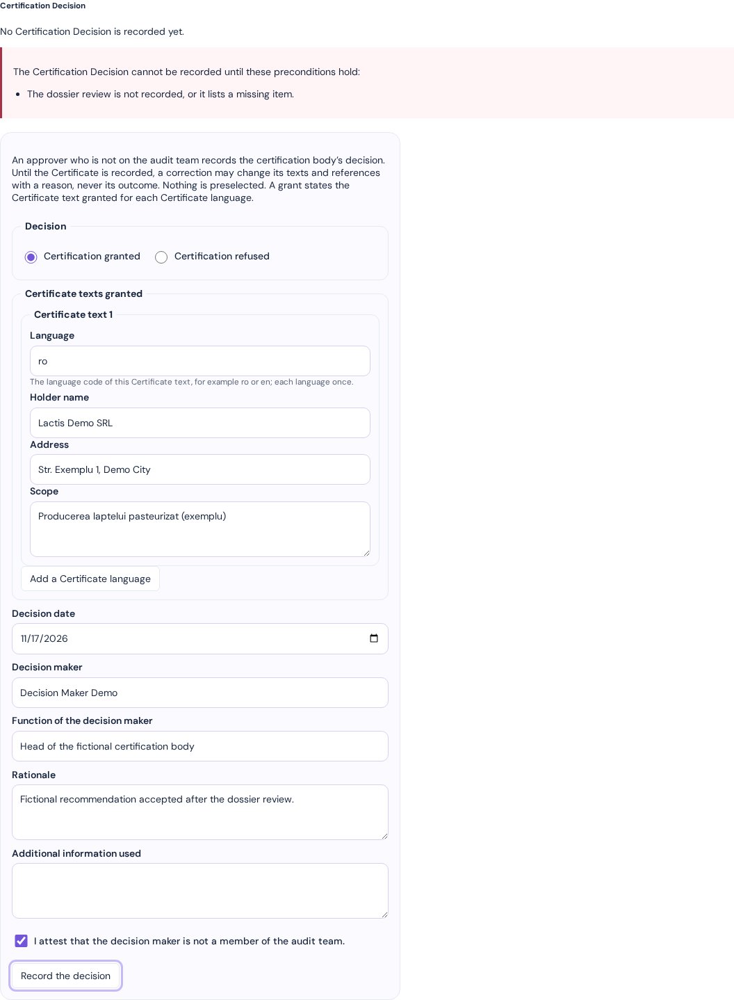

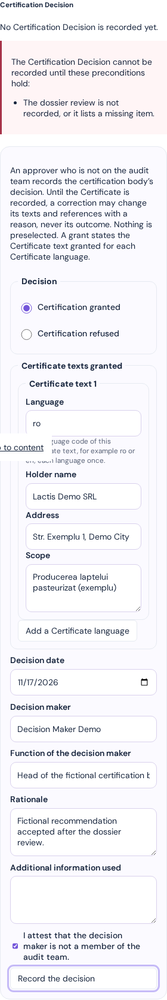

## dossier-consistency-open

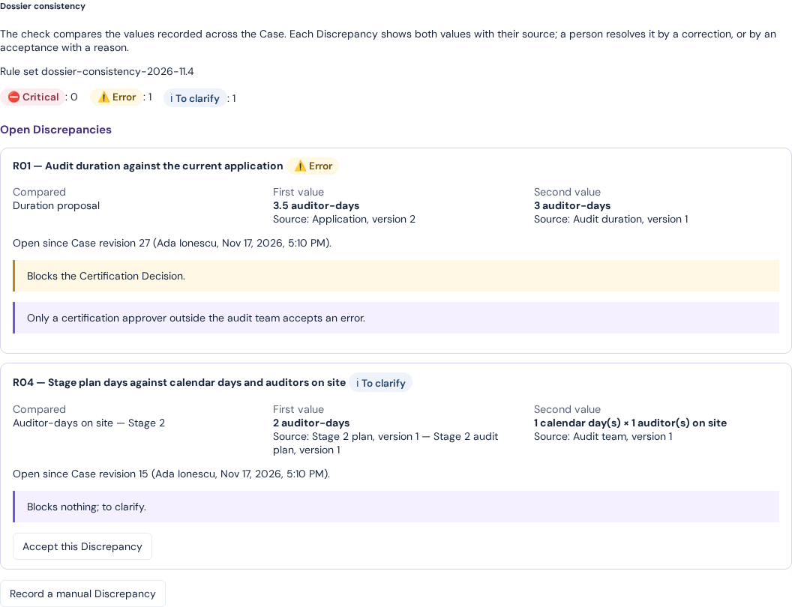

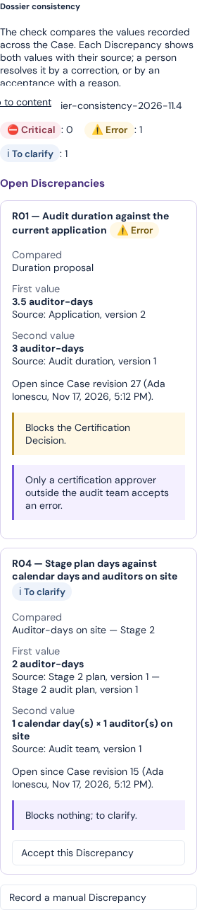

## dossier-consistency-resolved

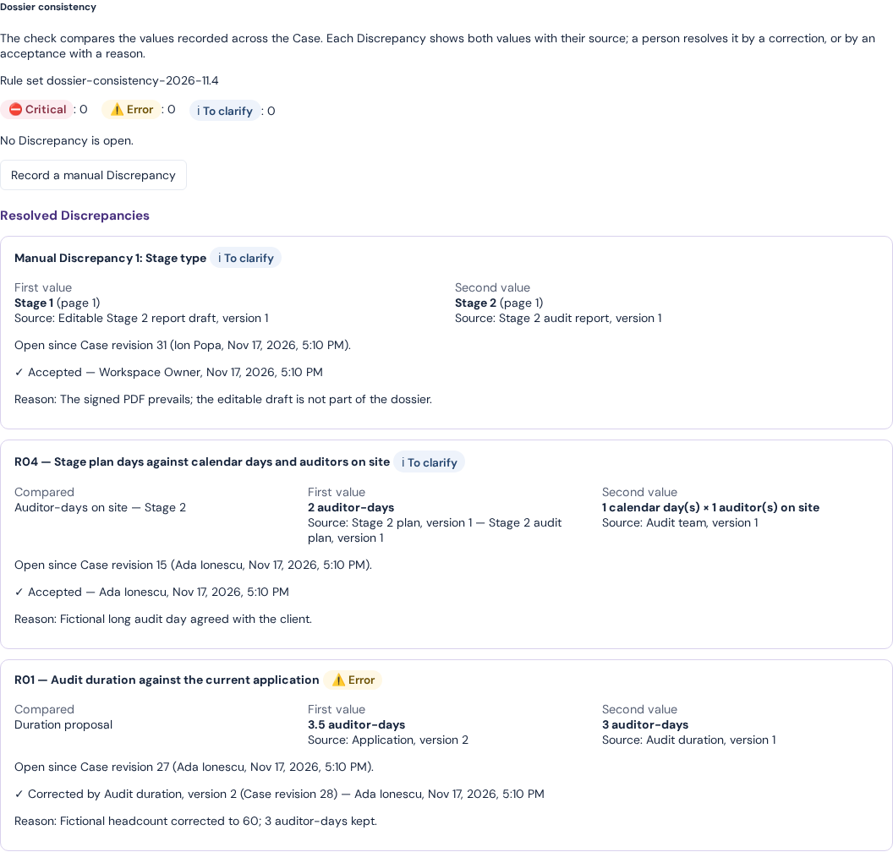

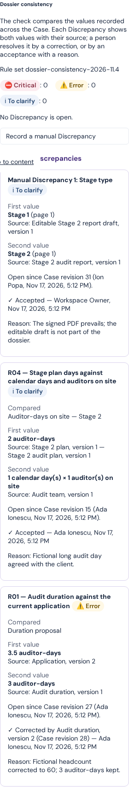

## exchanges-deadlines

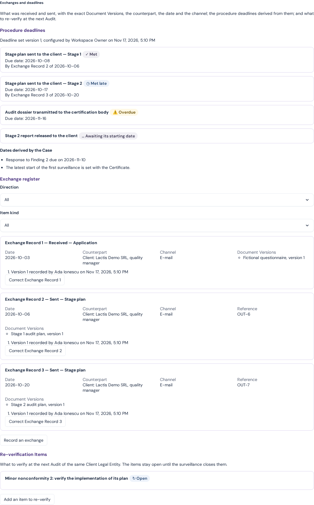

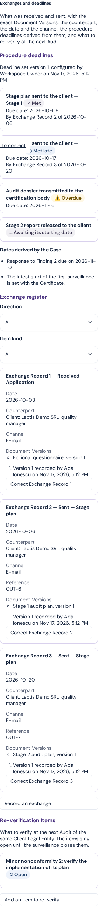

## reverification-items

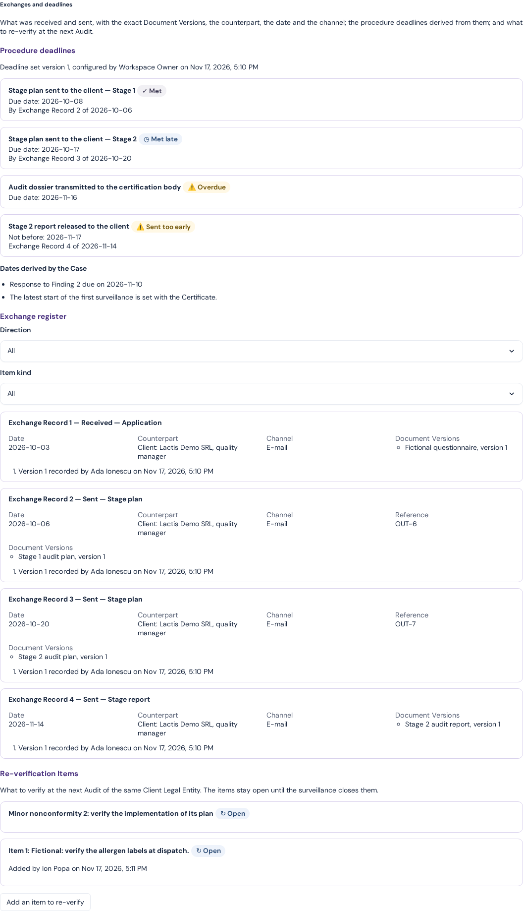

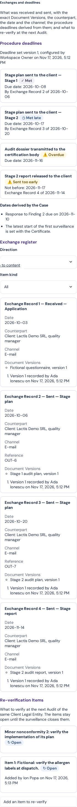
