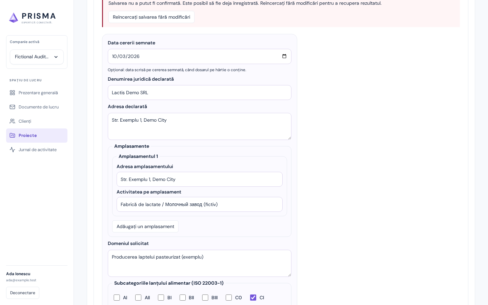
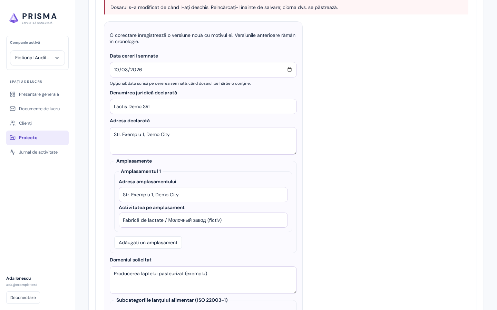
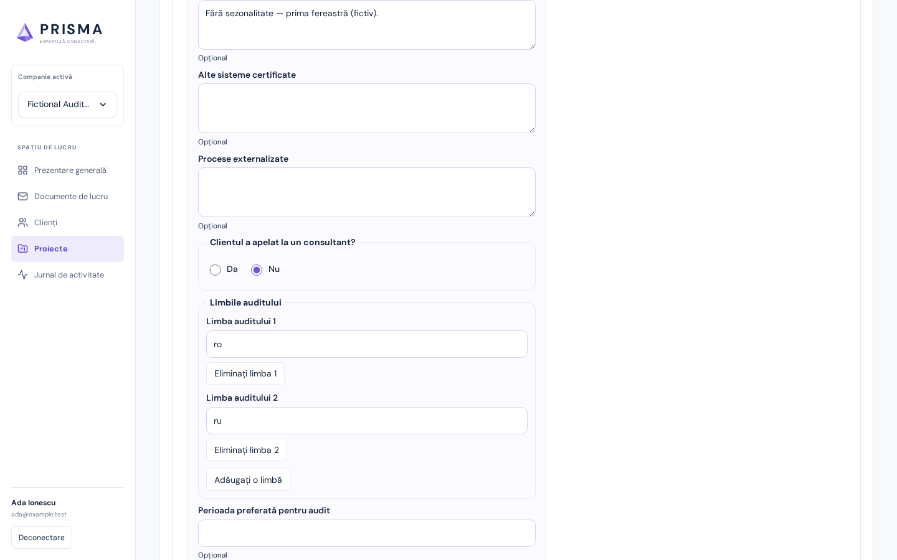
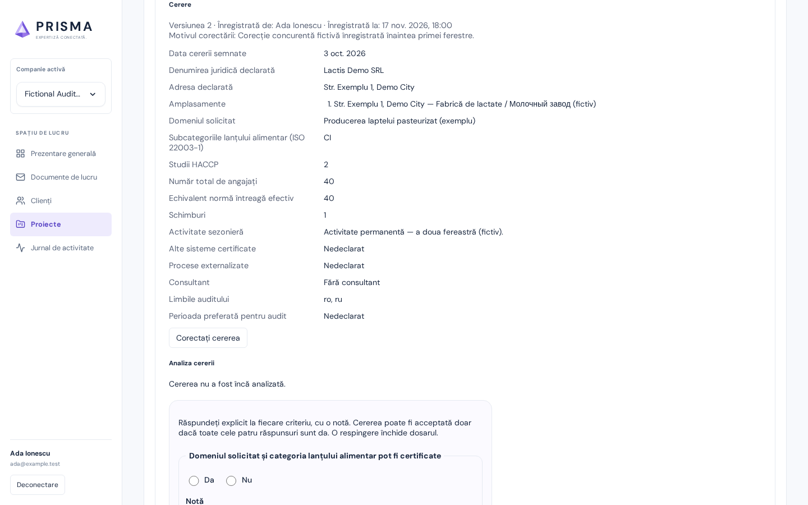
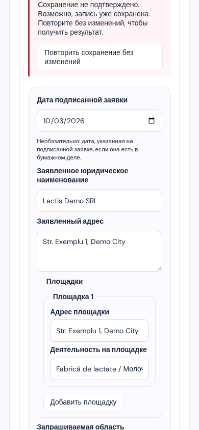
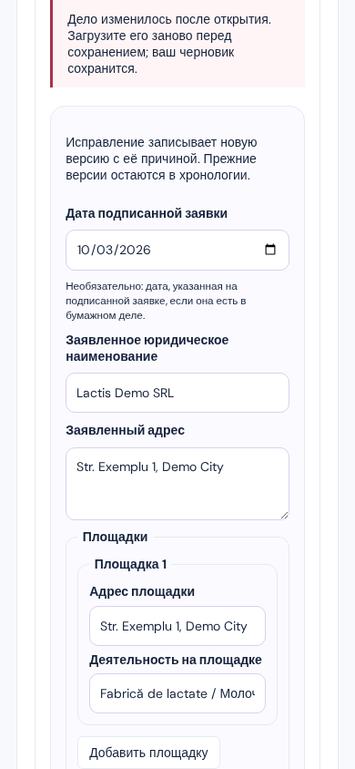
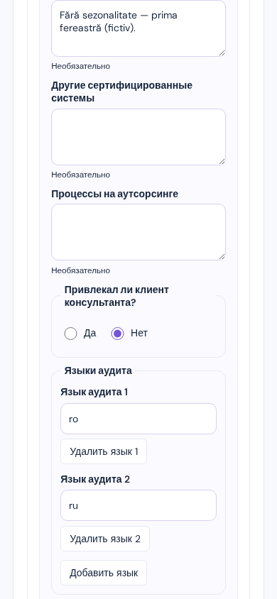
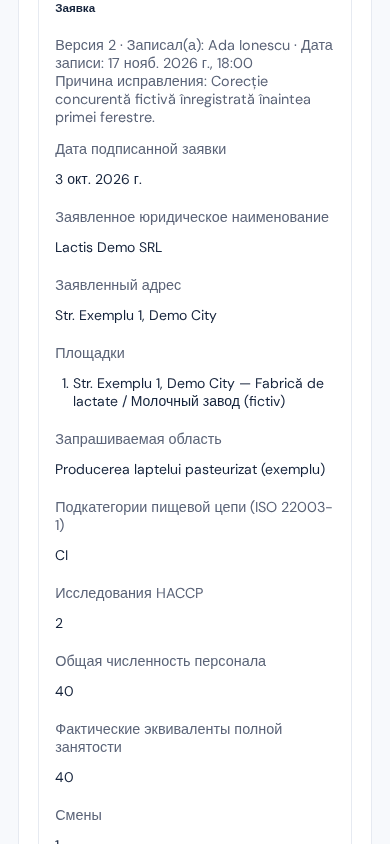

# Retry and concurrent edits

A separate fresh-dataset UI run passed at both widths. The first application POST commits, its browser acknowledgement is replaced by HTTP 503, and the UI retries the unchanged intent and idempotency key. Exactly one application version exists. Two real UI tabs then submit different corrections against the same revision: the stale save returns 409, preserves its draft and disables another save; explicit reload shows the committed correction.

These eight original viewport captures show the warnings and the retained/current values. Romanian desktop and Russian narrow. They supplement the full-09 sequence; they are not another complete certification journey.

## desktop: 09-manager-lost-success-acknowledgement-uncertain-1.png

## desktop: 12-manager-stale-warning-1.png

## desktop: 13-manager-stale-correction-refused-draft-preserved-1.png

## desktop: 14-manager-explicit-reload-shows-current-application-1.png

## narrow: 09-manager-lost-success-acknowledgement-uncertain-1.png

## narrow: 12-manager-stale-warning-1.png

## narrow: 13-manager-stale-correction-refused-draft-preserved-1.png

## narrow: 14-manager-explicit-reload-shows-current-application-1.png

