# grant-narrow

Selected original browser screenshots. Fictional data only. Complete business commands were entered through the interface; fixture setup used public APIs.

## 05-manager-controlled-unavailable-state

Actor: manager; interface: ru; viewport: 390 px. [Accessible snapshot](05-manager-controlled-unavailable-state.aria.yml)

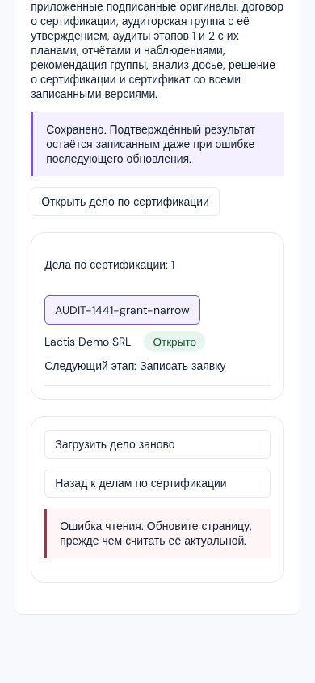

## 10-manager-exact-unchanged-retry-confirmed

Actor: manager; interface: ru; viewport: 390 px. [Accessible snapshot](10-manager-exact-unchanged-retry-confirmed.aria.yml)

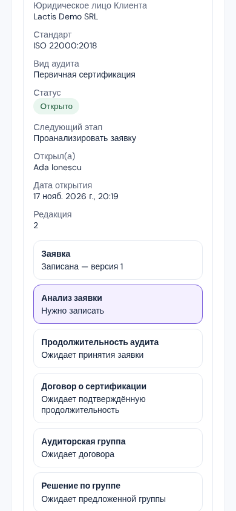

## 13-manager-stale-correction-refused-draft-preserved

Actor: manager; interface: ru; viewport: 390 px. [Accessible snapshot](13-manager-stale-correction-refused-draft-preserved.aria.yml)

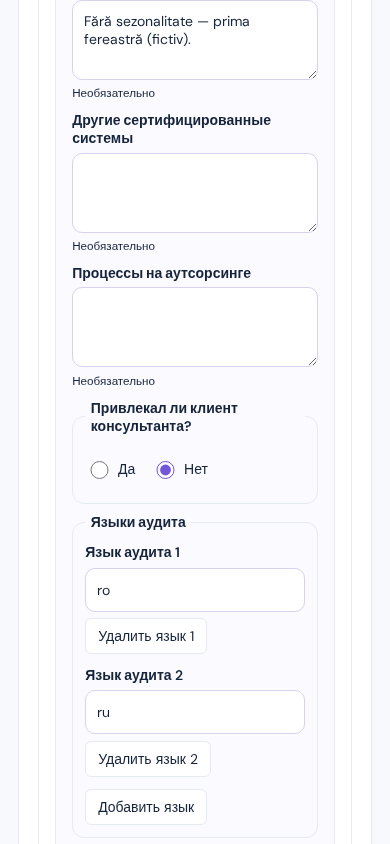

## 14-manager-explicit-reload-shows-current-application

Actor: manager; interface: ru; viewport: 390 px. [Accessible snapshot](14-manager-explicit-reload-shows-current-application.aria.yml)

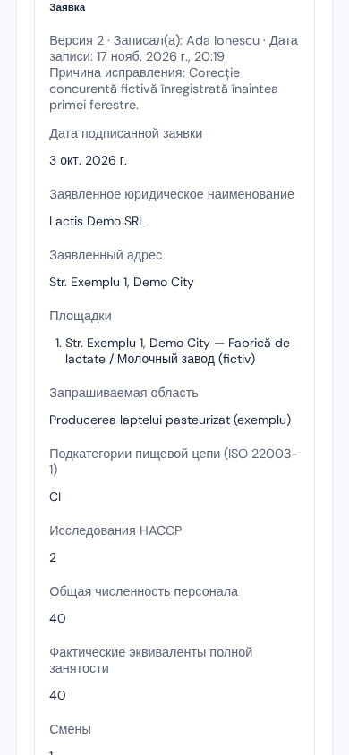

## 19-manager-team-without-category-is-refused

Actor: manager; interface: ru; viewport: 390 px. [Accessible snapshot](19-manager-team-without-category-is-refused.aria.yml)

## 20-manager-self-linked-leader-and-qualified-technical-expert

Actor: manager; interface: ru; viewport: 390 px. [Accessible snapshot](20-manager-self-linked-leader-and-qualified-technical-expert.aria.yml)

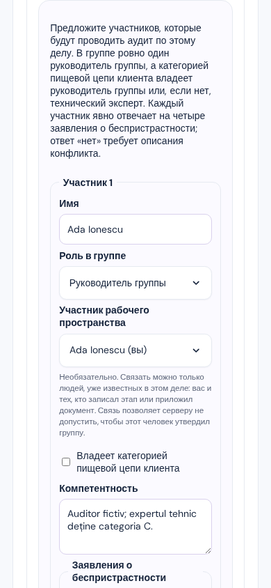

## 21-auditor-team-member-cannot-approve-own-team

Actor: auditor; interface: ru; viewport: 390 px. [Accessible snapshot](21-auditor-team-member-cannot-approve-own-team.aria.yml)

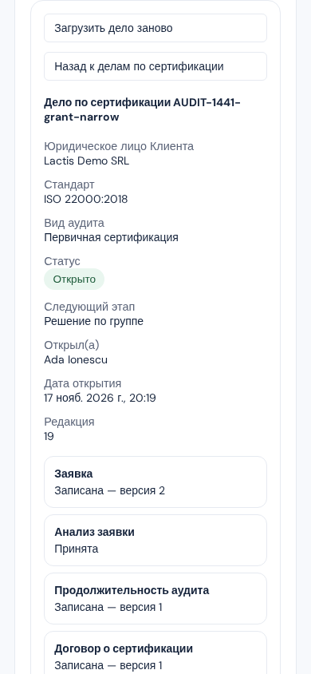

## 22-approver-independent-approver-returns-team

Actor: approver; interface: ru; viewport: 390 px. [Accessible snapshot](22-approver-independent-approver-returns-team.aria.yml)

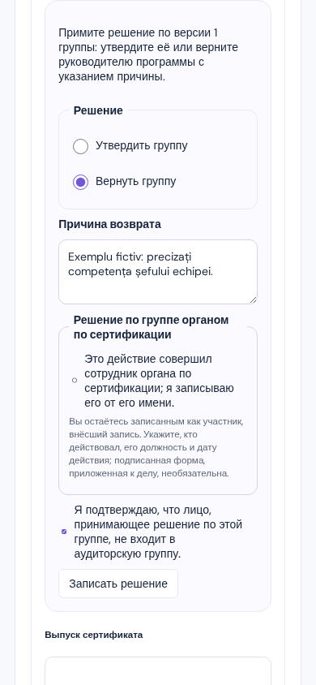

## 23-manager-returned-team-reproposed-with-reason

Actor: manager; interface: ru; viewport: 390 px. [Accessible snapshot](23-manager-returned-team-reproposed-with-reason.aria.yml)

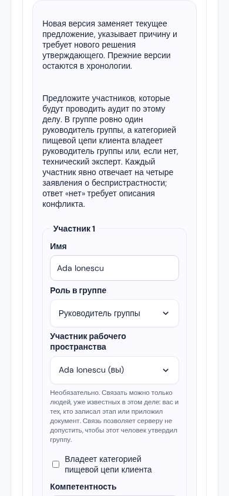

## 24-approver-independent-team-approval

Actor: approver; interface: ru; viewport: 390 px. [Accessible snapshot](24-approver-independent-team-approval.aria.yml)

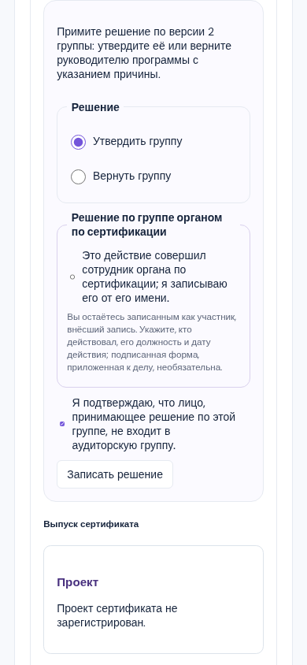

## 27-manager-not-ready-stage-1-blocks-stage-2

Actor: manager; interface: ru; viewport: 390 px. [Accessible snapshot](27-manager-not-ready-stage-1-blocks-stage-2.aria.yml)

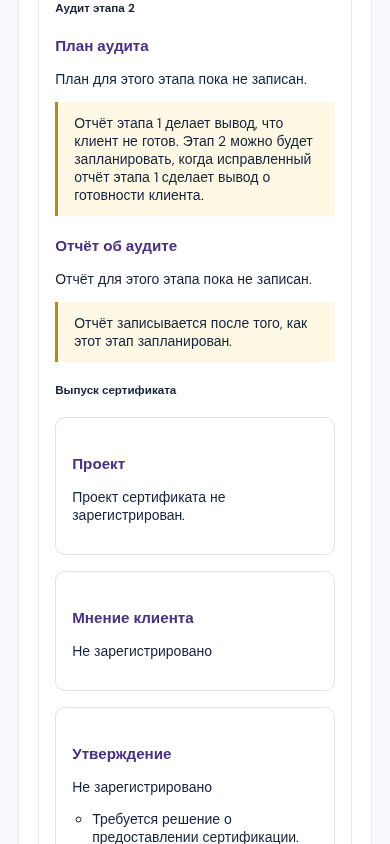

## 28-auditor-stage-1-corrected-to-ready

Actor: auditor; interface: ru; viewport: 390 px. [Accessible snapshot](28-auditor-stage-1-corrected-to-ready.aria.yml)

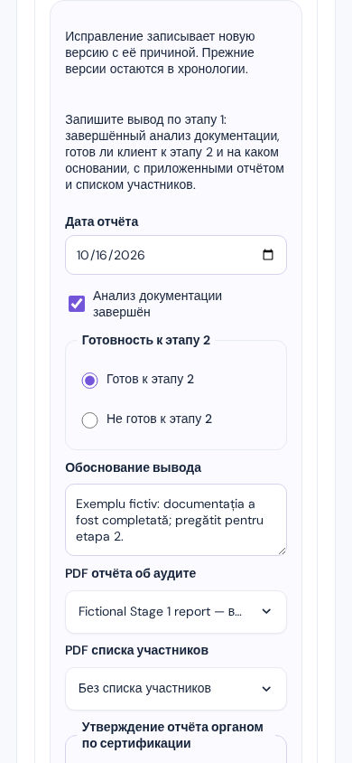

## 30-auditor-major-finding-exact-evidence

Actor: auditor; interface: ru; viewport: 390 px. [Accessible snapshot](30-auditor-major-finding-exact-evidence.aria.yml)

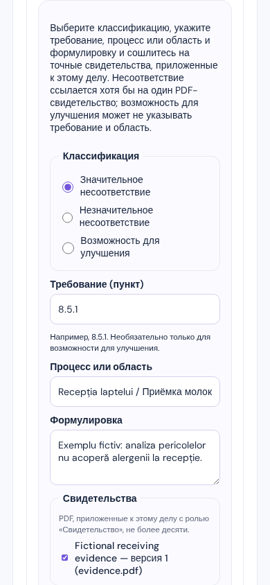

## 34-auditor-ineffective-verification-keeps-major-open

Actor: auditor; interface: ru; viewport: 390 px. [Accessible snapshot](34-auditor-ineffective-verification-keeps-major-open.aria.yml)

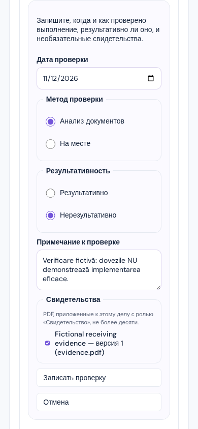

## 35-auditor-major-still-blocks-recommendation

Actor: auditor; interface: ru; viewport: 390 px. [Accessible snapshot](35-auditor-major-still-blocks-recommendation.aria.yml)

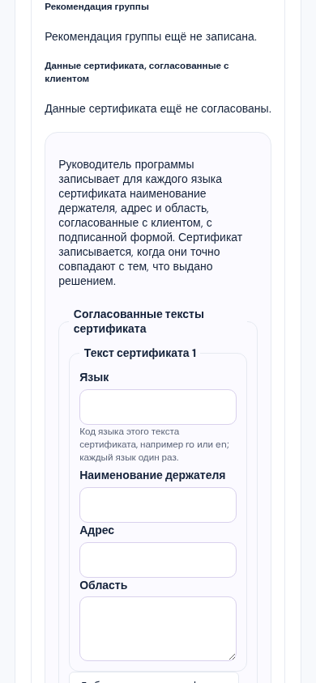

## 36-auditor-revised-client-response-after-ineffective-verification

Actor: auditor; interface: ru; viewport: 390 px. [Accessible snapshot](36-auditor-revised-client-response-after-ineffective-verification.aria.yml)

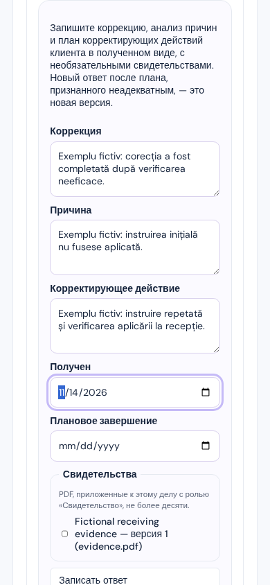

## 37-auditor-implementation-effectiveness-verification

Actor: auditor; interface: ru; viewport: 390 px. [Accessible snapshot](37-auditor-implementation-effectiveness-verification.aria.yml)

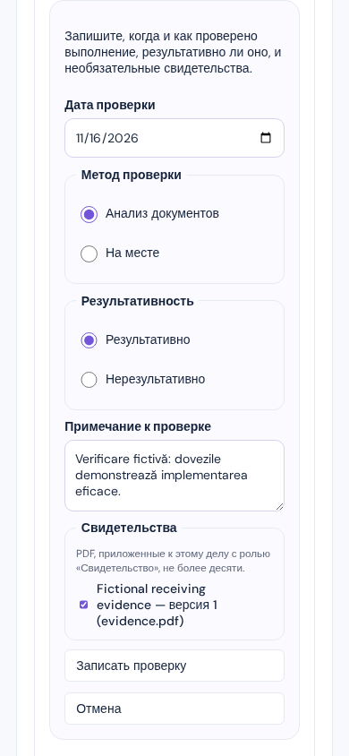

## 40-manager-client-agreed-certificate-data

Actor: manager; interface: ru; viewport: 390 px. [Accessible snapshot](40-manager-client-agreed-certificate-data.aria.yml)

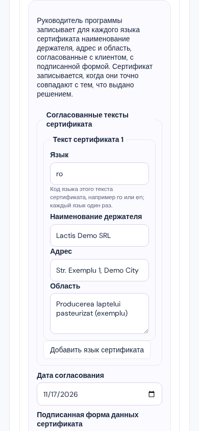

## 42-approver-independent-dossier-review

Actor: approver; interface: ru; viewport: 390 px. [Accessible snapshot](42-approver-independent-dossier-review.aria.yml)

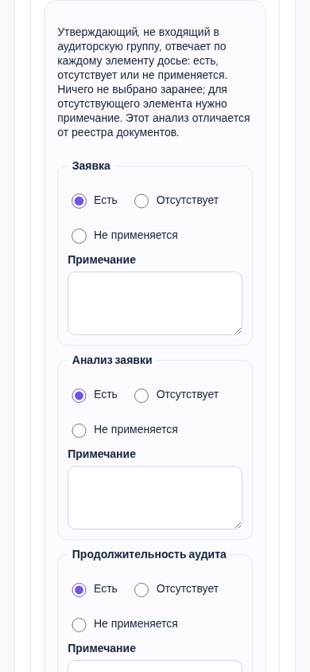

## 43-approver-independent-certification-decision

Actor: approver; interface: ru; viewport: 390 px. [Accessible snapshot](43-approver-independent-certification-decision.aria.yml)

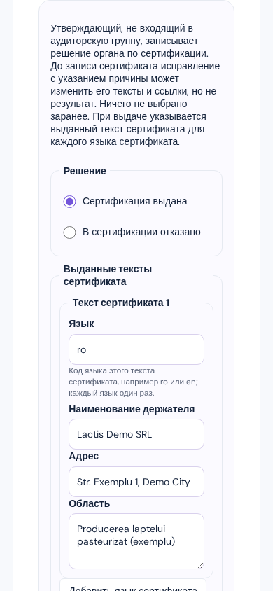

## 47-manager-client-opinion-agreed

Actor: manager; interface: ru; viewport: 390 px. [Accessible snapshot](47-manager-client-opinion-agreed.aria.yml)

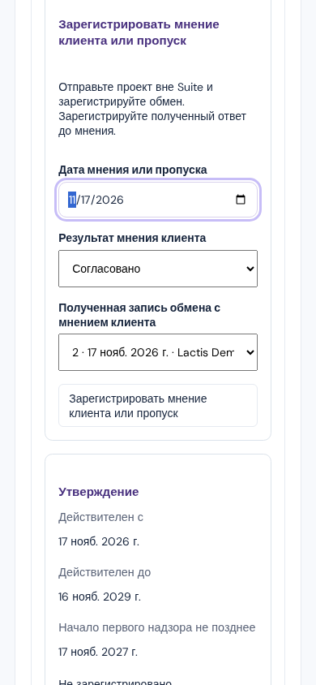

## 48-approver-certificate-draft-independent-approval

Actor: approver; interface: ru; viewport: 390 px. [Accessible snapshot](48-approver-certificate-draft-independent-approval.aria.yml)

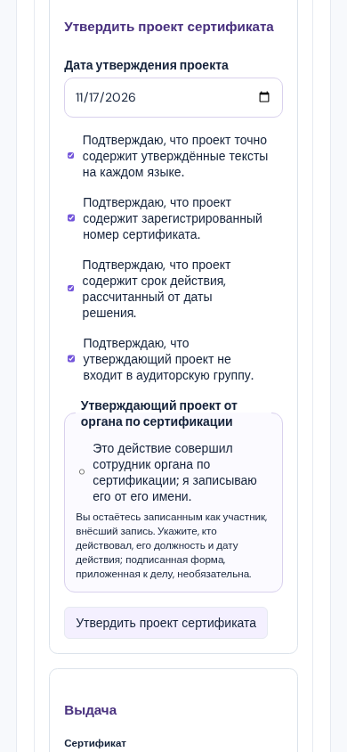

## 49-approver-certificate-issuance

Actor: approver; interface: ru; viewport: 390 px. [Accessible snapshot](49-approver-certificate-issuance.aria.yml)

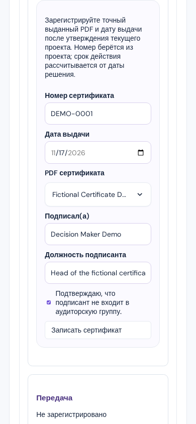

## 51-approver-certificate-revision-preserves-number-validity

Actor: approver; interface: ru; viewport: 390 px. [Accessible snapshot](51-approver-certificate-revision-preserves-number-validity.aria.yml)

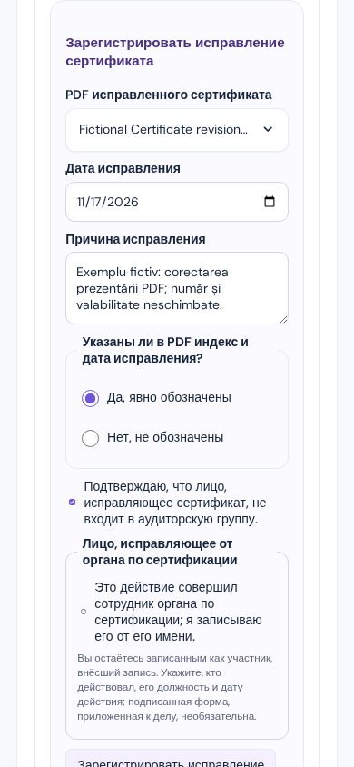

## 53-reader-reader-completed-release

Actor: reader; interface: ru; viewport: 390 px. [Accessible snapshot](53-reader-reader-completed-release.aria.yml)

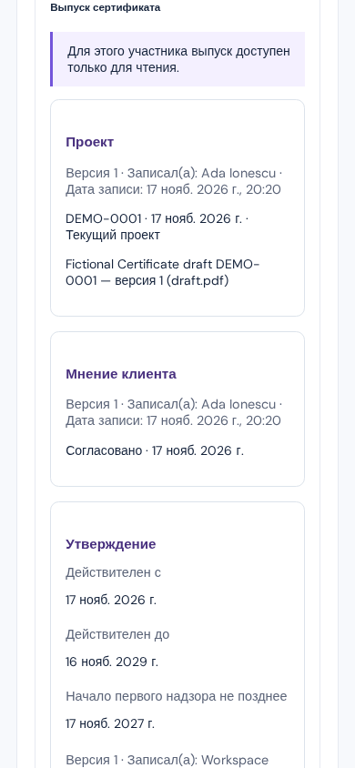

## 54-reader-reader-revision-history

Actor: reader; interface: ru; viewport: 390 px. [Accessible snapshot](54-reader-reader-revision-history.aria.yml)

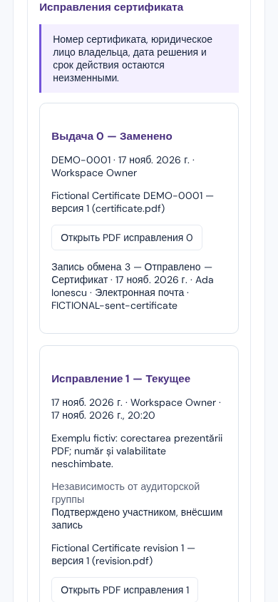

## 58-other-company-member-other-company-has-no-audit-company

Actor: other-company-member; interface: ru; viewport: 390 px. [Accessible snapshot](58-other-company-member-other-company-has-no-audit-company.aria.yml)

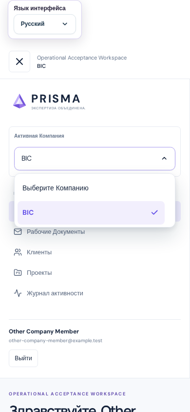
