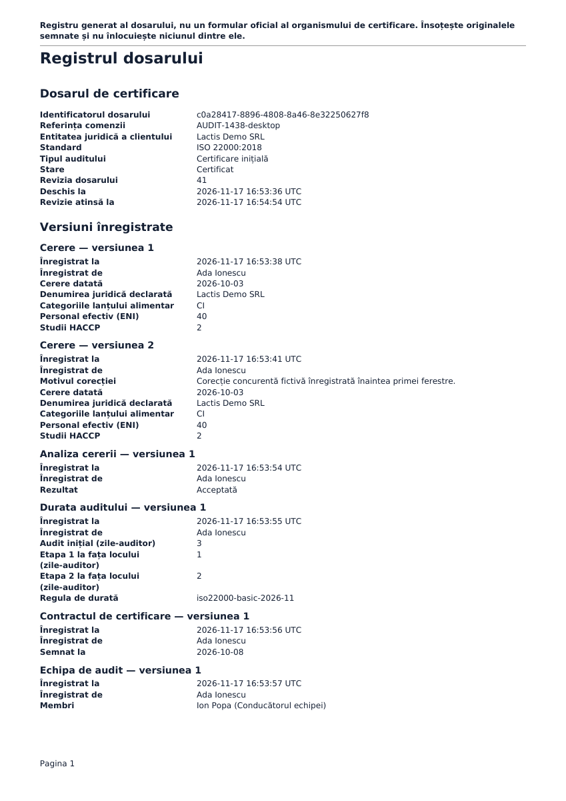
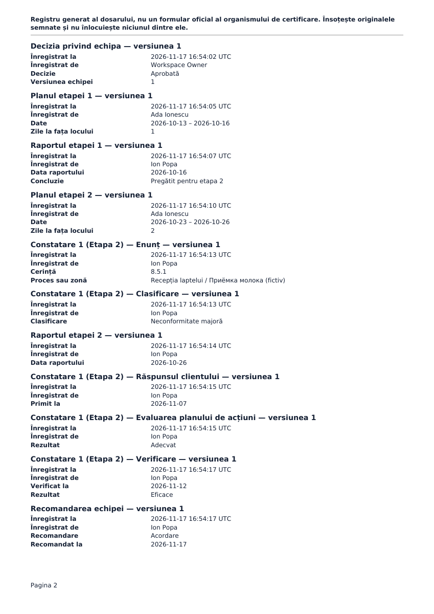
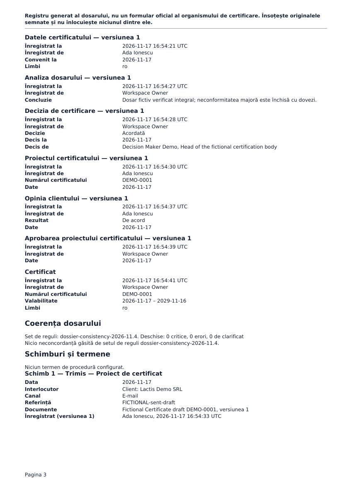
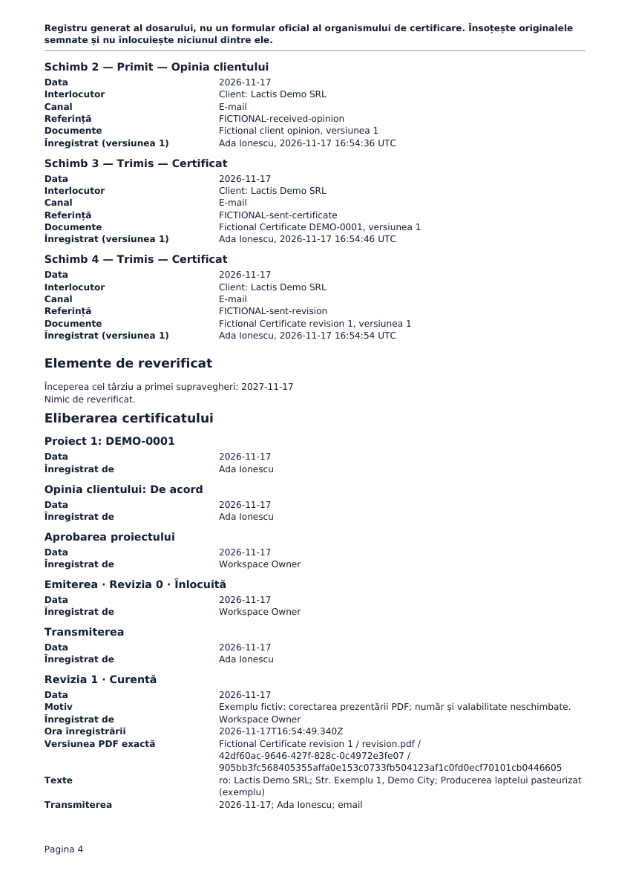
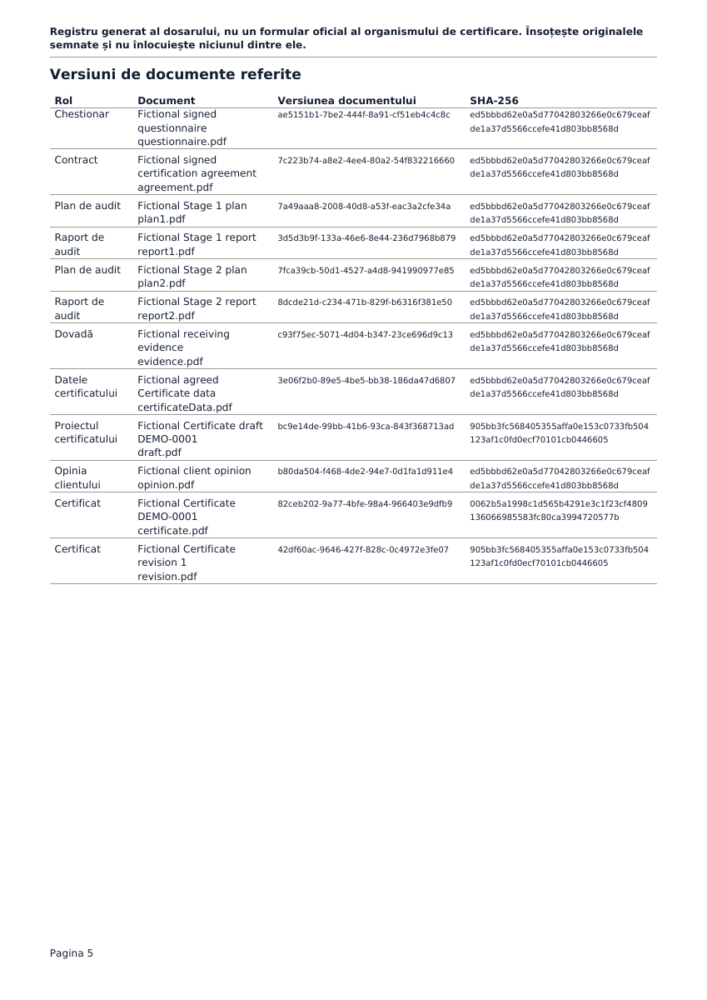
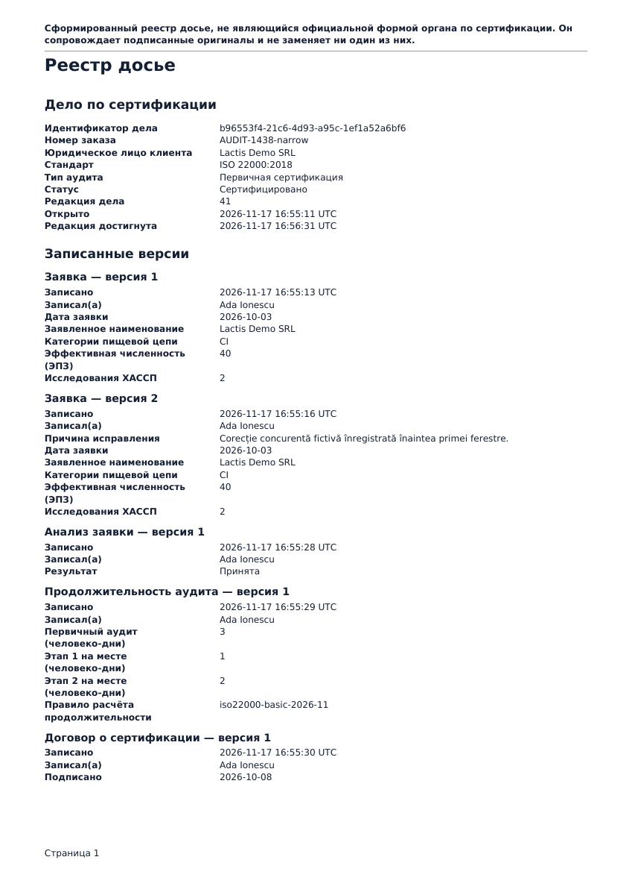
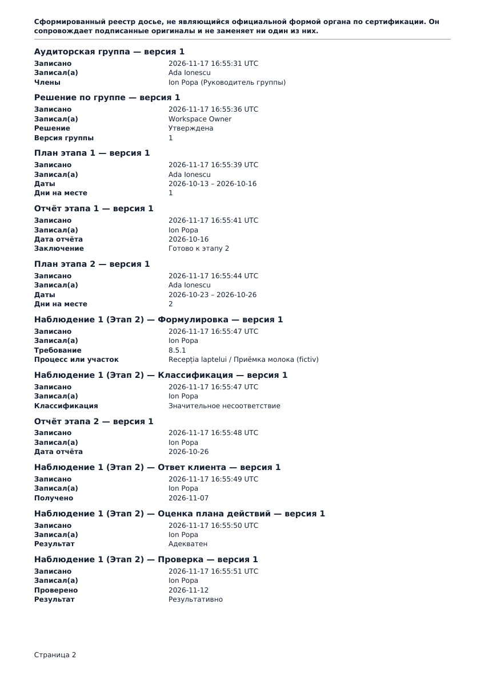
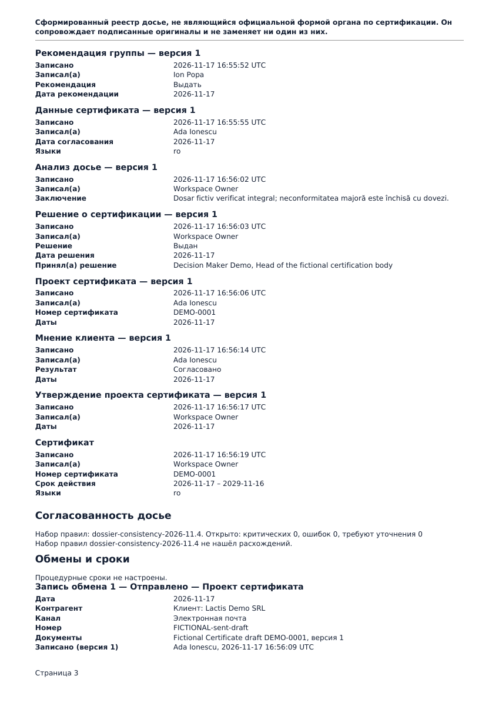
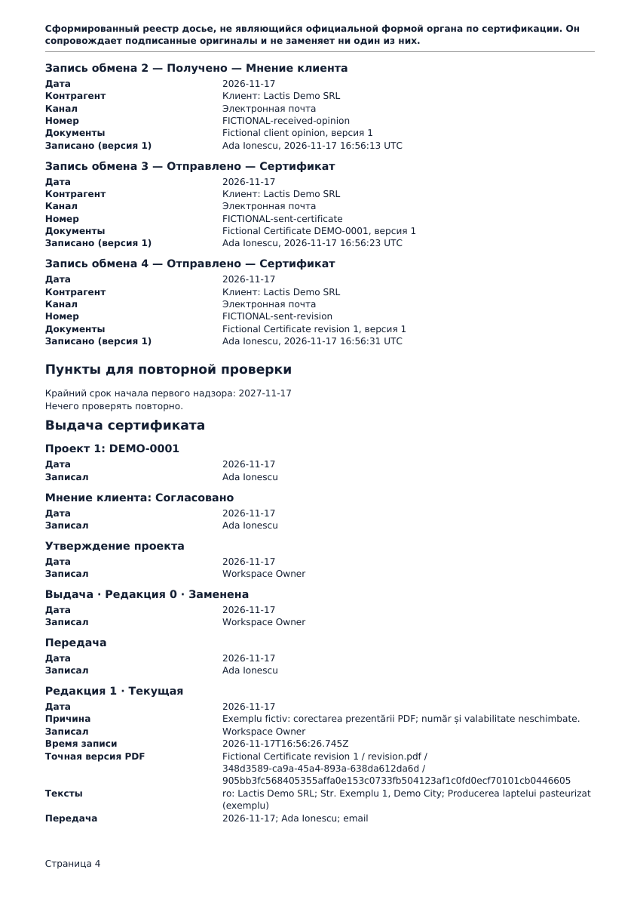
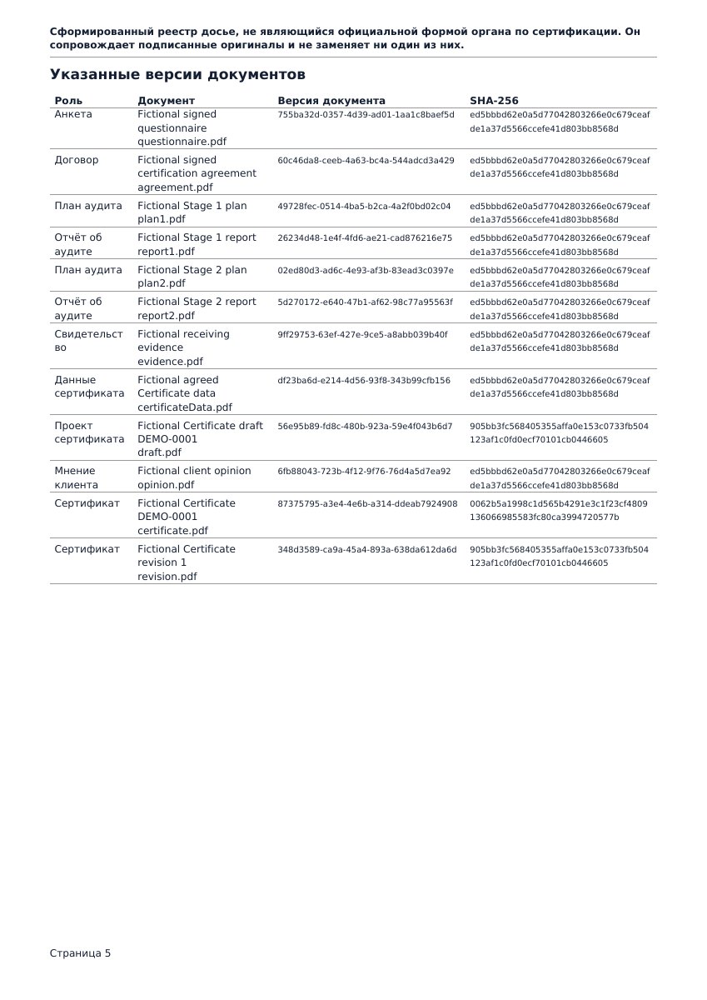

# Register PDF visual review

All five pages of each actual UI-downloaded register were rendered and visually inspected. These are previews of the attached generated registers, containing fictional data only.

## desktop, page 1

## desktop, page 2

## desktop, page 3

## desktop, page 4

## desktop, page 5

## narrow, page 1

## narrow, page 2

## narrow, page 3

## narrow, page 4

## narrow, page 5

