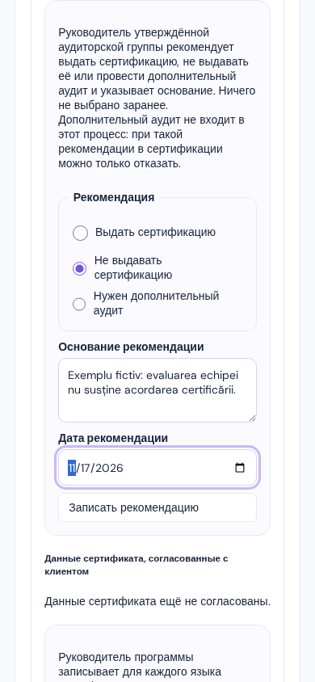
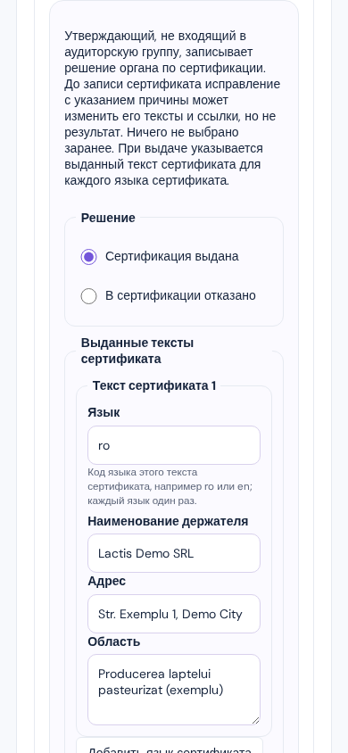
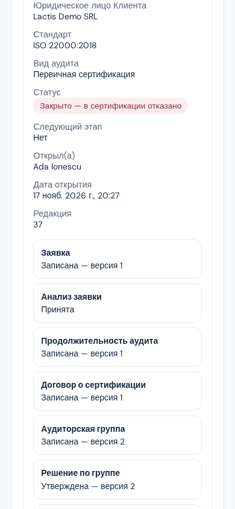
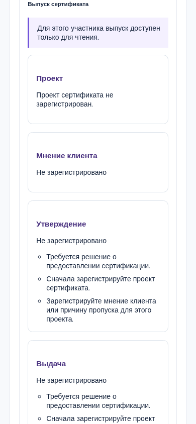

# refuse-narrow

Selected original browser screenshots. Fictional data only. Complete business commands were entered through the interface; fixture setup used public APIs.

## 30-auditor-team-leader-recommendation

Actor: auditor; interface: ru; viewport: 390 px. [Accessible snapshot](30-auditor-team-leader-recommendation.aria.yml)

## 36-approver-grant-blocked-by-do-not-grant-recommendation

Actor: approver; interface: ru; viewport: 390 px. [Accessible snapshot](36-approver-grant-blocked-by-do-not-grant-recommendation.aria.yml)

## 37-reader-independent-refusal-no-issued-certificate

Actor: reader; interface: ru; viewport: 390 px. [Accessible snapshot](37-reader-independent-refusal-no-issued-certificate.aria.yml)

## 38-reader-refused-case-has-no-issued-certificate

Actor: reader; interface: ru; viewport: 390 px. [Accessible snapshot](38-reader-refused-case-has-no-issued-certificate.aria.yml)

