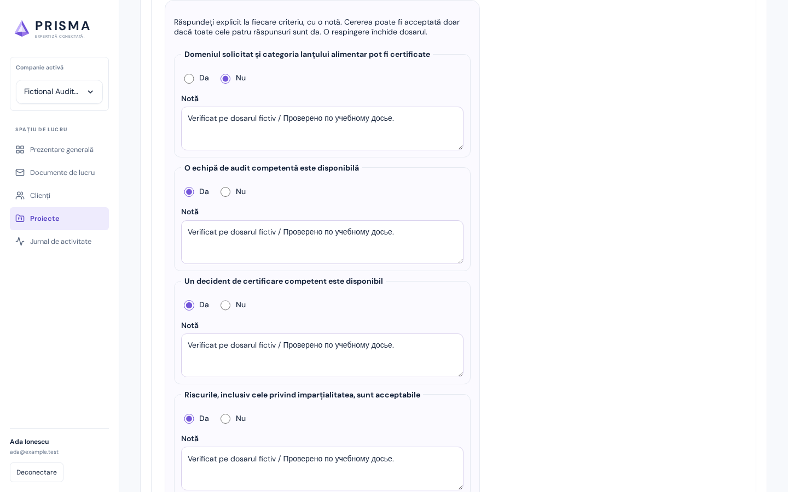
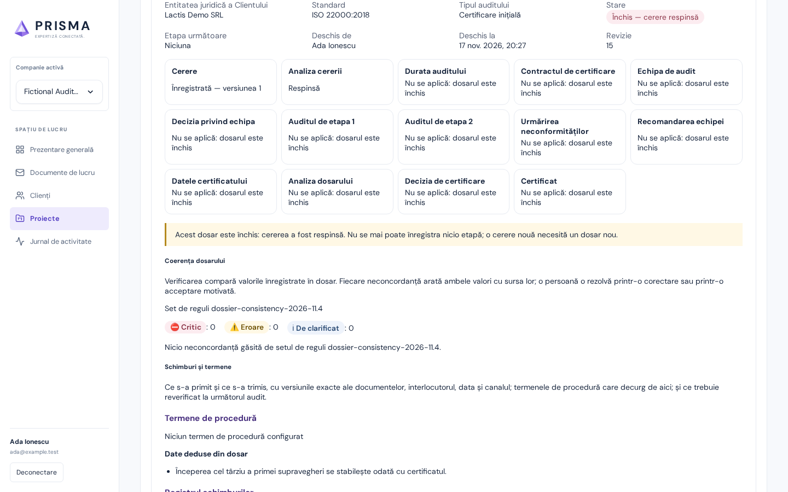
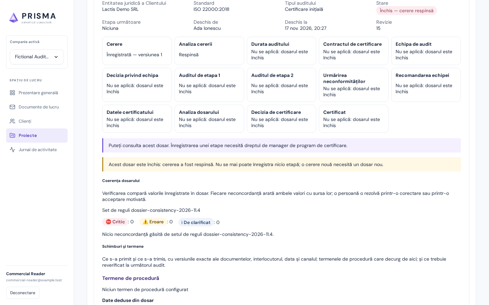
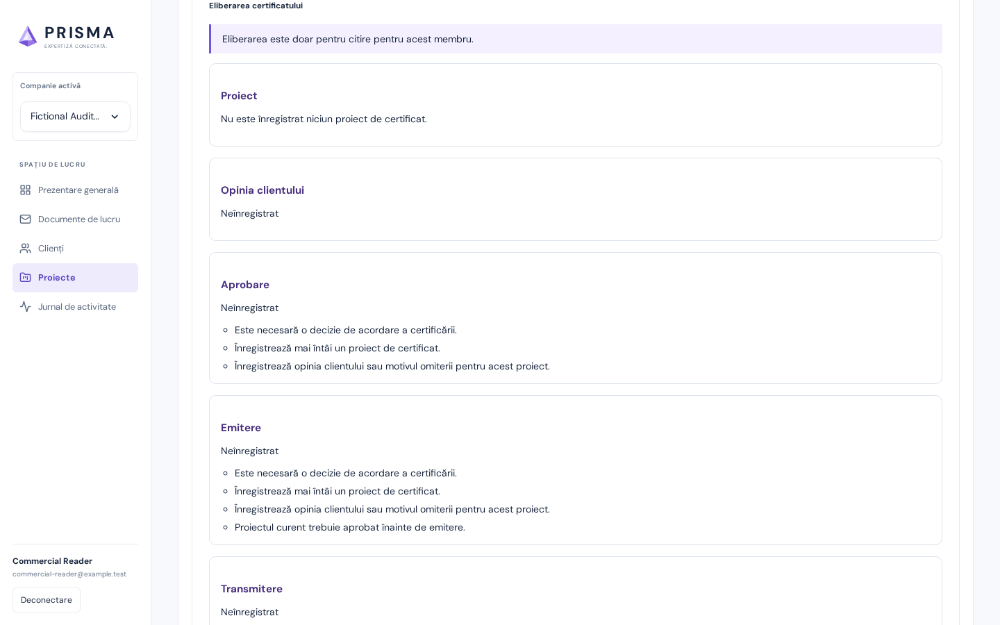

# reject-desktop

Selected original browser screenshots. Fictional data only. Complete business commands were entered through the interface; fixture setup used public APIs.

## 08-manager-rejection-requires-written-reason

Actor: manager; interface: ro; viewport: 1440 px. [Accessible snapshot](08-manager-rejection-requires-written-reason.aria.yml)

## 09-manager-rejected-application-closes-core-journey

Actor: manager; interface: ro; viewport: 1440 px. [Accessible snapshot](09-manager-rejected-application-closes-core-journey.aria.yml)

## 10-reader-application-rejected-case-closed

Actor: reader; interface: ro; viewport: 1440 px. [Accessible snapshot](10-reader-application-rejected-case-closed.aria.yml)

## 11-reader-refused-case-has-no-issued-certificate

Actor: reader; interface: ro; viewport: 1440 px. [Accessible snapshot](11-reader-refused-case-has-no-issued-certificate.aria.yml)

